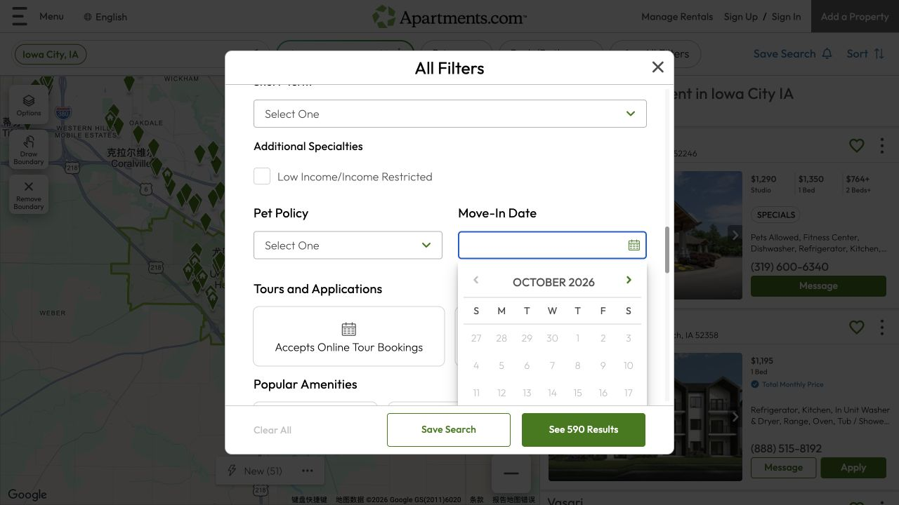
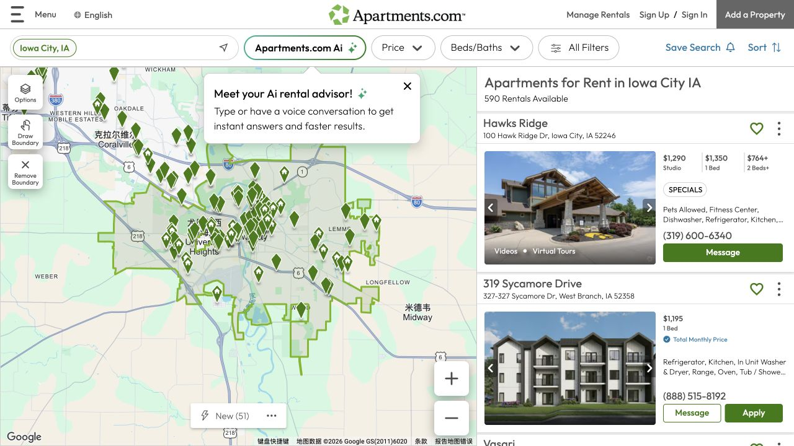

A second rental site is most useful when it helps you answer the questions your first shortlist still leaves open. On Apartments.com, the Space and Move-In Date controls can refine what you are looking for, while photos, videos and written features help you understand the property. The next step is to connect that material with a specific available unit, an actual date and a clear account of the costs.

## Set the space and move-in date before comparing prices

In the All Filters view shown here, Space separates Entire Place from Room for Rent, and Move-In Date opens an availability calendar. Choosing the space you mean gives the quoted rent a clearer context: a room and a complete home are different arrangements even when their prices appear side by side. Treat the date as a way to narrow the search, then read the listing and ask when the specific unit can be occupied and what lease dates are offered. If you arrive before that date, include the intervening accommodation in your plan rather than relying on a calendar selection alone.

## Use photos and tours to understand the layout

Some search cards carry Virtual Tours or Videos labels. Where a listing provides that material, it can help you see how rooms connect and how much usable space appears around the furniture. Compare the tour with the written floor-plan and unit details, then ask whether it shows the offered unit or a representative model. A building may offer different layouts, so a good tour is a starting point for a more specific question. The images in this note are browsing examples and do not represent an ISAB inspection of those properties.

## Translate the amenity filters into daily-life questions

The illustrated filters include In Unit Washer & Dryer, Air Conditioning, Utilities Included and Parking. Those labels are useful for narrowing results, while their details determine how the home will work for you. For laundry, ask where the machines are and which unit has them. For utilities, ask exactly which services are included and how the remaining charges are calculated. For parking, confirm whether a place is included, separately paid or subject to availability. Record the answers beside the rent so features and costs remain part of the same comparison.

## Make the first inquiry about one unit and one date

A focused inquiry can say: “I am looking for a room / whole apartment for [number] people from [date]. Which unit or floor plan is available for that date, and what would its rent, additional charges and lease dates be?” Replace the brackets with your own information and add the practical feature that matters most to you. The reply should help connect the advertised property to the actual offer. During a viewing, refer to that unit or floor plan and ask about anything that differs from the photographs or the written description.

## Compare the full arrangement before choosing a favorite

Put the Apartments.com candidate beside your other shortlist entries using the same fields: exact address and unit, space rented, rent, recurring charges, move-in costs, lease dates and daily transport. Keep a missing amount or uncertain feature marked as a question until it is answered. For a shared home, include how the household intends to divide the space and costs in your own planning. A property becomes easier to choose when its timing, usable space and total arrangement fit together, rather than because one attractive photo or amenity label stands out.

> Screenshots captured October 17, 2026. Prices, availability, and interfaces may change. Properties shown are examples for an ISAB browsing note, not recommendations or firsthand housing reviews.

## Sources & useful links

- [Apartments.com](https://www.apartments.com/iowa-city-ia/)
