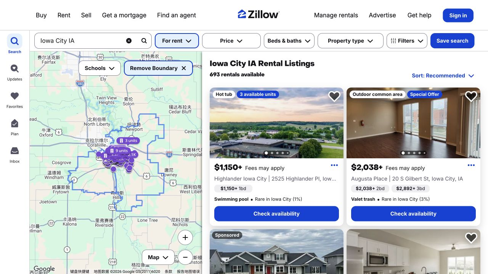
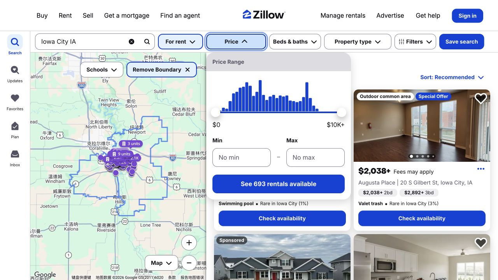
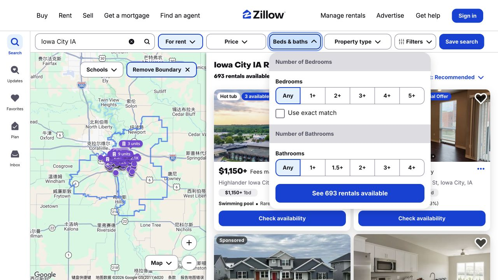

A rental search becomes easier when each round answers a different question: which area could work, what the advertised price describes, and whether a particular unit fits your move. The Iowa City Zillow page gives you a map, listing cards and filters for those first steps. This guide follows them through to a short list of properties worth asking about, with the details you will need for a meaningful comparison.

## Read the price together with the address and bedroom count

The Iowa City search places a map beside listing cards, so you can look at location and housing details together. A price followed by “+” is a starting amount; it does not give one price for every available unit in that building. When a card says “Fees may apply,” the listing’s fee details are part of understanding what the offer costs. Open the candidates whose location, bedroom count and starting price could work for you, and make a note of which unit or floor plan that price describes. The order of the results is the site’s presentation, not an ISAB ranking.

## Use Price to narrow the rent, then build the full budget

The Price panel has separate Min and Max fields. If your main constraint is an upper limit, setting Max can narrow the results without adding an unnecessary minimum. These controls work on advertised rental prices, while your household budget needs the charges that apply to the particular listing. Read how rent is quoted and whether utilities, internet, parking or other recurring items are separate. Keep the monthly total apart from any application, deposit or move-in amount you are asked to pay. That makes it easier to see both what you need before arrival and what you need every month.

## Choose the bedroom count and housing type you mean

In Beds & baths, 1+ means at least one bedroom and therefore includes larger homes. “Use exact match” limits the search to the selected count. Property type then helps distinguish an apartment, house or townhouse. A bedroom filter still leaves a separate question to resolve in the listing: is the quoted rent for the whole home, a particular unit or an individual room? If sharing with others, compare each person’s actual share of rent and responsibilities with a complete apartment rather than treating every one-bedroom search result as the same offer. Return to the cards after filtering and check that they reflect the search you intended.

## Keep a few candidates in the same comparison format

A useful shortlist records more than property names. For each candidate, note the full address, unit or floor plan, quoted rent, extra monthly charges, possible move-in date and proposed lease dates. Add the way you would reach class, groceries and other regular destinations. If a detail is not stated, leave it as a question instead of filling it with an assumption. Keeping three or four candidates in the same format makes tradeoffs easier to see: a lower advertised rent may come with a different commute, fewer included services or a date that does not fit your arrival.

## Use a viewing or inquiry to confirm the specific unit

When contacting a property, identify the listing and the unit or floor plan you want to discuss, then give your intended move-in date and the number of people who would live there. Ask whether the photos and any tour show that actual unit or a representative model, and confirm which quoted rent, fees and included features apply to it. During an in-person or video viewing, it is useful to look at the kitchen, bathroom, storage, laundry arrangement and the route into the building, not only the living-room photo. Save the written answers with the candidate so the final comparison reflects what is available to you.

> Screenshots captured October 17, 2026. Prices, availability, and interfaces may change. This is an ISAB website-browsing demonstration, not a property recommendation or a firsthand housing review.

## Sources & useful links

- [Zillow](https://www.zillow.com/iowa-city-ia/rentals/)
