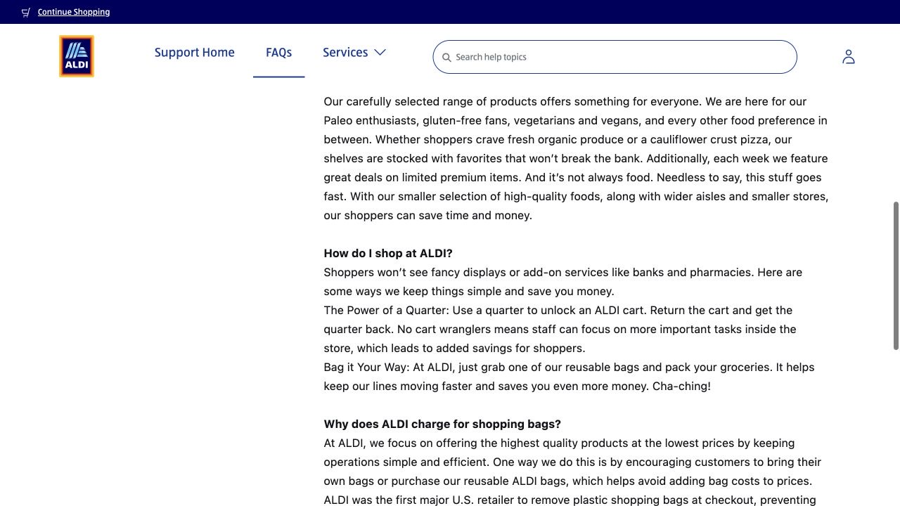

ALDI can be a useful place to buy everyday groceries once you know a few small routines. The refundable cart deposit and the separate bagging area may feel unfamiliar at first, but they are easy to manage. Think of your first visit as shopping for a few meals: choose food you already know how to use, leave room in the budget for essentials, and buy an amount you can comfortably carry home.

## Choose the branch around the complete journey

The two local branches are at 760 Ruppert Road in Iowa City and 2750 Heartland Drive in Coralville. Open the individual store page below to check its current hours and directions. The branch selected by an online delivery site may simply follow your ZIP code, so confirm the address yourself.

When comparing locations, include the trip home with groceries. A slightly shorter outward journey may be less useful if the return requires a long walk or an awkward connection. If you are taking a bus, save the return stop and timetable before shopping, and leave enough time to pack your purchases and reach it.

- [ALDI · Iowa City branch](https://info.aldi.us/stores/l/ia/iowa-city/760-ruppert-road/l135)
- [ALDI · Coralville branch](https://info.aldi.us/stores/l/ia/coralville/2750-heartland-dr/l125)

## Keep a quarter with your shopping bags

Bring a U.S. quarter, worth 25 cents, to release a cart from the row outside. The coin is a refundable deposit: when you finish, return the cart and reconnect it to the row to get the quarter back. Keeping one coin in a reusable grocery bag saves the search for change next time.

Bring bags from home as well, since you pack your own groceries. Bags are available to buy if you forget yours. A backpack plus one sturdy bag is a manageable combination for a small first visit, especially when you will walk from a bus stop.

## Build a basket around meals you can actually make

An easy way to start is to picture the next few breakfasts and dinners. Oats or bread can cover breakfast; rice or pasta can be a base for later meals. Add a protein you use, such as eggs, beans, or tofu when stocked, then two vegetables, one fruit, and milk or a suitable alternative. The exact choice depends on availability and your own dietary needs.

Choose familiar small packages and read the ingredients and dietary labels before buying something new. Add the sauces you will need to turn those ingredients into meals. Once that part of the basket fits the budget, browse snacks and the rotating nonfood finds; it is easier to decide what is worth adding when dinner is already covered.

## Use the unit price to understand what the label means

Shelf labels can show a price per pound, per ounce, per item, or for the whole package. Compare matching units before deciding which option is cheaper. One pound is about 454 grams, so a per-pound price should be multiplied by the package’s weight rather than treated as the cost of the entire bag.

For a small fridge, the useful quantity is the amount you will finish. A large package with a lower unit price can still cost more overall if part of it goes unused. If a label is confusing, photograph it and ask a staff member before reaching checkout, while it is still easy to change the quantity.

## At a staffed checkout, pay before moving over to pack

At a staffed lane, the cashier scans groceries into a cart. After payment, move to the designated bagging area to sort them at your own pace. Put heavy cans and cartons at the bottom and delicate produce on top. If you choose a self-checkout, follow that machine’s prompts for scanning and payment.

ALDI’s payment FAQ lists cash, most debit cards, Visa, Mastercard, Discover, American Express, Apple Pay and Google Pay. Check the terminal’s signs and keep a backup payment method available. With payment finished and your cart clear of the lane, you can organize the load for whichever part of the journey comes next.

## Shop for the load you will be taking home

For a first car-free trip, a backpack and one bag make it easier to judge what you can comfortably carry. Cases of drinks, a large rice bag, or several bottles of cleaning products are better saved for a trip with suitable transport. An insulated bag is useful for chilled purchases; head home directly once those are packed.

If you choose delivery or pickup instead, compare the final online total with the in-store trip you would otherwise make. Item prices, delivery or pickup fees, and bag charges can affect the result. ALDI’s online-ordering help page explains those charges, so use the final amount rather than just the product subtotal when planning the grocery budget.

> Independently edited by ISAB · Sources checked October 18, 2026. Confirm current hours, costs and applicable terms through the linked sources before travelling or purchasing.

## Sources & useful links

- [ALDI · Iowa City branch](https://info.aldi.us/stores/l/ia/iowa-city/760-ruppert-road/l135)
- [ALDI · Coralville branch](https://info.aldi.us/stores/l/ia/coralville/2750-heartland-dr/l125)
- [ALDI · Cart deposit, bags and checkout FAQ](https://help.aldi.us/faqs/article/About-ALDI-U-S---FAQs)
- [ALDI · Store payment methods](https://www.aldi.us/about-aldi/faqs/method-of-payment-aldi-gift-cards-coupons)
- [ALDI · Online ordering fees](https://help.aldi.us/faqs/article/Online-Ordering-Fees)
