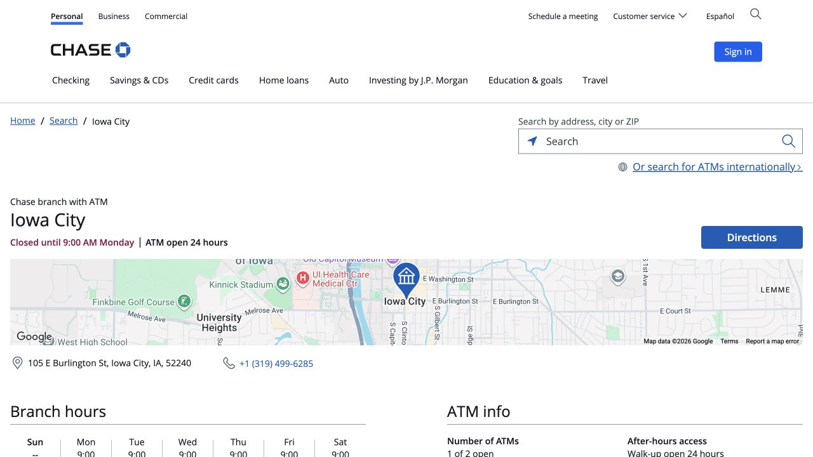
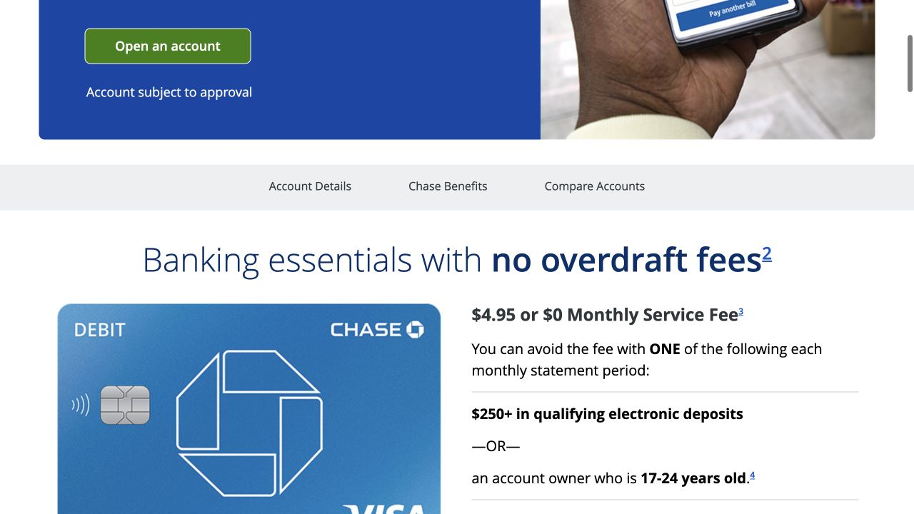

A local checking account is useful for receiving pay, paying rent and using a debit card for daily purchases. Chase, one of the banks in the handbook, has a downtown Iowa City branch that you can contact before visiting. The most useful preparation is to connect the account rules with your own month: how money will arrive, how rent is paid, and which fee waiver you can continue to meet.

## Arrange the visit to the Burlington Street branch

The Iowa City branch is at 105 E Burlington St, Iowa City, IA 52240, and its phone number is 319-499-6285. Open the branch page to see current lobby hours and arrange a personal checking appointment. If you do not yet have an SSN or ITIN, a call beforehand gives you a chance to describe the original IDs and address documents you have and ask whether the branch can review that combination. Plan around a banker’s appointment time; the ATM’s opening hours describe a different service.

- [Chase · Iowa City branch and appointment](https://www.chase.com/locator/banking/us/ia/iowa-city/105-e-burlington-st)

## Prepare the originals and the full U.S. mailing address

Chase asks for an original primary ID and secondary ID. Its international-student document list includes a passport, photo student ID, and I-20 or DS-2019; non-permanent residents need a U.S. address on a primary or secondary document. Put the originals together with your complete apartment or dorm address and a working phone number. Bring an SSN or ITIN if you already have one, and keep the handbook’s suggested proof of address and I-94 available. The banker will determine which documents apply to your situation, so having the material ready is different from every item being mandatory.

- [Chase · Acceptable forms of identification (PDF)](https://www.chase.com/content/dam/chase-ux/documents/personal/checking/acceptable-forms-of-identification.pdf)

## Understand what Secure Banking includes

Secure Banking currently has a $4.95 monthly service fee. It can be waived when an account owner is 17–24 or when the account receives $250 in qualifying electronic deposits per statement period. It has no overdraft fees and does not offer paper checks. That makes the way you pay rent relevant to the choice: if your landlord needs checks you write yourself, bring that requirement into the conversation. Chase now says College Checking is unavailable for new accounts, so the current product name and disclosure matter more than an older student guide.

- [Chase · Secure Banking details](https://personal.chase.com/personal/secure-banking)
- [Chase · College Checking availability notice](https://www.chase.com/personal/fees/college-checking)

## Compare Total Checking against a realistic month

Total Checking’s standard monthly fee is $15, with applicable ways to waive it. Common routes are $500 in qualifying electronic deposits per statement period, a beginning-of-each-day balance of $1,500, or an average beginning daily balance of $5,000 across eligible linked deposits and investments. These measure different things, so ask the banker which test would apply to you and where it appears in the disclosure. Student status alone does not waive this product’s fee. Once the continuing monthly requirement is clear, you can decide whether an opening promotion changes the overall value.

- [Chase · Compare checking accounts and monthly fees](https://personal.chase.com/personal/checking)

## Work out how the first money will reach the account

Receiving money and meeting an electronic-deposit waiver are separate questions. Secure Banking excludes cash, checks, Zelle, wire transfers and interest from its qualifying electronic deposits. Explain whether your account will usually receive wages, money from family or another kind of transfer, and ask whether that exact route counts. For wages, request the direct-deposit details for your own account. For a family wire, request its separate receiving instructions and fees; the routing information must match your account and the type of payment.

## Leave with the app and debit-card arrangements understood

While a banker is available to help, check the spelling of your name and the mailing address, including the apartment number. Ask where the debit card will be sent and how you will activate it, then sign in to the official app and locate the account information and low-balance alert. Save the support contact shown in the app or on your card. The checking account holds your funds; the debit card is one way to use them. A credit-card application, or an optional savings account with its own fee rules, is a further choice to review separately.

## Set up outside transfers around the payment you actually need

For linking an eligible account at another bank, Chase publishes the route Pay and transfer → External accounts → Add external account, followed by verification and scheduling. Once verification is complete, review the destination, arrival estimate and any charges from the other bank on the final screen. Rent deserves its own check with the landlord: ACH, Zelle and a paper check use different instructions and are not automatically accepted in place of one another. Save the payment arrangement with the lease so that the first rent deadline does not become your first attempt to work it out.

- [Chase · Link an external account and transfer](https://www.chase.com/digital/transfer)

## Use the first statement to check that the account works as expected

When the first complete statement is available, compare its product name, statement dates, service fee and applied waiver with the explanation you received at the branch. If a charge is different, contact the bank with that statement open so you can discuss the exact period. For an age waiver, a reminder before your 25th birthday gives you time to review the available alternatives. Keep your phone and mailing address current after moving; they are part of how the bank sends cards, security messages and correspondence.

> Independently edited by ISAB · Official sources checked October 18, 2026. The branch confirms document acceptance and account eligibility; review the current disclosure before opening.

## Sources & useful links

- [Chase · Iowa City branch](https://www.chase.com/locator/banking/us/ia/iowa-city/105-e-burlington-st)
- [Chase · Iowa City address and phone](https://businessbranch.chase.com/ia/iowa-city/business/cbcb-Branch-20022)
- [Chase · Acceptable forms of identification](https://www.chase.com/content/dam/chase-ux/documents/personal/checking/acceptable-forms-of-identification.pdf)
- [Chase · International student banking](https://www.chase.com/personal/banking/education/basics/bank-accounts-for-international-students)
- [Chase · Secure Banking terms](https://personal.chase.com/personal/secure-banking)
- [Chase · College Checking availability](https://www.chase.com/personal/fees/college-checking)
- [Chase · Checking comparison and fees](https://personal.chase.com/personal/checking)
- [Chase · External account transfers](https://www.chase.com/digital/transfer)
