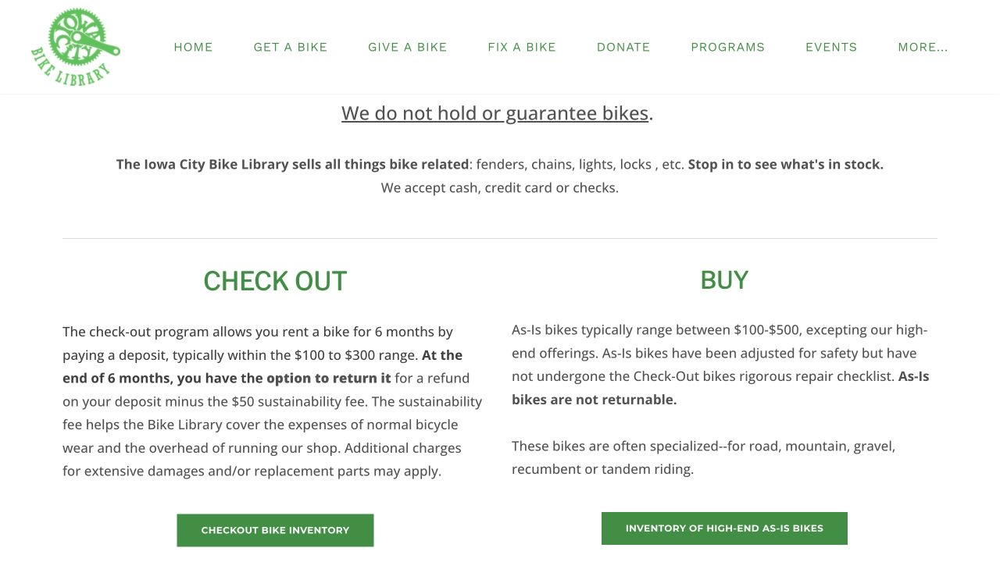
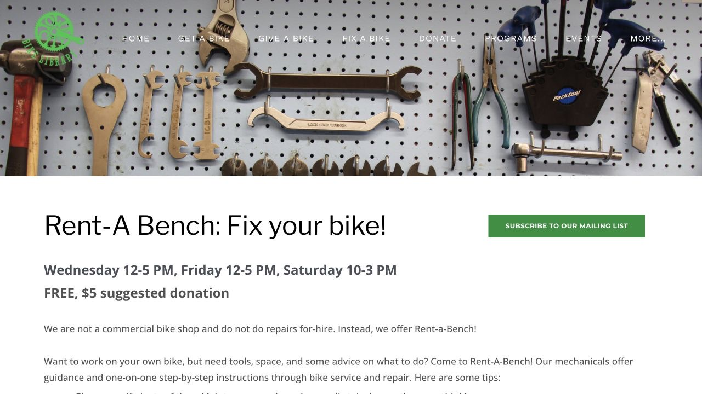

If you want to find out how cycling fits your semester before buying a new bike, Iowa City Bike Library offers another route. Its checkout programme starts with a deposit, then gives you the choice to keep the bike or return it within six months under the published terms. Understanding that arrangement at the beginning makes both the first ride and the end of the semester easier to plan.

## Give yourself time to choose during public checkout hours

Bike Library is at 1222 S Gilbert Ct. The published public checkout hours are Wednesday and Friday noon–5 p.m. and Saturday 10 a.m.–3 p.m.; check the current homepage or calendar before visiting. Bikes are available first come, first served, so a listing gives you an idea of the programme rather than a reservation.

Bring your usual shoes and backpack so you can discuss the bike as you will use it. Tell staff your height, typical route and whether you need to carry groceries, then ask about fit, gears and braking. If you are making a special journey, contact them beforehand about what the checkout form requires and allow enough time to choose.

- [Bike Library · Get a bike](https://icbikelibrary.org/get-a-bike)

## Plan the cash you need for the deposit as well as the fee

Checkout deposits are usually $100–$300. If you return the bike within six months, the refund has a $50 sustainability fee deducted, along with any applicable damage or parts charges. The amount needed on collection day is therefore larger than the eventual cost of a straightforward return.

For example, a $200 deposit would produce a $150 refund after that $50 fee if there were no additional deductions. You still need the full $200 at checkout. Ask for the specific bike’s deposit and return deadline, and put the deadline in your calendar while the paperwork is in front of you.

## Understand whether you are taking a checkout or an as-is bike

With a checkout bike, you can choose to keep it by giving up the return and refund option; that option expires after six months. An as-is purchase is a final sale. Those choices can suit different plans, but they need to be understood before signing.

Ask staff to show which option applies to your bike and what comes with it. Keep the form and receipt, photograph the bike and serial number, and confirm the lock and lights you will need. Having those details together helps with maintenance questions and with deciding later whether you want to keep the bicycle.

## When maintenance is needed, use the programme that fits

During the six-month checkout period, Bike Library covers minor repairs and adjustments; larger work may involve parts costs and leaving the bike. Contact them with the problem so you can understand the likely arrangement before counting on a same-day ride home.

For learning your own maintenance, Rent-A-Bench provides tools, space and guidance while you do the work. The current page lists free use with a $5 suggested donation, during Wednesday and Friday noon–5 p.m. and Saturday 10 a.m.–3 p.m. Bring one clear problem, such as a flat tyre or rubbing brake, and arrive early enough to learn. This is a hands-on workshop, so allow time to participate rather than planning a quick commercial drop-off repair.

## Before moving away, allow time for both the return and the refund

Returns take place during public opening hours. The published refund method is a mailed cheque, taking about four to six weeks, with the sustainability fee and any other applicable charges deducted. That timing matters if the end of your lease or an international departure is approaching.

Contact Bike Library in advance about a mailing address where you can reliably receive the cheque. Return before the deadline with enough time to resolve questions, and keep a return record with your original paperwork. This lets the end of the semester follow the same clear plan as the day you collected the bike.

> Independently edited by ISAB · Sources checked October 18, 2026. Confirm current hours, costs and applicable terms through the linked sources before travelling or purchasing.

## Sources & useful links

- [Bike Library · Get a Bike / checkout & returns](https://icbikelibrary.org/get-a-bike)
- [Bike Library · current hours & address](https://icbikelibrary.org/)
- [Bike Library · Rent-A-Bench](https://icbikelibrary.org/rent-a-bench)
