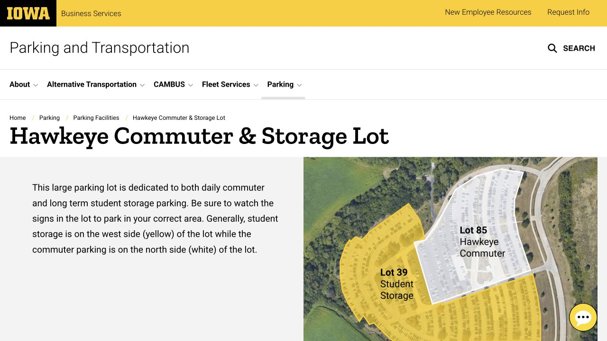
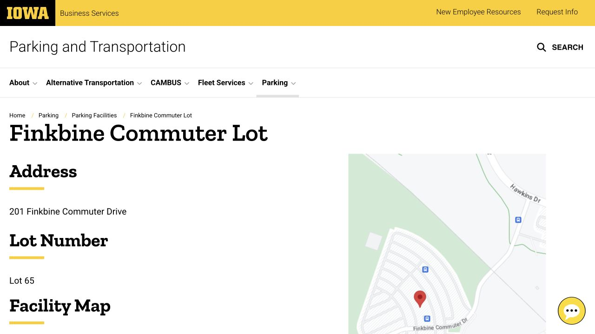
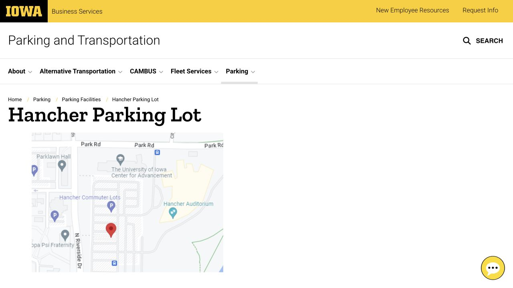

A lot number becomes useful when you know how it connects to your classes and your journey home. Start with the classroom or lab, then work backward through the walk, bus connection and parking location. The comparison below includes daily commuting, storing a residence-hall car and occasional hourly visits. Your address, student status and timetable determine which option can work; this is an independent student guide to those campus facilities.

## A short list before opening the purchase portal

Locate your destination and each lot on the official interactive map before comparing prices. The table uses student rates effective July 1, 2026, with one fall or spring semester as the semester unit. Monthly figures help compare products, while student billing is by semester. Once a location looks suitable, check the Parking Portal for your eligibility and the available inventory.

| Lot / location | Use to compare | Student eligibility | Month / semester |
| --- | --- | --- | --- |
| 85 · Hawkeye Commuter | West of campus; plan a CAMBUS connection | Graduate students; undergraduates commuting from outside Iowa City / Coralville | $18 / $81 |
| 65 · Finkbine | West campus / health-sciences destinations | Graduate students; portal availability applies | $29 / $130.50 |
| 55 · Hancher | Arts Campus or a walk/bus onward | City-limit rules apply; local graduate students should confirm the conflicting wording below | $48 / $216 |
| 56 · Mayflower | Behind Mayflower Hall | Current Mayflower residents only; gate card needed | $68 / $306 |
| 38 · Parklawn / Mayflower Storage | Different products in the same numbered lot | Parklawn resident permit OR Mayflower resident storage permit | Parklawn $68 / $306; storage $55 / $247.50 |
| 39 · Hawkeye Storage | Keep a residence-hall car west of campus | Current university residence-hall residents only | $55 / $247.50 |

- [Open the interactive campus parking map](https://experience.arcgis.com/experience/2fe7b2488d43433cb387e72238f96152)
- [Current student permit rate table](https://transportation.uiowa.edu/parking-rates)

## Lot 85 · Hawkeye: lowest commuter price here, with a bus leg

Hawkeye commuter parking is at 3350 Hawkeye Park Road, about two miles west of main campus. The large site contains both Lot 85 commuter spaces and Lot 39 storage spaces, with commuter parking described to the north and storage to the west. Use the allocation map and signs to reach the section covered by your product.

The onward journey is part of using Lot 85. Route 41 connects to West Campus Transportation Center, while route 42 runs through the Hawkeye Campus–Health Sciences–Pentacrest connection. Match the stop and direction to your building, then try the return at your normal finishing time. CAMBUS currently stops at the central silver shelter; the former brown and brick shelters are no longer served. That trial trip will show how the permit fits a complete day.

- [Lot 85 / 39 location, allocation map and current shelter](https://transportation.uiowa.edu/parking/facilities/hawkeye-commuter-storage-lot)
- [Hawkeye student commuter eligibility](https://transportation.uiowa.edu/parking/student-parking/student-hawkeye-commuter-permit)

## Lot 65 · Finkbine: compare it for a west-campus daily routine

Finkbine Lot 65 is at 201 Finkbine Commuter Drive, northeast of Finkbine Golf Course, with primary access from Hawkins Drive. Its student product is for graduate students and depends on available spaces. Undergraduates with west-campus classes need to compare the products available to their own classification.

For the bus leg, route 51 links Finkbine/Arena with West Campus Transportation Center; route 52 connects Health Sciences and the Pentacrest area. Include the walk after the bus when comparing your timetable. Two shelters offer on-demand heat from November through March. The southeast corner also has a separately signed public-payment area, zone 5104 with a twelve-hour maximum, so choose that area specifically if paying as a visitor.

- [Finkbine location, photograph and public-payment corner](https://transportation.uiowa.edu/parking/facilities/finkbine-commuter-lot)
- [Student Finkbine permit eligibility](https://transportation.uiowa.edu/parking/student-parking/student-finkbine-permit)

## Lot 55 · Hancher: useful to compare for Arts Campus, but check eligibility

Hancher Lot 55, at 300 North Riverside Drive, lies west of the auditorium and extends toward the Theater Building. Check the walking route to your actual arts building or onward destination. During fall and spring academic terms, route 54 Hancher–Newton Road adds weekday morning and afternoon peak service. At midday, weekends and breaks, check the route 31/32 alternatives because 54 does not run then.

The official eligibility wording needs care: the overview/rate table includes graduate students, while the detailed commuter page also excludes students living inside Iowa City/Coralville or in residence halls. A local graduate student should have parking confirm their address and status at 319-335-1475 before paying. Undergraduates must commute from outside those city limits. Confirming that detail resolves whether this otherwise convenient location is an option for you.

- [Hancher lot location and facility information](https://transportation.uiowa.edu/parking/facilities/hancher-parking-lot)
- [Read the Hancher student eligibility wording](https://transportation.uiowa.edu/parking/student-parking/student-hancher-permit)
- [54 Hancher–Newton Road service times](https://transportation.uiowa.edu/cambus/routes/54-hancher-newton-road)

## Live in a residence hall? Look at storage and hall-specific products

For a residence-hall car used mainly for shopping and trips, compare the storage products and the journey to collect the car. Hawkeye Storage Lot 39 requires current university residence-hall residency; that eligibility ends when you move out. It is purchased separately from Lot 85 commuter parking even though both are at the same large site.

The lot behind Mayflower is Lot 56, not Lot 54. Current Mayflower residents can buy its product and use a gate access card; when it sells out, use the relevant Portal waitlist. Subject to space, Mayflower residents may be offered Lot 38 Mayflower Storage. Lot 38 also has a separate Parklawn-resident product, so the complete product name identifies the arrangement. Moving out of Mayflower requires changing the permit; the page describes an exchange to Hawkeye Storage.

- [Residence-hall Hawkeye Storage Lot 39 rules](https://transportation.uiowa.edu/parking/student-parking/hawkeye-storage-permit)
- [Mayflower Lot 56 and Lot 38 waitlists](https://transportation.uiowa.edu/parking/student-parking/student-mayflower-permits)
- [Choose your student housing / classification](https://transportation.uiowa.edu/parking/student-parking)

## Only driving in for a study session? Compare the actual hourly facility

For an occasional Main Library visit, Library Lot 3 is at 123 Museum Drive, entered from Burlington Street at Museum Drive. For the Iowa Memorial Union area, IMU Ramp / Lot 60 is at 120 North Madison Street. Both are campus hourly facilities rather than the daytime assigned space covered by an 85, 65 or 55 permit. Their pages list exit payment by debit/credit card, accepting Visa, Mastercard and Discover.

Open the live availability dashboard from the facilities page before driving to a small central lot. On arrival, follow the hourly entry process and keep the ticket or credential needed to leave. If you have a separate Night Weekend product, use its participating-location list and time rules to determine whether it applies. City-ramp first-hour pricing belongs to a different operator.

- [Library Lot 3 entry and payment](https://transportation.uiowa.edu/parking/facilities/library-lot)
- [IMU Ramp / Lot 60 entry and payment](https://transportation.uiowa.edu/parking/facilities/iowa-memorial-union-ramp)
- [Campus public parking facilities and live availability link](https://transportation.uiowa.edu/parking/facilities)

## After buying: your plate, the correct area and the return bus all matter

For student permits in 85, 65 and 55, the registered license plate provides the parking credential and a gate card is not required. Mayflower access and the separately purchased NW product do require the appropriate card. Keep the confirmation, note the effective date and update the registration when a plate changes. The permit applies to its designated lot and area; signed hourly, reserved and patient spaces have their own rules.

Commuter facility pages list weekday enforcement from 7:30 a.m. to 4:30 p.m., alongside other posted restrictions. Read the signs for the place you use at other times as well. Home football games change regular CAMBUS service and add dedicated shuttles, so a late lab, weekend study session or holiday trip deserves a fresh look at event signs and the day’s service alerts.

- [Student portal, billing and vehicle guidance](https://transportation.uiowa.edu/parking/student-parking)
- [CAMBUS route maps, alerts and service calendars](https://transportation.uiowa.edu/cambus/routes)
- [2026 home-football shuttle and detour information](https://transportation.uiowa.edu/cambus-football-shuttles-and-game-day-detours)

## ISAB’s practical way to make the choice

A graduate student with a west-campus lab could compare 65 and 85 by the morning and evening connection. An eligible undergraduate commuting from outside the city limits to arts classes could compare 55 and 85, including the final walk. A residence-hall student who mainly drives for groceries could compare storage access and the trip to retrieve the car. An undergraduate living inside Iowa City/Coralville should check transit and occasional hourly options while confirming what their student category allows. These examples help frame a comparison; availability remains product-specific.

When calling Parking & Transportation at 319-335-1475, have your student status, full current address, target lot and earliest arrival/latest departure ready. Ask about eligibility for that exact product, a full-lot alternative and any extra evening/weekend credential. Once the location is settled, the linked permit-purchase note explains the portal, billing and cancellation.

- [Official student parking starting point](https://transportation.uiowa.edu/parking/student-parking)
- [Parking Portal: view eligible products](https://parking.uiowa.edu/)

> Independently edited by ISAB · Sources checked October 18, 2026. Campus parking is operated by the university; this guide explains options from a student perspective. Confirm current eligibility, inventory, rates and day-specific restrictions with the linked operator before purchase.

## Sources & useful links

- [Campus parking facilities / 校园停车设施与地图入口](https://transportation.uiowa.edu/parking/facilities)
- [Student parking classifications / 学生身份与住宿分类](https://transportation.uiowa.edu/parking/student-parking)
- [FY2027 student permit rates / 2026 年 7 月起学生价目表](https://transportation.uiowa.edu/parking-rates)
- [Hawkeye Commuter & Storage / Lot 85 与 39 设施](https://transportation.uiowa.edu/parking/facilities/hawkeye-commuter-storage-lot)
- [Student Hawkeye Commuter / Lot 85 学生资格](https://transportation.uiowa.edu/parking/student-parking/student-hawkeye-commuter-permit)
- [Finkbine Commuter / Lot 65 设施](https://transportation.uiowa.edu/parking/facilities/finkbine-commuter-lot)
- [Student Finkbine / Lot 65 学生资格](https://transportation.uiowa.edu/parking/student-parking/student-finkbine-permit)
- [Hancher / Lot 55 设施](https://transportation.uiowa.edu/parking/facilities/hancher-parking-lot)
- [Student Hancher / Lot 55 资格原文](https://transportation.uiowa.edu/parking/student-parking/student-hancher-permit)
- [Hawkeye Storage / Lot 39 住校存车](https://transportation.uiowa.edu/parking/student-parking/hawkeye-storage-permit)
- [Mayflower / Lot 56 与 38 产品](https://transportation.uiowa.edu/parking/student-parking/student-mayflower-permits)
- [Library Lot / Lot 3 图书馆临停](https://transportation.uiowa.edu/parking/facilities/library-lot)
- [Iowa Memorial Union Ramp / IMU Lot 60 临停](https://transportation.uiowa.edu/parking/facilities/iowa-memorial-union-ramp)
- [CAMBUS routes and service calendar / 公交路线与服务日历](https://transportation.uiowa.edu/cambus/routes)
- [54 Hancher–Newton Road / 高峰接驳时段](https://transportation.uiowa.edu/cambus/routes/54-hancher-newton-road)
- [2026 football shuttles and detours / 比赛日接驳与绕行](https://transportation.uiowa.edu/cambus-football-shuttles-and-game-day-detours)
