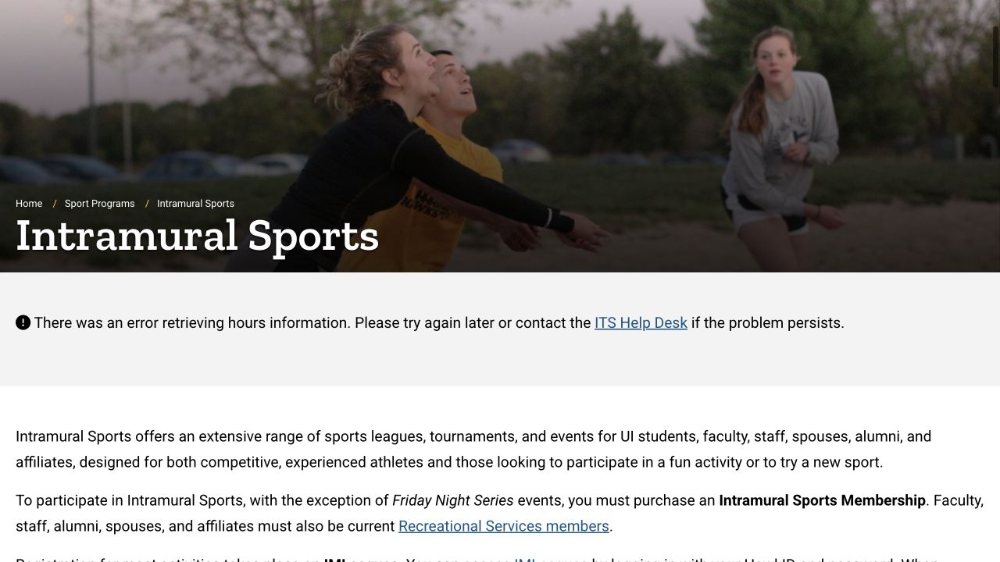

Campus sport can fit around a normal week without joining a competitive team. You might use a treadmill between classes, swim after a lab, or try a group class with a friend. The useful starting point is the activity and the day you want to go: that determines the building, opening schedule and any extra registration. This ISAB guide walks through those choices so your first visit feels familiar.

## CRWC for a central workout; Field House for a west-campus routine

The Campus Recreation & Wellness Center, usually shortened to CRWC, is at 309 S Madison Street. It combines strength and cardio equipment, an indoor running track, courts, group-class rooms and pools, so it is a practical first building to explore if you study near downtown. The Field House, at 225 S Grand Avenue on west campus, also has fitness space and multiple courts, including badminton/pickleball areas. Its drop-in courts are available when they are not reserved for programs.

Compare the route from your last class with the route home. A building you can reach easily is often more useful than one with an activity you rarely have time to attend. Open that building’s dated hours before leaving; a facility being open does not mean every court or pool is available.

- [CRWC location and dated hours](https://recserv.uiowa.edu/campus-recreation-wellness-center)
- [Field House courts, location and dated hours](https://recserv.uiowa.edu/field-house)

## Check whether your student fees already cover membership

Enrolled students paying the mandatory recreation fee have facility membership included in tuition and fees. The current no-fee/not-enrolled student rate is $40 per month; eligibility and session limits apply. A photo ID is needed for an in-person membership purchase. If your status is unclear, ask the member-services desk to check it before buying another membership.

This membership covers the four indoor recreation facilities and most ordinary recreation activities. Intramural sports and specialized programs can have additional charges. A visiting friend needs their own eligible access or a day pass rather than entering on your student card.

- [Membership categories, eligibility and current prices](https://recserv.uiowa.edu/memberships)

## Pack a small bag and make the first visit an orientation

A useful first bag has your student ID, water, comfortable exercise clothes, suitable athletic shoes and a small towel. For swimming, add swimwear, goggles if you use them, and something to carry wet items home. These are packing suggestions; activity-specific rules are displayed by the facility. Ask the desk about changing areas and lockers instead of leaving valuables on a bench.

The official recreation app, currently found by searching “Fusion Go,” provides facility notices, class schedules, live visitor counts and a digital membership barcode. You can use the website instead if you prefer. During your first visit, locate the desk, changing area and the space you plan to use; asking how an unfamiliar machine works is a reasonable use of that visit.

- [Official app and digital ID instructions](https://recserv.uiowa.edu/RecServApp)

## For a swim, read the specific pool’s timetable

Aquatics lists separate schedules for the CRWC competition pool, diving well, recreation pool and Field House pool. Lap swimming and open recreational swimming are different sessions. Select the date and the pool you want, then check again on the day because meets and programs can change access.

The competition pool is for lap swimming; the recreation pool has a different layout and rules. Bring appropriate swimwear, shower before entering and follow the lifeguard’s instructions. Being allowed into the building does not authorize entering water without a lifeguard. If you are learning to swim, use the Swim Lessons route on Aquatics to check an actual lesson and its cost rather than treating open swim as instruction.

- [Pool schedules, swim lessons and pool rules](https://recserv.uiowa.edu/aquatics)

## Ordinary group fitness is a simple way to try something new

The Group Fitness page lists classes at CRWC and the Field House, including strength, cycle and mind-body options. Ordinary classes are included with a valid recreation membership, and in-person classes currently do not require advance registration. Choose the exact class, room and date from the live timetable, arrive before the start and tell the instructor it is your first time. Doors close when the safe capacity is reached, and late arrivals are not admitted.

Some separately advertised training series charge a fee and require registration. Read the individual listing when a class is marked as private or specialized; the ordinary group-class arrangement does not automatically apply to that program.

- [Current group-class timetable and participation rules](https://recserv.uiowa.edu/groupfit)

## Intramural sports: a separate membership for campus leagues and tournaments

Intramural Sports offers organized games among the campus community. For most activities, log into IMLeagues through the official page with HawkID, open the sport and read its registration deadline, divisions and playing times. Follow the listing to create or join a team; if you do not have teammates, check the sport’s free-agent options or ask the program office.

The published membership prices are $30 for one fall or spring semester, or $50 for fall and spring together. There are also tournament and single-game options. The intramural fee is separate from ordinary facility access; Friday Night Series events are a listed exception. Review the specific sport before paying, since the golf tournament has separate treatment.

- [Sport listings, IMLeagues entry and membership options](https://recserv.uiowa.edu/intramural-sports)

## Sport clubs: contact the actual club about practice and commitment

A sport club is a student organization that practices, competes or arranges recreational activities together. Many compete against clubs at other universities; others focus on learning and social participation. The active-club directory is the useful entry point for sports such as badminton or a club team. Open the club’s own listing and ask about beginner participation, tryouts, dues, equipment, travel and the current practice schedule.

Joining a club and paying for building access are separate arrangements: members using indoor recreation facilities for practice still need a recreation membership or the daily walk-in fee. A friend’s team schedule is useful context, but the current club contact should confirm your own requirements.

- [Active sport clubs and club contacts](https://recserv.uiowa.edu/sport-clubs)

## Turn a first visit into a routine you can keep

For a manageable first week, you could choose one short solo workout and one group class, leaving swimming or a team sign-up for a later visit. That is a suggested plan rather than a fitness prescription. Save the official schedules beside your timetable so a changed lab or closing time does not become a wasted trip.

If a machine, booking page or eligibility message is unclear, use the relevant program’s contact or ask the member-services desk at 319-335-9293. Bringing the class name, date or screenshot of the message makes the question easier to resolve. You can explore several activities before deciding which one deserves a regular place in your week.

> Independently edited by ISAB · Sources checked October 18, 2026. Live schedules, eligibility, fees and program registration are handled by the linked providers.

## Sources & useful links

- [CRWC · Facilities and hours / 场馆与时间](https://recserv.uiowa.edu/campus-recreation-wellness-center)
- [Field House · Courts and location / 球场与位置](https://recserv.uiowa.edu/field-house)
- [Recreation · Memberships / 会员与费用](https://recserv.uiowa.edu/memberships)
- [Recreation · Official app / 官方 App](https://recserv.uiowa.edu/RecServApp)
- [Aquatics · Pool schedules / 泳池时间与课程](https://recserv.uiowa.edu/aquatics)
- [Group Fitness · Participation / 团课参加规则](https://recserv.uiowa.edu/groupfit)
- [Intramural Sports · Registration and fees / 比赛报名与费用](https://recserv.uiowa.edu/intramural-sports)
- [Sport Clubs · Active directory / 体育社团目录](https://recserv.uiowa.edu/sport-clubs)
