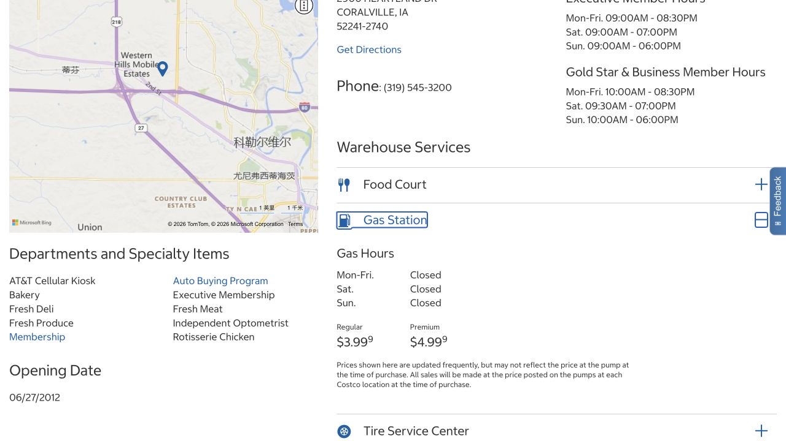

Costco works best when its large packages fit the way you cook, store food and travel. Before joining, picture a normal restocking trip: what you would buy, where it would go at home, and how often you would make that journey. That gives the annual membership fee a useful context. It also helps you decide whether combining groceries with fuel will be convenient for your own routine.

## Check the warehouse and fuel service separately

Coralville Costco is at 2900 Heartland Drive, Coralville, IA 52241. Its location page separates warehouse opening times by membership type and gives the gas station its own Gas Hours section. In the October 18, 2026 browser check, the expanded section displayed Closed for weekdays, Saturday and Sunday, without explaining why or giving a reopening date.

If fuel is the reason for the trip, call 319-545-3200 to confirm that the station is operating before setting out. The warehouse can have its own opening hours, and a fuel price remaining on the page does not establish that pumps are open. Keep that distinction in mind when choosing whether to combine shopping and gas.

- [Costco · Coralville warehouse and Gas Hours](https://www.costco.com/warehouse-locations/warehouse-1111.html)

## Compare the annual membership with your normal shopping pattern

U.S. Gold Star membership costs $65 per year and Executive costs $130, plus applicable sales tax. Gold Star includes a free Household Card for one other eligible person at the same address. Cards are for the named member’s own use, so a shared household arrangement needs its own eligible card rather than a card passed between friends.

Compare the fee with the groceries and household goods you actually buy, including the extra travel. A larger advertised reward or promotion is useful only when it fits those purchases. You can begin by assessing Gold Star rather than assuming Executive is necessary, and membership itself does not require an application for the Costco credit card.

## Let your kitchen decide which large packs are useful

A short first list can include one or two pantry staples you already use, household supplies you have space to store, and a fresh item you can finish. Compare the same unit price with your usual supermarket. This is particularly helpful when a low unit price comes in a package much larger than you normally buy.

Before taking a meat pack, work out freezer space and how you will portion it. For a produce bag, think through the meals that will use it over the next few days. Shopping with roommates can make a large pack easier to share, provided everyone agrees beforehand on the items, the split and the cost.

## Bring a payment method that works inside the warehouse

U.S. warehouses accept Visa, most PIN-based debit or ATM cards, Costco Shop Cards and cash, alongside other methods in the official payment FAQ. Online and in-store acceptance differ: a Mastercard credit card accepted at Costco.com is not a general payment option for warehouse groceries. Paying through a mobile wallet still depends on the underlying card.

Bring your own valid membership and a suitable payment method so you can complete the trip at the register. If you are unsure which of your cards qualifies, check its type against the FAQ before leaving, while it is easy to bring an alternative.

## At an operating gas station, follow the pump’s sequence

The following describes Costco’s general self-service process; Coralville’s current availability needs the separate check above. At an operating station, follow the one-way signs, pull alongside a pump and switch off the engine. Use your valid membership as the screen instructs, then provide an accepted payment method. The pumps accept Visa, most PIN debit cards, Apple Pay and Costco Shop Cards; they do not take cash.

Follow the prompts and choose the grade specified by your vehicle’s manual. Insert the nozzle into the fuel opening and proceed as instructed. When finished, return the nozzle, close the fuel cap and collect a receipt if requested before driving away.

## Ask the attendant when a card or pump is unfamiliar

Costco stations have trained fuel attendants. If the screen rejects a card, membership verification stalls or the nozzle is unfamiliar, ask for help before repeating the transaction. Keeping the engine off and avoiding smoking are part of the visit throughout.

Fuel service is normally for members. The official FAQ also explains an exception involving a prepaid Costco Shop Card; use those published terms if relevant to you. Membership cards themselves are personal, and borrowing somebody else’s card does not follow from that exception. The attendant can explain the current station instructions for the payment method you have brought.

## Count storage, travel and the load as part of the price

Combining groceries and gas can be convenient when both already fit the same journey. Compare the posted pump price with nearby stations, while allowing for the extra distance and queue. The cheapest displayed price is less useful if reaching it adds a long detour to a busy day.

Bring bags or boxes and arrange a way to carry the purchases home. Without a car, smaller trips to a nearby supermarket may fit daily life better than warehouse restocking. Storage space, travel and the annual fee all belong in the decision; you can wait to join until those pieces make sense together.

> Independently edited by ISAB · Sources checked October 18, 2026. Confirm current hours, costs and applicable terms through the linked sources before travelling or purchasing.

## Sources & useful links

- [Costco · Coralville warehouse and Gas Hours](https://www.costco.com/warehouse-locations/warehouse-1111.html)
- [Costco · Membership types and annual fees](https://customerservice.costco.com/app/answers/detail/a_id/857/)
- [Costco · Household membership eligibility](https://customerservice.costco.com/app/answers/detail/a_id/853/)
- [Costco · Membership card conditions](https://www.costco.com/f/-/member-privileges-conditions)
- [Costco · Warehouse and gas payment methods](https://customerservice.costco.com/app/answers/detail/a_id/719/)
- [Costco · Fuel FAQ](https://www.costco.com/f/-/gasoline-qanda)
- [Costco · Fuel station safety and attendants](https://www.costco.com/f/-/gasoline-environment)
