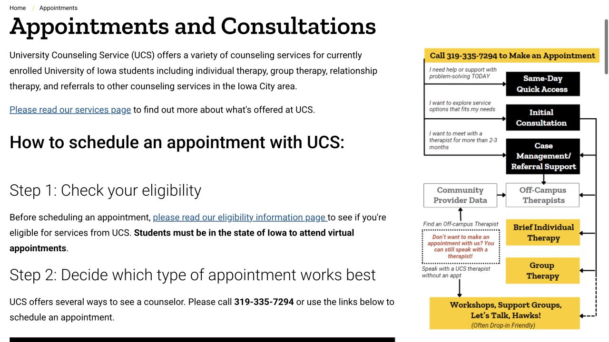

It can be hard to ask for help when you are also learning a new campus and a new health system. This guide follows the actual path from choosing a first conversation to understanding the next step, so you can start with the part that feels manageable.

## You can start with what has been difficult lately

Adjusting to a new place, feeling isolated, struggling with sleep, or finding that stress is affecting your work are all things you can bring to a conversation about support. You do not need to arrive with a diagnosis or a polished explanation. University Counseling Service (UCS) serves currently enrolled students and eligible postdocs; enrollment status determines eligibility. Its eligibility page also explains summer access. For a virtual session, plan to be physically in Iowa and contact UCS before booking from another state or country.

- [UCS · Eligibility and summer access](https://counseling.uiowa.edu/appointments-and-consultations/eligibility-information)

## Choose an initial consultation, or a short informal conversation

An Initial Consultation is the starting point when you want a fuller discussion of your concerns and possible continuing care. If you mainly want to understand what counseling is like, Let’s Talk, Hawks! offers a brief, informal conversation of up to 15 minutes without intake paperwork. It can help with a question, a practical coping skill or finding a resource. Let’s Talk is not therapy or a crisis appointment; its page lists the current locations and sign-up arrangements.

- [UCS · Initial Consultation and booking](https://counseling.uiowa.edu/appointments-and-consultations)
- [UCS · Let’s Talk, Hawks!](https://counseling.uiowa.edu/outreach-services-scope-and-offerings/lets-talk-hawks)

## Make the appointment and leave time for the first forms

Use the booking links on the UCS appointments page or call 319-335-7294. Initial consultations can be booked online up to two weeks ahead; if the page has no appointments, staff may be able to offer other options by phone. First-time visitors, and those returning after more than three months, complete background and concern forms on the day of the appointment, at least 30 minutes before it begins. The main office is W200 in the Iowa Memorial Union. Use the confirmation for the actual room or video link, and mention language preferences or access needs when arranging care.

- [UCS · Booking, forms and cancellations](https://counseling.uiowa.edu/appointments-and-consultations)

## For something pressing, look at Quick Access

Quick Access is designed for support with an immediate life stressor or a pressing mental health concern. The dedicated appointment page currently describes 60-minute, single-session appointments Monday–Friday, 9 a.m.–4 p.m., bookable up to 48 hours ahead on a first-come basis. A single session can focus on what is happening now and what would help next. Availability is not guaranteed by the name “same day”; use the booking page or call UCS to discuss what is available.

- [UCS · Quick Access appointments](https://counseling.uiowa.edu/quick-access-appointments)

## Understand how brief individual therapy and groups differ

After the first consultation, you and the clinician decide what fits your needs. UCS individual therapy is brief and goal-focused; its page says most students receive three to eight sessions. The goal might concern a current transition, a particular pattern, or a problem that can be worked on in that format. Group therapy offers a different setting for working on concerns with other students and requires a screening conversation first. Review the current group descriptions with the clinician rather than treating a group as a second-choice appointment.

- [UCS · Brief individual therapy](https://counseling.uiowa.edu/clinical-services/brief-individual-therapy)
- [UCS · Current group therapy options](https://counseling.uiowa.edu/clinical-services/group-therapy)

## For ongoing care, ask a Mental Health Navigator to help connect the pieces

If you want longer-term therapy, a particular specialty, or help finding someone who fits your language and cultural preferences, Mental Health Navigation is a useful next appointment. A navigator can discuss insurance, help call the insurer, suggest community providers, assist with a first appointment and follow up about barriers. Bring your insurance card and explain practical constraints such as transport, times and cost. Navigation can provide bridging support while you connect with care; it is not itself open-ended therapy.

- [UCS · Mental Health Navigation](https://counseling.uiowa.edu/clinical-services/mental-health-navigation)
- [UCS · Community Provider Database](https://cpd.counseling.uiowa.edu/)

## Ask how privacy and payment work before you begin

UCS describes its student services as free and confidential. Its confidentiality policy says protected information, including whether you attended, is not released to professors, advisers, parents or friends without prior written permission, apart from narrow legal and safety exceptions described in that policy. You can ask the clinician to explain those limits at the beginning. A referral to a community therapist has its own billing arrangements: confirm the exact clinician’s network status and expected cost with the insurer and provider, even when the referral began at UCS.

- [UCS · Confidentiality and its limits](https://counseling.uiowa.edu/about-us/confidentiality)
- [Well-Being at Iowa · Student mental health services](https://wellbeing.uiowa.edu/mental-health-and-resilience)

## Leave with a next step you understand

Before the session ends, make sure you know whether you are arranging a follow-up, waiting for a group screening, or contacting another provider. Write down the contact route and what you should do if the arrangement does not work out. If you need urgent support outside the normal appointment schedule, use the university’s current distress-response page for available immediate options. If there is an immediate physical emergency or danger, contact local emergency services. This student guide does not receive appointment requests or messages for clinicians.

- [Campus Safety · Current distress-response resources](https://safety.uiowa.edu/response)

> Independently written by ISAB · Official sources checked October 18, 2026. The linked providers manage appointments, coverage and claims; use their current guidance for your situation.

## Sources & useful links

- [UCS · Appointments and consultations](https://counseling.uiowa.edu/appointments-and-consultations)
- [UCS · Eligibility information](https://counseling.uiowa.edu/appointments-and-consultations/eligibility-information)
- [UCS · Let’s Talk, Hawks!](https://counseling.uiowa.edu/outreach-services-scope-and-offerings/lets-talk-hawks)
- [UCS · Quick Access appointments](https://counseling.uiowa.edu/quick-access-appointments)
- [UCS · Brief individual therapy](https://counseling.uiowa.edu/clinical-services/brief-individual-therapy)
- [UCS · Group therapy](https://counseling.uiowa.edu/clinical-services/group-therapy)
- [UCS · Mental Health Navigation](https://counseling.uiowa.edu/clinical-services/mental-health-navigation)
- [UCS · Confidentiality](https://counseling.uiowa.edu/about-us/confidentiality)
- [Well-Being at Iowa · Mental health and resilience](https://wellbeing.uiowa.edu/mental-health-and-resilience)
- [Campus Safety · Distress response resources](https://safety.uiowa.edu/response)
