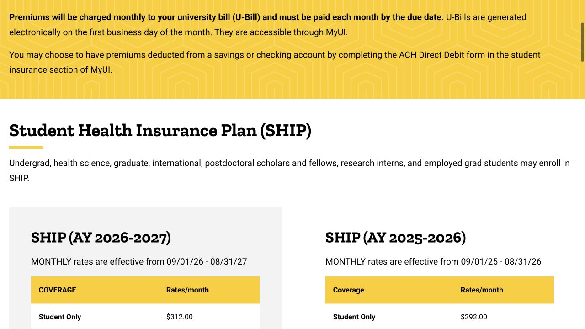
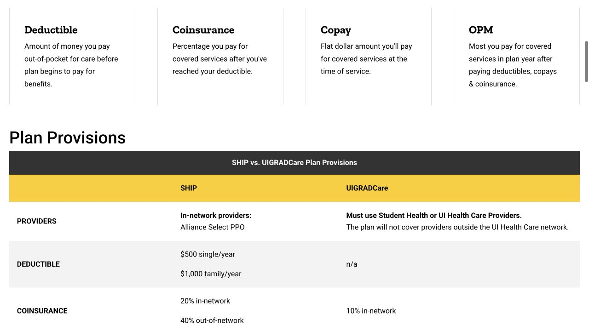

Student insurance becomes easier to compare when you separate three questions: which plan you can use, where it covers care, and what you pay before and after any employment contribution. Keep your appointment or funding information nearby as you read; it changes both the amount and the timing.

## Match the insurance dates to the semester and your arrival

International students are required to have health insurance; dental coverage is optional. The Benefits page explains that, without accepted proof of other coverage, students are billed for student-only SHIP, with coverage and premiums beginning on the first day of the month in which registration and classes begin. Read the effective date on your own confirmation, especially if arriving early. Keep the first-month cost in your arrival budget rather than assuming an assistantship subsidy already applies.

- [Benefits · International student coverage requirements](https://hr.uiowa.edu/benefits/ui-student-insurance/international-student-benefits)

## Compare where you can receive care before comparing prices

SHIP uses the Alliance Select PPO network and has coverage in and outside Iowa, with different costs for participating and nonparticipating providers. UIGRADCare is available to graduate and health science students, not undergraduates, and its general medical network centers on Student Health and UI Health Care. If you regularly travel, already have a clinician, or expect specialist care, locate those providers in the relevant plan information. Mental health and emergency benefits have specific provisions, so use the actual benefit section for those services.

- [Benefits · SHIP plan and coverage manual](https://hr.uiowa.edu/benefits/ui-student-insurance/student-insurance-overview/student-health-insurance/student-health)
- [Benefits · UIGRADCare plan and coverage manual](https://hr.uiowa.edu/benefits/ui-student-insurance/student-insurance-overview/student-health-insurance/uigradcare-plan)

## Use the 2026–27 rate table for your household

For September 1, 2026–August 31, 2027, the published full monthly student-only premium is $312 for SHIP or $495 for UIGRADCare; student-only dental is another $25. These are premiums before an employment contribution, not the amount of a medical bill. Spouse, child and family tiers have their own prices, and UIGRADCare’s student-plus-child tier is listed as unavailable. Open the AY 2026–2027 rows and choose the household tier that actually matches your enrollment.

- [Benefits · Current student insurance premium rates](https://hr.uiowa.edu/benefits/ui-student-insurance/student-insurance-overview/student-insurance-premium-rates)

## An assistantship changes the premium only when eligibility and timing line up

Registered graduate students may qualify for a university contribution with an assistantship of at least 25% time, or a fellowship of at least $5,000 for the semester or $10,000 for the academic year. At current student-only rates, an eligible employed graduate pays $31.20 a month for SHIP or $49.50 for UIGRADCare, plus $3.75 if choosing dental. Benefits states that the contribution starts on the first of the month after the appointment and submission of enrollment in MyUI. Confirm both with your department and Benefits; an August start can leave an earlier month at the full rate.

September 1, 2026–August 31, 2027. Student-only coverage; dental is optional and separate. Contribution eligibility and start dates are explained above. Family tiers have separate rates.

| Plan · student only | Full monthly premium | Eligible graduate student share |
| --- | --- | --- |
| SHIP | $312 | $31.20 |
| UIGRADCare | $495 | $49.50 |
| Student Dental | $25 | $3.75 |

- [Benefits · Employed graduate eligibility, contribution and timing](https://hr.uiowa.edu/benefits/ui-student-insurance/employed-grad-benefits)

## Put premium, deductible and a typical visit in the same comparison

A lower premium does not describe the whole cost. The comparison chart currently lists a $500 individual annual deductible for SHIP, with in-network primary-care and specialist office copays of $25 and $50; UIGRADCare lists no deductible and a $10 office copay for its covered medical providers. Labs, imaging and other services can have separate cost sharing. These are general plan examples, while Student Health’s health-fee arrangement can affect its own office charges. Read the coverage manual for the treatment you expect instead of applying one copay to the whole visit.

- [Benefits · SHIP and UIGRADCare comparison](https://hr.uiowa.edu/benefits/ui-student-insurance/student-insurance-overview/student-health-insurance/ship-and)

## Treat dental as a separate decision

The Student Dental Plan is administered by Delta Dental of Iowa and has a three-tier provider network. It covers categories such as exams, cleanings and restorative care according to the plan’s limits and cost-sharing rules. Enrolling in medical insurance does not automatically mean you selected dental, and paying a dental premium does not mean every procedure has no charge. If you already expect a filling or other treatment, ask the dental office which network tier it uses and request an estimate under your exact plan before scheduling that work.

- [Benefits · Student Dental Plan details](https://hr.uiowa.edu/benefits/ui-student-insurance/student-insurance-overview/student-dental-insurance/student-dental-0)

## Enroll in MyUI, then check the confirmation and the insurance card

The route is MyUI → Student Information → +More → Student Life Management → Student Insurance → Enroll in Insurance. Choose the plan and dependents, submit, then retain the workflow confirmation and check the request status. Keep your residing address current because cards are sent there. The published enrollment windows are August 1–September 9, January 1–February 9 and May 1–June 9; outside them, a qualifying event is required. If adding family members, the enrollment page has separate arrival, eligibility and birth deadlines that should be checked as soon as the situation arises.

- [Benefits · Enrollment steps and dependent deadlines](https://hr.uiowa.edu/benefits/ui-student-insurance/student-insurance-overview/how-enroll)

## Other coverage and summer travel need their own follow-through

If you already hold another policy, submit Proof of Coverage through MyUI’s Student Insurance page and allow Benefits to review it against the requirements. Having an insurance card alone is not an approved exemption. Published proof deadlines are September 9, February 9 and June 9; if one has passed, contact Benefits about your situation rather than assuming a late request will be accepted. Coverage can continue over summer. A planned absence from the U.S. requires the stated temporary-cancellation process, and short trips do not automatically remove premiums. Keep the decision and effective dates with your records. For enrollment, exemption or premium questions, contact University Benefits at 319-335-2676 or benefits@uiowa.edu.

- [Benefits · Proof, exemptions and summer coverage](https://hr.uiowa.edu/benefits/ui-student-insurance/international-student-benefits)

> Independently written by ISAB · Official sources checked October 18, 2026. The linked providers manage appointments, coverage and claims; use their current guidance for your situation.

## Sources & useful links

- [Benefits · International student requirements and proof](https://hr.uiowa.edu/benefits/ui-student-insurance/international-student-benefits)
- [Benefits · SHIP](https://hr.uiowa.edu/benefits/ui-student-insurance/student-insurance-overview/student-health-insurance/student-health)
- [Benefits · UIGRADCare](https://hr.uiowa.edu/benefits/ui-student-insurance/student-insurance-overview/student-health-insurance/uigradcare-plan)
- [Benefits · AY 2026–27 premium rates](https://hr.uiowa.edu/benefits/ui-student-insurance/student-insurance-overview/student-insurance-premium-rates)
- [Benefits · Employed graduate students](https://hr.uiowa.edu/benefits/ui-student-insurance/employed-grad-benefits)
- [Benefits · SHIP and UIGRADCare comparison](https://hr.uiowa.edu/benefits/ui-student-insurance/student-insurance-overview/student-health-insurance/ship-and)
- [Benefits · Dental plan details](https://hr.uiowa.edu/benefits/ui-student-insurance/student-insurance-overview/student-dental-insurance/student-dental-0)
- [Benefits · How to enroll](https://hr.uiowa.edu/benefits/ui-student-insurance/student-insurance-overview/how-enroll)
