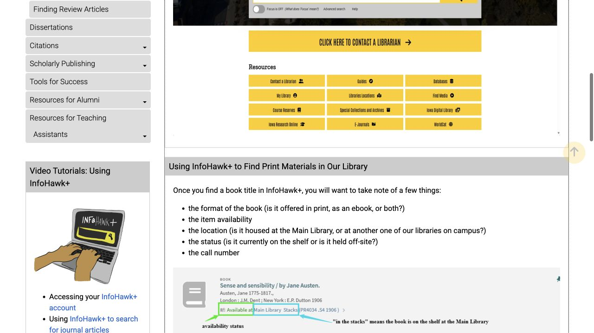
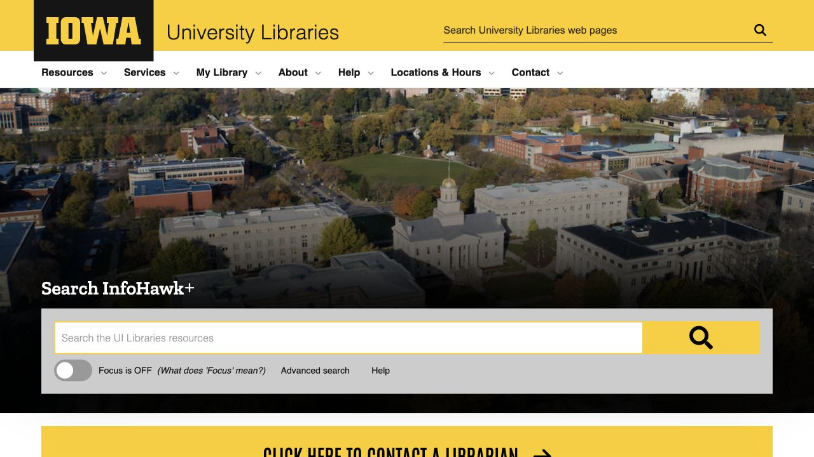

A library search often begins with something quite specific: a title from a syllabus, a paper someone cited, or a topic that still feels too broad. The steps below connect that starting point to the copy or full text you can actually use. Keep the library homepage handy while working, and bring a librarian into the process when access or searching stalls. This is ISAB’s independent guide to services operated by the libraries.

## Pick the library that fits the task

Main Library, at 125 W Washington Street, is a useful starting point for general borrowing questions and humanities or social-science materials. Hardin Library at 600 Newton Road focuses on health sciences, while Sciences Library at 120 E Iowa Avenue supports science research. Your subject can suggest a starting place, but an item’s catalog record tells you where that particular copy is held.

Searching before travelling can save an unnecessary walk between buildings. Once you have identified the holding library, check its location and access details. For Sciences Library, read the contact page for the current entrance directions and any construction notices before setting out.

- [Main Library · Location and floor plans](https://www.lib.uiowa.edu/locations/main/)
- [Hardin Library · Location and access](https://www.lib.uiowa.edu/locations/hardin/)
- [Sciences Library · Current access and contact](https://www.lib.uiowa.edu/sciences/contact/)

## A print book: check location, availability and call number

In InfoHawk+, search the title or author and open the full record. Read the format, holding library, availability or status, and call number together: these tell you which version you found, where it is and whether you can use it now. A title match may refer to an ebook, a checked-out copy, another branch or off-site storage.

For a shelf copy, save the call number and location, or take a screenshot of the record so you can ask the desk for help finding it. If a physical-item request is available, sign in and select an offered pickup point. Wait for the ready-for-pickup email before travelling; that message marks the point when the requested item has actually been prepared.

- [InfoHawk+ · Library search](https://search.lib.uiowa.edu/)
- [UI Libraries · Using InfoHawk+](https://guides.lib.uiowa.edu/hssgradstudent/catalog)

## A paper or ebook: open the full text, not just the citation

For a paper, an exact title or DOI is a useful starting search. Open the record and follow the available online-access link until you reach the readable item. A result page may contain only a citation or abstract, so check what has opened before deciding that you have the text needed for an assignment.

Match the title, authors and year to the reference you were given; for an ebook, check the edition as well. Saving the citation and DOI with your reading notes makes it easier to return to the same version later. Access depends on the libraries’ subscriptions and that item’s terms, which is why two similar-looking records may lead to different reading options.

- [InfoHawk+ · Library search](https://search.lib.uiowa.edu/)
- [UI Libraries · Find resources](https://www.lib.uiowa.edu/find/)

## At home: begin with a library link before paying

If you meet a publisher paywall at home, reopen the item through the library homepage, catalog or database list. Those links route eligible off-campus users through the access system and request HawkID when needed. A publisher page reached directly may not yet recognize the subscription access available to you.

When the library route still fails, keep the title, DOI, library link and error message for a help request. That gives staff the item and access path they need to investigate. Hardin’s off-campus access page also describes the optional LibKey Nomad browser extension if you prefer that way of finding available access.

- [UI Libraries · Off-campus access troubleshooting](https://guides.lib.uiowa.edu/c.php?g=132222&p=863309)
- [Hardin · Off-campus access and LibKey Nomad](https://www.lib.uiowa.edu/hardin/off-campus-access/)

## A research topic: choose a subject database

When a broad catalog search produces too much unrelated material, use Databases A–Z and its subject-resource route to find a database suited to your field. This is also the place to begin when an instructor names a particular database. Opening it through the library link keeps the access route connected to the subscription.

For a first search, break the topic into two or three ideas, then try alternative words for each. Note the database and search terms that produced useful results so you can build on them later. Different databases cover different kinds of material, and the choice becomes part of developing the research question.

- [UI Libraries · Databases A–Z](https://guides.lib.uiowa.edu/databases)

## No available full text? Try Interlibrary Loan

For material the libraries do not own, open Interlibrary Loan & Document Delivery, sign in and select the appropriate request for a book, article or chapter. The system also lets you follow the request’s progress. Document Delivery can provide scans from eligible print material held by the libraries, so it may also help when you need a particular article or chapter from a local printed volume.

Copy the citation carefully and distinguish a whole book from one chapter; the requested format affects how the item is supplied. Request with some lead time and work on another reading while waiting. Availability and fulfillment vary, so the request itself does not promise an immediate or guaranteed delivery.

- [UI Libraries · Interlibrary Loan and Document Delivery](https://www.lib.uiowa.edu/services/illdd/)

## For a course reading, check ICON and Course Materials+

For an assigned reading, open the course in ICON and look for the instructor’s Course Materials+ reading list. This library tool links the course list with the catalog. If the list is absent or the required item is unclear, ask the instructor how the reading is being provided rather than assuming every textbook has an included electronic copy.

Physical course reserves set aside high-demand items for short loans. Confirm the holding library and that particular item’s loan period at the desk, then plan the reading around that period. A short reserve loan supports sharing a heavily used copy, so its timing differs from an ordinary book you can keep for a longer loan.

- [UI Libraries · Course Reserves and Course Materials+](https://www.lib.uiowa.edu/services/course-reserves/)

## When searching stalls, bring the question to a librarian

A research consultation can help when you have tried a few searches but still cannot find the right sources. The library offers in-person or Zoom appointments as well as live chat and walk-up help; use the current consultation page to choose an available route. Bring the assignment, topic, due date and a couple of searches you have already tried.

Specific questions give the conversation a useful starting point: which database suits the topic, why a record only opens an abstract, or how to narrow a question. Asking while there is still time to adjust the search allows you to use the advice in the work you are doing.

- [UI Libraries · Research consultation appointments](https://www.lib.uiowa.edu/research/consultations/)

> Independently edited by ISAB · Sources checked October 18, 2026. Library links lead to services operated by the University of Iowa; ISAB does not operate the catalog, authentication or lending systems.

## Sources & useful links

- [UI Libraries · Search, locations and services](https://www.lib.uiowa.edu/)
- [Main Library · Location and floor plans](https://www.lib.uiowa.edu/locations/main/)
- [Hardin Library · Location and access](https://www.lib.uiowa.edu/locations/hardin/)
- [Sciences Library · Current access and contact](https://www.lib.uiowa.edu/sciences/contact/)
- [UI Libraries · Using InfoHawk+](https://guides.lib.uiowa.edu/hssgradstudent/catalog)
- [UI Libraries · Find resources](https://www.lib.uiowa.edu/find/)
- [UI Libraries · Off-campus access troubleshooting](https://guides.lib.uiowa.edu/c.php?g=132222&p=863309)
- [Hardin · Off-campus access and LibKey Nomad](https://www.lib.uiowa.edu/hardin/off-campus-access/)
- [UI Libraries · Databases A–Z](https://guides.lib.uiowa.edu/databases)
- [UI Libraries · Interlibrary Loan and Document Delivery](https://www.lib.uiowa.edu/services/illdd/)
- [UI Libraries · Course Reserves and Course Materials+](https://www.lib.uiowa.edu/services/course-reserves/)
- [UI Libraries · Research consultation appointments](https://www.lib.uiowa.edu/research/consultations/)
