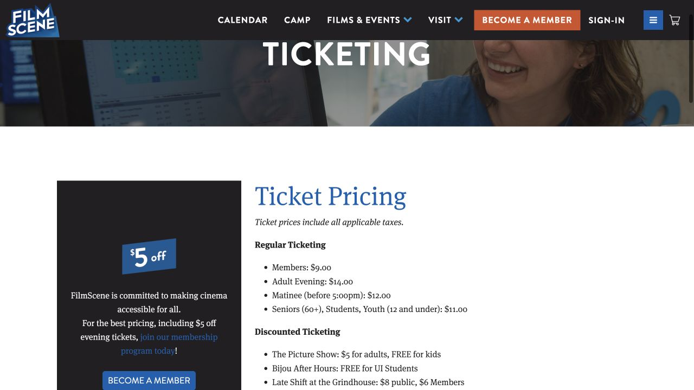

A cinema trip can be an easy evening with friends or a quiet break on your own. FilmScene is useful for discovering independent, international and repertory films, while Marcus is another place to compare commercial releases and showtimes. Choose the film and showing together: the same title can play at different addresses, with different ticket categories or accessibility features. A few minutes spent reading the listing makes the evening much easier to plan.

## Decide what you want from this evening

If you already have a film in mind, search its exact title on the cinemas’ own sites and compare dates before choosing a venue. If you want to discover something new, open FilmScene’s programme and read a synopsis, the language, running time, content information and any post-film discussion. The trailer can help you decide whether the pace and subject suit your mood. A programme labeled National Theatre Live is a cinema screening of stage work, rather than a live cast performing inside the movie theatre. Check its own ticket price and running time before treating it as an ordinary movie.

- [FilmScene · films and programme](https://icfilmscene.org/)

## FilmScene has two addresses; the ticket tells you which one

The Chauncey is at 404 E College St, Suite 100, and the Ped Mall cinema is at 118 E College St, Suite 101. Both are downtown, but they are separate venues. Read the location and auditorium beside the time before choosing seats, and navigate to that address rather than to whichever FilmScene pin your map selects first. When meeting friends, send the location as well as the film name and start time. Most shows use reserved seating, so coordinating seats before buying is easier than assuming the group can move together after arrival.

- [FilmScene · The Chauncey](https://icfilmscene.org/visit-contact/the-chauncey/)
- [FilmScene · The Ped Mall](https://icfilmscene.org/visit-contact/the-ped-mall/)

## Compare the student price with the programme’s own price

The current regular FilmScene prices, including tax, are $11 for students, $14 for adult evening tickets, $12 for matinees before 5 p.m., and $9 for members. These are regular-admission categories: rooftop screenings, National Theatre Live and other specialty programmes can cost more. Bring your student ID when using the student rate and ask the box office if your eligibility is unclear. For an occasional visit, compare a normal student ticket with the exact special event you want; membership is a separate purchase and makes sense only if its benefits suit how often you will actually attend.

- [FilmScene · ticket prices and purchase information](https://icfilmscene.org/visit-contact/ticket-prices/)

## Look for Bijou, then complete the booking

FilmScene’s ticket page lists Bijou After Hours as free for UI students. Look for a screening with that series label, open its details, and follow that showing’s reservation or ticket instructions; the offer does not make every FilmScene film free. For ordinary online purchases, nonmembers create an account, while members sign in with their member details for discounts. Confirm the venue, date, seats and final amount before paying, then save the ticket or collection instructions. The box office can answer questions at 319-358-2555, but FilmScene does not sell tickets over the phone. Its staffed box offices open one hour before the day’s first show.

## For Marcus, select the local theatre before comparing prices

The local Marcus pages are Sycamore Cinema in Iowa City and Coral Ridge Cinema in Coralville. Select the theatre and the intended date on its own page, then compare the available times, formats and seats. The chain advertises Student Thursdays at $7.50 for students and faculty with a valid school ID at participating locations; check the current offer and the chosen cinema before relying on it, including any format or special-event exclusions and extra charges. A regular screening and a premium-format showing need not have the same total. For theatre-specific questions, the official contacts list gives Sycamore 319-358-6773 and Coral Ridge 319-625-2100.

- [Marcus · Sycamore Cinema](https://www.marcustheatres.com/theatre-locations/sycamore-cinema)
- [Marcus · Coral Ridge Cinema](https://www.marcustheatres.com/theatre-locations/coral-ridge-cinema)
- [Marcus · current value offers](https://www.marcustheatres.com/marcus-specials/value-pricing/5-dollar-student-thursdays)

## Captions are a feature of the showing, not an automatic translation

If English subtitles would help you follow dialogue, look for a screening explicitly marked Open Captions, meaning text appears on the main screen for everyone. Closed Captions usually use an individual device collected at the box office; check the film’s accessibility icons and ask staff to show you how it works before the film starts. Captioning does not mean Chinese translation, and a foreign-language film’s translation subtitles are a separate part of its presentation. FilmScene publishes an open-caption schedule and explains available devices. Marcus also provides captioning and other assistive devices for compatible films at many theatres; ask the selected location about that exact showing.

- [FilmScene · open-caption showtimes](https://icfilmscene.org/open-captions/)
- [FilmScene · accessibility and devices](https://icfilmscene.org/visit-contact/accessibility/)
- [Marcus · assistive technology](https://www.marcustheatres.com/amenities/theatre-technology/accessibility-devices)

## At the cinema, make the first few minutes easy

Aim to arrive about 15–20 minutes before the stated time if you need to collect tickets, buy a snack or ask about a device. Use the time to find the correct auditorium and seat instead of assuming there will be a long trailer buffer. If anything on the ticket is unclear, show it to staff before entering. Once seated, silence the phone and put its bright screen away; keep conversations outside the auditorium and follow the cinema’s rules on food and recording. Leave accessible and companion spaces available for the people who require them, and ask staff if the seating arrangement is difficult for you.

## Choose the return trip with the same care as the showtime

A late film can finish after a useful bus service has ended. Add the running time and a little departure time to the advertised start, then check the actual return timetable for that day. A matinee or earlier evening showing can be easier if you depend on transit. Chauncey connects to the Chauncey Swan parking ramp; the Ped Mall location has nearby downtown ramps. Read the posted parking terms rather than assuming the two locations offer the same rate. If a group plans to share a ride, agree on the pickup point before the film and wait somewhere well lit after it ends.

> Independently edited by ISAB · Sources checked October 18, 2026. Ticket availability, prices and entry arrangements can change; use the linked presenter or cinema for the performance you choose.

## Sources & useful links

- [FilmScene · programme](https://icfilmscene.org/)
- [FilmScene · tickets, student price and Bijou](https://icfilmscene.org/visit-contact/ticket-prices/)
- [FilmScene · Chauncey location](https://icfilmscene.org/visit-contact/the-chauncey/)
- [FilmScene · Ped Mall location](https://icfilmscene.org/visit-contact/the-ped-mall/)
- [FilmScene · open captions](https://icfilmscene.org/open-captions/)
- [FilmScene · accessibility](https://icfilmscene.org/visit-contact/accessibility/)
- [Marcus · Sycamore Cinema](https://www.marcustheatres.com/theatre-locations/sycamore-cinema)
- [Marcus · Coral Ridge Cinema](https://www.marcustheatres.com/theatre-locations/coral-ridge-cinema)
- [Marcus · value pricing](https://www.marcustheatres.com/marcus-specials/value-pricing/5-dollar-student-thursdays)
- [Marcus · accessibility devices](https://www.marcustheatres.com/amenities/theatre-technology/accessibility-devices)
- [Marcus · location contacts](https://www.marcustheatres.com/contact/faq/theatres-location-contacts)
