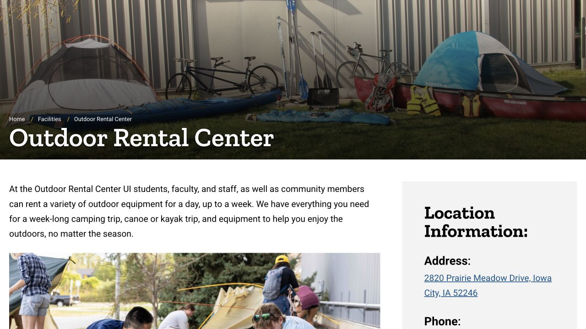

An outdoor break can be a walk that fits between assignments rather than a full day trip. Iowa City has parks where you can choose a short out-and-back, a defined lake circuit or woodland paths. Pick a starting address and a turnaround plan, then look at weather, daylight and the trip home. The three ideas below use public city parks; sports programs and equipment rentals have their own separate booking arrangements.

## City Park: choose a short riverside walk rather than a fixed mileage goal

City Park is at 200 E Park Road. The city lists riverfront paths, open space, picnic shelters and sports courts, making it a flexible place for a walk with friends. Start from a marked park entrance or parking area, use the city map to orient yourself and follow the paths that are open that day. For a first visit, an out-and-back is easy to shorten if the weather changes.

A simple plan is to choose a turnaround time—perhaps after fifteen minutes—rather than following an unfamiliar path until you are tired. That is a suggested itinerary, not an official route distance. Seasonal amenities such as the pool or ice skating have their own operating conditions; their presence on the park’s amenity list does not mean they are operating during your visit.

- [City Park address, map and amenities](https://www.icgov.org/Home/Components/FacilityDirectory/FacilityDirectory/26/252)

## Terry Trueblood: a lake circuit with a clear starting point

Terry Trueblood Recreation Area is at 579 McCollister Boulevard. The city’s South District plan describes a two-mile bicycle/pedestrian circuit around Sand Lake, about 3.2 kilometres. Use the park map and open paths to follow the lake circuit, returning to the same entrance; the full outing will be longer if you also walk or cycle there. You can turn around early instead of completing the circuit.

The current city Parks and Trails page states that swimming is not permitted here because of low water levels and water-quality challenges. Treat that as a current restriction, even if an older guide mentions a beach. Walking by the lake and entering the water are separate activities; a rental or old event advertisement does not remove a posted restriction.

- [Current city parks notices, including the no-swimming notice](https://www.icgov.org/government/departments-and-divisions/parks-and-recreation/parks-and-trails)
- [Official South District plan · lake circuit description](https://www.icgov.org/home/showpublisheddocument/2700/638834135430870000)

## Hickory Hill: choose a woodland walk and allow for the ground underfoot

The city lists Hickory Hill Park at 800 Conklin Street, with natural areas, trails, a parking lot and picnic facilities. It is an alternative when you want a park walk rather than a workout around a playing field. Check the map before entering, remember the entrance you used and choose a manageable out-and-back on your first visit.

Wear shoes you are comfortable walking in on uneven or wet ground and leave time to return before dark. Trail length depends on which paths you combine, so this guide does not attach an invented single loop distance to the whole park. If a path is muddy, blocked or closed, shorten the walk or choose another open route.

- [City park directory · Hickory Hill address and amenities](https://www.icgov.org/government/departments-and-divisions/parks-and-recreation/parks-and-trails/parks)

## A bike outing includes the route to the park and the way home

The city’s Parks and Trails page links its interactive park map and trail information. Use these to connect your starting point to the park, then check the road crossings and the route back. A trail segment shown on a map is only one part of the journey; the street or crossing at either end can change how comfortable a first ride feels.

A suggested first ride is a nearby route you can repeat in daylight, with a helmet, lights, water and a charged phone. Leave room for people walking, signal before passing and follow the posted rules for the specific path. For an e-bike or scooter, confirm the rules for the vehicle and place rather than assuming every path allows the same use. The separate cycling note covers choosing a bike and local shops.

- [City park map and trail-planning entry](https://www.icgov.org/government/departments-and-divisions/parks-and-recreation/parks-and-trails)

## You can try outdoor equipment before buying a full set

The Outdoor Rental Center at 2820 Prairie Meadow Drive rents equipment to students and community members, including bicycles, camping gear and snow equipment. Use its public request form at least three business days before the requested date, then wait for staff to confirm availability and pickup arrangements. Submitting the form alone does not reserve an item.

The published road and mountain bike rates are $20 for a daily rental or $40 for a weekend, including a helmet. Weekend rentals use the weekend rate and are due back during Monday open hours. Renters must be at least eighteen and bring photo ID. Ask how you will transport the item and confirm the exact collection and return times; different sections of the page show different general opening-day descriptions, so the confirmation matters.

- [Equipment, prices, request form and pickup policy](https://recserv.uiowa.edu/outdoor-rental-center)

## Weather and seasonal access shape the plan

Check the city’s current notices and the weather before leaving. In cooler months, allow for an earlier sunset and surfaces that can stay wet or icy in shade. Take a layer you can add when you stop moving, and carry water instead of depending on a drinking fountain being available. A shorter route near home can be the better afternoon plan when conditions are uncertain.

Snow clearing does not guarantee an ice-free trail. Follow barriers and closure notices, and change routes when a path is flooded or slippery. For a social outing, share the meeting entrance and the intended finishing time so a late arrival can find the group without searching the whole park.

## A low-effort weekend plan

You could begin with City Park for a flexible walk and a picnic, then save the full Terry Trueblood lake circuit for a day when you know the transport and forecast work. Bring food you can carry, take rubbish home and leave the park in time for the return journey. These are example plans rather than organized ISAB events.

If renting equipment, make the reservation and transport arrangements before inviting a group. A public trail walk, a rental contract and a guided adventure trip involve different commitments. The official recreation pages are where you can check availability and book any paid activity; the park walk itself does not require applying through this guide.

> Independently edited by ISAB · Sources checked October 18, 2026. Check current park restrictions, weather, trail access and rental confirmation before travelling.

## Sources & useful links

- [Iowa City · Parks, maps and current notices / 公园地图与当前公告](https://www.icgov.org/government/departments-and-divisions/parks-and-recreation/parks-and-trails)
- [Iowa City · City Park / 城市公园](https://www.icgov.org/Home/Components/FacilityDirectory/FacilityDirectory/26/252)
- [Iowa City · Park directory / 公园地址与设施](https://www.icgov.org/government/departments-and-divisions/parks-and-recreation/parks-and-trails/parks)
- [Iowa City · South District plan / 环湖路线官方描述](https://www.icgov.org/home/showpublisheddocument/2700/638834135430870000)
- [Recreation · Outdoor Rental Center / 户外装备租借](https://recserv.uiowa.edu/outdoor-rental-center)
