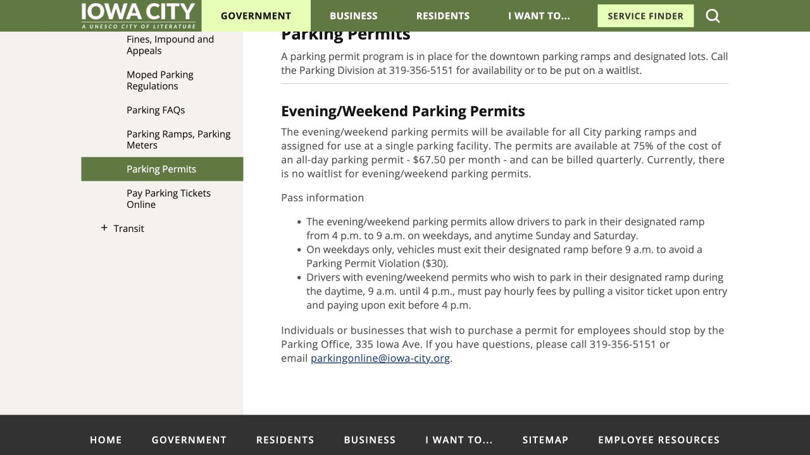
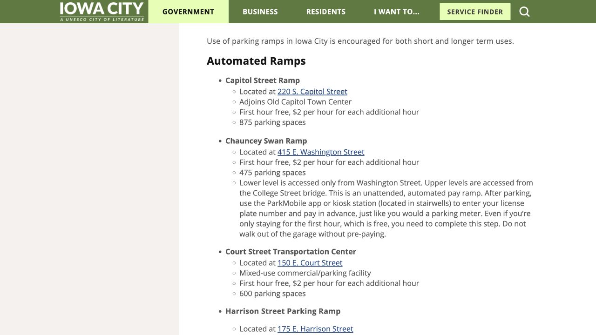

A parking permit is useful when its location and valid hours match your routine. Someone driving to a morning lab needs a different arrangement from someone who keeps a car near an apartment and visits downtown in the evening. Write down where you go, when you arrive and leave, how many days you drive, and whether your lease includes parking. Those details will help you compare the campus and city options below.

## Choose a recurring permit or an occasional paid visit

For a regular commute, compare the full permit cost with the walk or bus ride between the lot and your building. For an occasional library visit or errand, compare hourly parking with your actual number of trips. A distant lot may have an attractive price, but its usefulness depends on a connecting bus still running when you finish. The lot map and service calendar belong in the same decision.

Campus parking and city ramps are operated separately, so a permit applies to the facilities named in that product. Ordinary permits also do not reserve one particular stall for you. Before buying, check the location, restrictions and availability, including what the operator advises when the facility is full.

## Campus route: first check which permits you can actually buy

The Student Parking page organizes choices by student status and residence: living in a residence hall, being an undergraduate inside Iowa City/Coralville, commuting as an undergraduate from outside those city limits, or being a graduate/professional student. Select the category that describes your current situation, then read the detailed page for the product you are considering.

For example, the Lot 85 page lists undergraduates commuting from outside Iowa City/Coralville and graduate students as eligible, subject to space. An undergraduate apartment inside Iowa City does not by itself create commuter-permit eligibility. When the overview and detailed rules leave your own address or status unclear, call campus parking at 319-335-1475 and explain both before making a purchase.

## Prepare the actual plate before opening the portal

Have your campus login, current contact information and exact license plate ready. The registered plate is the credential for a virtual permit, and a student permit covers one registered vehicle. Accurate vehicle details matter when enforcement checks the car, so update the permit after a vehicle change or after replacing a temporary plate with a permanent one.

Campus guidance asks owners of vehicles with a temporary or dealer plate to contact the parking office so the full VIN can be added. A temporary-plate procedure used in a paid-parking app may be different. Also check whether your chosen location needs an access card: virtual registration identifies the permit, while some gates still use a separate card.

## Order directly in the campus Parking Portal

From the official Student Parking page, follow Parking Portal and sign in with your campus account. Open the permit-ordering route and compare the products your account can buy with the lot map. The full product name and lot number should match the place you intend to use. If that product is missing or unavailable, ask the parking office about help or a waitlist.

Select the correct vehicle, review the validity dates and terms, and choose a payment method offered on the page; student guidance lists online payment or billing to the student account. After purchase, keep the confirmation email and check the plate, permit, dates and payment. For a gated product, arrange the access card before your first trip. The Portal Info source below includes the official ordering and vehicle-update tutorials.

- [Open the campus purchase portal](https://parking.uiowa.edu/)

## Read the semester price, not just the monthly number

The student rates effective July 1, 2026 give useful comparisons: Lot 85 is $18 per month or $81 per semester; graduate/professional Lot 65 is $29 per month or $130.50 per semester; student Night Weekend is $8 per month or $36 per semester. Use the price for a product you are eligible to buy and compare the semester amount with your budget.

Academic-year permits cover August 16 through May 15, with a separate summer period from May 16 through August 15. The monthly figure is a comparison rate within that arrangement, so read the actual dates and amount shown at checkout rather than planning on an ordinary one-month subscription.

## Night Weekend: the permit costs money; the parking benefit has limits

The student Night Weekend, or NW, product is for eligible students living outside residence halls. Its published gate-entry window is Monday–Friday 4:30 p.m.–4:29 a.m. and all weekend in participating facilities. Hospital Parking Ramps 1, 2 and 4 are excluded. Open the detailed NW page to check the current facility list against your destination.

At entry and exit, use the access card even when the gate is raised; entering on a visitor ticket changes the transaction. The page lists hourly charges for weekday parking from 8:31 a.m. to 4:29 p.m. and describes a stay from 4 a.m. to 4 p.m. as misuse. If you plan to leave after an overnight stay, ask the office how your precise departure time is treated. The useful comparison is your full stay, including the morning after.

## Before leaving town: check billing and cancel properly

Student parking is billed for fall and spring, with the second installment charged January 1. A credit card used in fall is not stored for spring; the spring charge goes to the student billing account. The NW and Lot 85 pages explain that the permit financially renews into spring unless it is cancelled. This matters if you leave town or stop driving before the next installment.

Use the official Cancel Permit Form when the permit is no longer needed, and keep its confirmation. Charges continue until cancellation or expiry. The published calculation uses half months: cancellation on the 1st–15th produces a half-month final charge, and cancellation on the 16th onward produces a full-month final charge. Read the next semester’s sales and renewal notice as well, since your circumstances and available products may change.

## City route: ask for a ramp and a time window

For a city ramp, contact the Parking Office at 319-356-5151 or 335 Iowa Avenue with the ramp you want to use. Ask about availability or a waitlist, then confirm what contact, billing, vehicle and access-card information is needed, how collection works, and how the permit renews or ends. The public page routes purchase questions through this office.

The city code lists a prepaid all-day ramp permit at $90 per month. The evening/weekend product is $67.50 per month, can be billed quarterly and applies to one assigned ramp: weekdays 4 p.m.–9 a.m. and all Saturday/Sunday. A weekday stay needs to end before 9 a.m. to remain within that window. For daytime use from 9 a.m.–4 p.m., follow the visitor-ticket and hourly-payment procedure and pay and exit before 4 p.m. Confirm the current terms and your preferred ramp’s availability; an overall notice about no evening-permit waitlist does not establish availability in a particular building.

- [City ramp permits and purchase office](https://www.icgov.org/government/departments-and-divisions/transportation/parking/parking-permits)

## Only visiting downtown? A free first hour still has a procedure

City ramps list a free first hour followed by $2 for each additional hour, but the payment procedure depends on the ramp. At Chauncey Swan and Harrison Street, enter the plate at the kiosk or in ParkMobile and start a session before walking away, including for a visit within the free hour. Other facilities may use an entry ticket and payment on exit, so read the equipment and signs where you park.

For a short downtown or library trip, choosing the closest suitable ramp also means knowing that procedure before leaving the car. Campus ramps have their own charges. At a street meter, follow the posted maximum stay, which still applies when the payment system allows more money to be added.

> Independently edited by ISAB · Sources checked October 18, 2026. Confirm current hours, costs and applicable terms through the linked sources before travelling or purchasing.

## Sources & useful links

- [Campus · Student eligibility, ordering & billing / 校园学生购证说明](https://transportation.uiowa.edu/parking/student-parking)
- [Campus · Parking Portal / 校园停车购证入口](https://parking.uiowa.edu/)
- [Campus · Portal ordering & vehicle tutorials / 购证和车辆修改教程](https://transportation.uiowa.edu/parking/license-plate-recognition/parking-portal-info)
- [Campus · Plates & virtual permits / 车牌与虚拟许可](https://transportation.uiowa.edu/parking/license-plate-recognition)
- [Campus · Lot 85 eligibility / Lot 85 通勤许可资格](https://transportation.uiowa.edu/parking/student-parking/student-hawkeye-commuter-permit)
- [Campus · Current rate table / 当前价格表](https://transportation.uiowa.edu/parking-rates)
- [Campus · Student Night Weekend rules / 学生夜间周末许可规则](https://transportation.uiowa.edu/parking/student-parking/student-night-weekend-permit)
- [Iowa City · Permits & office purchase route / 城市许可与办理入口](https://www.icgov.org/government/departments-and-divisions/transportation/parking/parking-permits)
- [Iowa City · Current parking fee code / 城市现行停车收费表](https://codelibrary.amlegal.com/codes/iowacityia/latest/iowacity_ia/0-0-0-1146)
- [Iowa City · Ramp locations & payment steps / 停车楼位置和缴费方法](https://www.icgov.org/government/departments-and-divisions/transportation/parking/parking-ramps-parking-meters)
