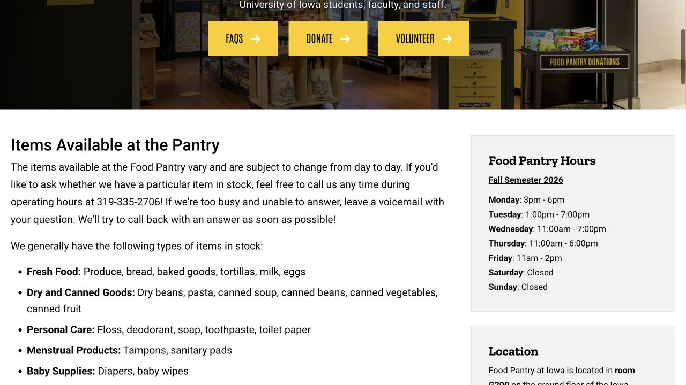

The handbook lists several support services, but a list of names can still leave you wondering where your own problem belongs. Food running short, an unexpected housing problem and a difficult presentation call for different kinds of help. You can describe the situation in ordinary language and let the relevant service explain its options. This guide turns those names into a route: who to approach, what to prepare and what happens next.

## An unexpected problem affecting several parts of life: Student Care and Assistance

Student Care and Assistance coordinates help when illness, a family death, an off-campus living problem or another unexpected event is affecting your studies. It supports undergraduate, graduate, professional and postdoctoral students through in-person, virtual or phone meetings. Use its public Make an appointment link or call 319-335-1162 to explain the situation and ask where to begin.

For example, if a hospital visit has left you unsure how to speak with instructors and manage practical needs, you can say exactly that. Bring a short timeline, the classes or deadlines affected and what needs attention first. The team can help connect the relevant offices; the service’s page currently mentions a temporary Calvin Hall office, so confirm the meeting location before travelling.

- [Student Care and Assistance · Appointment and contact](https://dos.uiowa.edu/assistance)

## Food, housing or money worries: book a Basic Needs conversation

The Basic Needs page provides an appointment with an advisor who works on food access, housing stability and finances. You can use it when a problem is building gradually, as well as after an unexpected event. A useful opening is specific: “My grocery money will not last until next month,” or “I may have a gap between leases.”

Before the meeting, note the immediate deadline, what you have already tried and the kind of help you need. The advisor can discuss campus and community resources and relevant applications. Program eligibility is considered by the provider; you do not need to decide in advance which named fund or program fits perfectly.

- [Basic Needs · Advisor booking and resources](https://dos.uiowa.edu/basic-needs)

## Food Pantry: bring your card and a bag to IMU G200

The Food Pantry provides free groceries and basic items to eligible campus users, with no specific income requirement. It is in G200 on the IMU ground floor. Bring your Iowa One Card and reusable bags, sign in at the entrance and follow the item limits. At checkout, volunteers record the visit and weigh the groceries; there is no grocery bill. Available food and toiletries vary.

Current rules allow one visit per school week, resetting on Monday. Fall 2026 hours are Monday 3–6 p.m., Tuesday 1–7 p.m., Wednesday 11 a.m.–7 p.m., Thursday 11 a.m.–6 p.m. and Friday 11 a.m.–2 p.m.; weekends are closed. Check the live page around breaks. Ask a volunteer about a dietary requirement or unfamiliar ingredient rather than relying on a fixed list of what will be in stock.

- [Food Pantry · Current hours, location and rules](https://foodpantry.org.uiowa.edu/)
- [Pantry FAQ · Eligibility and income question](https://foodpantry.org.uiowa.edu/frequently-asked-questions)

## Need prepared meals? Hawkeye Meal Share has a request route

Hawkeye Meal Share provides short-term dining-marketplace meal support to eligible students facing food insecurity, subject to donated meal availability. Open Request meals on the official page and complete that provider’s request. Current allocations are seven swipes, with requests limited to two per semester. Student Care and Assistance follows up about eligibility and obtaining meals.

The page’s current high-demand notice says requests are reviewed within four business days, while an older paragraph below mentions twenty-four hours. Plan around the high-demand notice and contact 319-335-1162 directly if you have an immediate need. Keep a pantry or advisor conversation in your plan while waiting, rather than assuming a form submission means meals are already available.

- [Hawkeye Meal Share · Current notice and request link](https://dos.uiowa.edu/assistance/hawkeye-meal-share)

## An unforeseen emergency expense: ask about the Emergency Fund

The Student Life Emergency Fund is for enrolled undergraduate, graduate and professional students facing an unforeseen financial emergency that could interrupt their education. Examples on the official page include major accidents, urgent safety needs and travel following an immediate family member’s death. It is not intended for routine ongoing expenses, and funds cannot pay university tuition or fees.

The page reports awards averaging $500, at most once per academic year; this is not a promised amount. Read the eligibility questions and use the official application route if it fits. A short explanation of what happened, when payment is needed and the resources already considered will make an advisor conversation more concrete. Ask the office if the circumstances or documentation requirements are unclear.

- [Student Life Emergency Fund · Eligibility and application](https://dos.uiowa.edu/assistance/student-life-emergency-fund)

## For a paper or presentation, book the current Writing Center system

The Writing Center offers free help with writing and presentations for students across disciplines. Its current homepage has appointment and document-review routes. For a first appointment, register in the linked system and activate the account through the email it sends to your full campus email address. Bring the assignment, any draft and two or three questions, such as how to organize an argument or make a five-minute talk clear.

Older handbook links may point to a separate Speaking Center calendar. That old system states that speaking appointments moved to the Writing Center in Fall 2023. Use the current Writing Center entry for presentation support. Tutors give feedback and help you develop the work; they do not take over editing the whole paper for you.

- [Writing Center · Current appointment and review entry](https://writingcenter.uiowa.edu/)
- [Writing Center FAQ · What to bring and presentation support](https://writingcenter.uiowa.edu/services/frequently-asked-questions)
- [Former Speaking Center · Notice about the move](https://uiowa.mywconline.net/)

## A lease or other legal question: request a Student Legal Services consultation

Student Legal Services offers enrolled students free consultations with licensed attorneys, in person or on Zoom. Its current appointment page asks you to email student-legal@uiowa.edu with a description of the issue and your student ID number, then complete the service’s intake process. Relevant leases, messages or photographs can be provided directly to the service before the meeting.

For example, if a landlord has proposed a charge you do not understand, gather the lease, the written charge and the relevant correspondence so the question is clear. The website notes that appointments are forty-five minutes. The office can explain whether it can assist or provide a referral; its scope and any representation arrangements must be confirmed with the attorneys.

- [Student Legal Services · Current appointment instructions](https://studentlegal.uiowa.edu/schedule)

## Make the next step easy to follow after the conversation

At the end of an appointment, write down the agreed next action, who is handling it and when you should expect a response. If several offices are involved, keep their confirmations together. A useful follow-up question is, “If I do not hear back by this date, which office should I contact?” That turns a helpful conversation into something you can act on.

Use each provider’s own appointment, upload and contact routes for personal records. ISAB’s website helps you find the service; the provider assesses eligibility, handles documents and makes the appointment. If the first route does not fit, describe what you still need and ask for a referral rather than treating one unavailable appointment as the end of the search.

> Independently edited by ISAB · Sources checked October 18, 2026. Service eligibility, privacy terms, appointments and applications are handled directly by the linked providers.

## Sources & useful links

- [Student Care and Assistance · Support and contact / 综合协助与联系](https://dos.uiowa.edu/assistance)
- [Basic Needs · Advisor and resources / 顾问与资源](https://dos.uiowa.edu/basic-needs)
- [Food Pantry · Current visit rules and hours / 当前使用规则与时间](https://foodpantry.org.uiowa.edu/)
- [Food Pantry FAQ · Eligibility / 资格](https://foodpantry.org.uiowa.edu/frequently-asked-questions)
- [Hawkeye Meal Share · Requests / 餐食支持申请](https://dos.uiowa.edu/assistance/hawkeye-meal-share)
- [Student Life Emergency Fund · Eligibility / 紧急资助条件](https://dos.uiowa.edu/assistance/student-life-emergency-fund)
- [Writing Center · Current booking entry / 当前预约入口](https://writingcenter.uiowa.edu/)
- [Writing Center FAQ · Writing and presentations / 写作与演讲支持](https://writingcenter.uiowa.edu/services/frequently-asked-questions)
- [Former Speaking Center · Move announcement / 迁移公告](https://uiowa.mywconline.net/)
- [Student Legal Services · Appointment instructions / 咨询预约说明](https://studentlegal.uiowa.edu/schedule)
