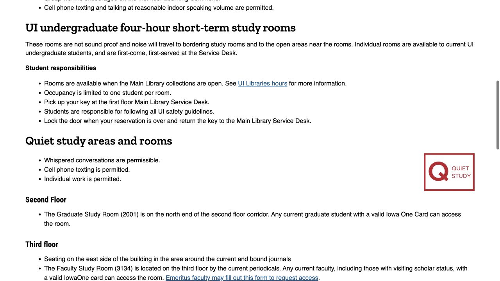
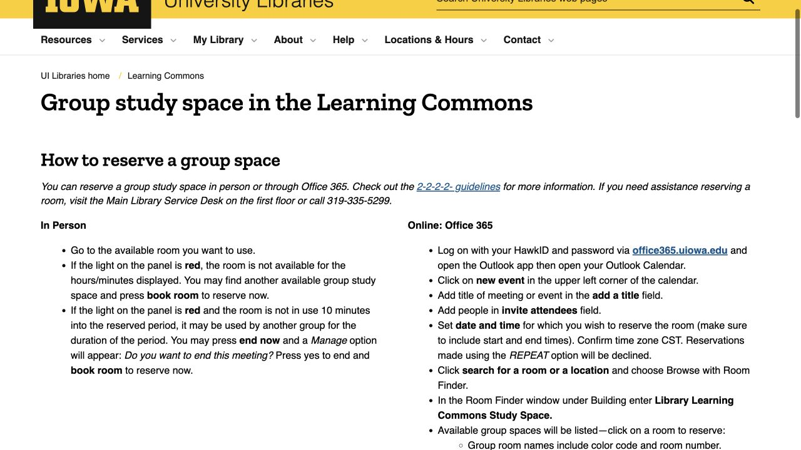

Reading on your own, discussing a project and attending an online meeting need different kinds of space. Choosing that setting first makes the room map and booking rules easier to use. The guide below explains where to look, how a reservation becomes confirmed and what to do on arrival. ISAB provides the route; current availability and bookings are handled by the libraries.

## Choose a work setting, then check the day’s hours

Main Library’s first-floor Learning Commons is designed for collaborative work, with group rooms, tables and lounge seating. A designated quiet or silent area is a better starting place for sustained individual reading. Thinking about the task before choosing a floor helps you settle into an environment where the people around you expect the same kind of activity.

For a late visit, check the dated hours: the building, collections and café can follow different schedules. Allow for the return journey and keep one alternative location in mind if the space you want is busy. That small amount of planning can save you from moving your whole study session after arriving.

- [Main Library · Learning Commons](https://www.lib.uiowa.edu/commons/)
- [UI Libraries · Current opening hours](https://www.lib.uiowa.edu/hours/)

## Quiet study: use the map instead of assuming a whole floor

Use the Main Library quiet/silent map to locate a specific zone. Quiet seating includes the east-side journal area on the third floor and book-stack areas on floors four and five. The map and posted labels give a more accurate guide than treating every part of an upper floor the same way.

Graduate students with a valid Iowa One Card can access the Graduate Study Room, room 2001 at the north end of the second-floor corridor. Wherever you settle, move calls or conversation to the central corridors and follow the area’s quiet/silent signs. That lets a shared study environment work for the next reader as well.

- [Main Library · Study spaces and lockers](https://www.lib.uiowa.edu/about/studyspaces/)
- [Main Library · Quiet and silent study map (PDF)](https://www.lib.uiowa.edu/about/files/2012/10/map-of-quiet-study-spaces.pdf)

## Main group booking: HawkID → Outlook → Room Finder

For a Main Library student group room, sign into UI Office 365 with HawkID and open Outlook Calendar. Create an event with the group’s attendees, start and end times, then use Room Finder. Search the building name “Library Learning Commons Study Space” and select an available room from its list before saving or sending the event.

Check the time zone and look for the room’s acceptance email. A declined room can leave the event visible in your own calendar, so the acceptance response is the useful confirmation to share with the group. Repeating bookings are declined; use an individual eligible session for each actual meeting.

- [Learning Commons · How to reserve a group space](https://www.lib.uiowa.edu/commons/group-spaces/)
- [UI Office 365 · Sign in and open Outlook Calendar](https://office365.uiowa.edu/)

## Remember the 2-2-2-2 rule before choosing a slot

Learning Commons group-room rules use four twos: at least two students in the group, a booking of up to two hours, up to two reservations per student each week, and a booking window no more than two weeks ahead. If the group has not arrived within ten minutes, the reservation is lost. Choose the slot with those limits and everyone’s arrival time in mind.

Once accepted, keep the response and share the room name and time with the participants. If plans change, or you cannot tell how the room responded, the Main Library Service Desk can help release or correct the booking. Following up leaves the space available for other students when your group will not use it.

- [Learning Commons · 2-2-2-2 and no-show policy](https://www.lib.uiowa.edu/about/policies/group-spaces/)

## At the door: read the panel and pick the right kind of room

The room’s door panel displays its booking status. For an available space, the official guide describes making a local reservation through that panel, so read and follow the screen before settling in. A room can be temporarily empty during a booked session.

The standard color-striped group rooms hold up to six people; larger rooms and open spaces have different layouts. Match the space and listed equipment to the group, particularly when planning to share a screen. Whiteboard markers and erasers can be borrowed from the Service Desk. For help with a room or its booking, ask the first-floor desk or call 319-335-5299.

- [Learning Commons · How to reserve a group space](https://www.lib.uiowa.edu/commons/group-spaces/)

## An individual room follows a different route

Main Library’s short-term individual study rooms are for current undergraduates, one student per room, for a four-hour use period. While the collections are open, ask the first-floor Service Desk about first-come-first-served availability and collect the key there. Return it after finishing. These rooms are not soundproof, so ask about suitability before relying on one for an interview or other call.

Long-term research rooms are allocated through a separate eligibility-based arrangement. For an ordinary solo session, an open quiet seat may be all you need; if you require a room, explaining the task to the desk helps staff direct you to the appropriate option.

- [Main Library · Study spaces and lockers](https://www.lib.uiowa.edu/about/studyspaces/)

## Hardin uses its own booking calendar

Hardin uses its own live group-room calendar. Open its official Study Rooms link, choose an available slot and use your campus email; the confirmation includes a cancellation route. There are eleven reservable group rooms. A booking can be cancelled for solo use or if the group is fifteen minutes late, so arrange arrival with the people who will use it. Fourth-floor individual rooms operate first come first served and cannot be reserved.

Hardin also has a third-floor twenty-four-hour quiet study area for eligible university faculty, students and staff using an accepted UI or UI Health Care badge outside normal hours. This describes that designated area’s access arrangement. Check the space page and booking prompts for the current badge requirements and entrance instructions before a late visit.

- [Hardin · Study rooms and 24-hour study access](https://www.lib.uiowa.edu/hardin/information/spaces-at-hardin/)
- [Hardin · Live group-room availability and booking](https://uiowa.libcal.com/reserve/hardin-groupstudy)

## Food, bags and a useful backup plan

Main Library permits food and drink in many areas, with restrictions near computers, copiers/printers and certain departments. Branches can have different policies, so use the signs where you sit and clean up afterwards. The Learning Commons near Madison Street lists daily-use lockers, while allocated longer-term lockers have a separate application route.

A light bag with headphones and a charger is a useful starting setup. If you need to speak in a meeting or cannot find the right type of seat, explain that at the desk rather than moving into a quiet room and hoping it will work. Matching the task to the space helps you stay settled and makes the session more productive.

- [UI Libraries · Food and drink policy](https://www.lib.uiowa.edu/about/policies/fooddrink/)
- [Main Library · Study spaces and lockers](https://www.lib.uiowa.edu/about/studyspaces/)

> Independently edited by ISAB · Sources checked October 18, 2026. Follow current library hours, access rules and booking confirmations. ISAB does not reserve rooms or display live room availability.

## Sources & useful links

- [Main Library · Learning Commons](https://www.lib.uiowa.edu/commons/)
- [Main Library · Study spaces and lockers](https://www.lib.uiowa.edu/about/studyspaces/)
- [Main Library · Quiet and silent study map (PDF)](https://www.lib.uiowa.edu/about/files/2012/10/map-of-quiet-study-spaces.pdf)
- [Learning Commons · How to reserve a group space](https://www.lib.uiowa.edu/commons/group-spaces/)
- [Learning Commons · 2-2-2-2 and no-show policy](https://www.lib.uiowa.edu/about/policies/group-spaces/)
- [UI Office 365 · Sign in and open Outlook Calendar](https://office365.uiowa.edu/)
- [Hardin · Study rooms and 24-hour study access](https://www.lib.uiowa.edu/hardin/information/spaces-at-hardin/)
- [Hardin · Live group-room availability and booking](https://uiowa.libcal.com/reserve/hardin-groupstudy)
- [UI Libraries · Food and drink policy](https://www.lib.uiowa.edu/about/policies/fooddrink/)
- [UI Libraries · Current opening hours](https://www.lib.uiowa.edu/hours/)
