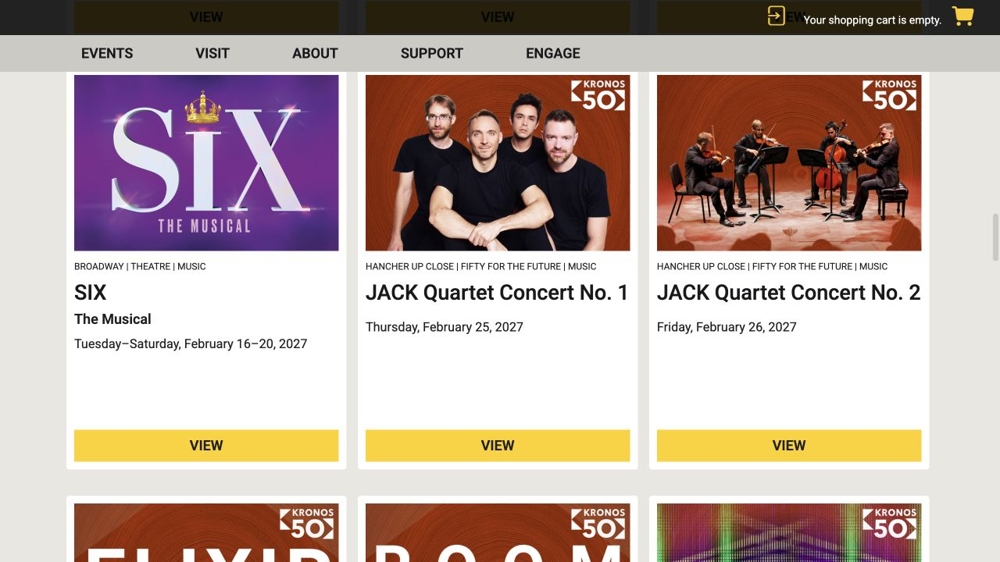
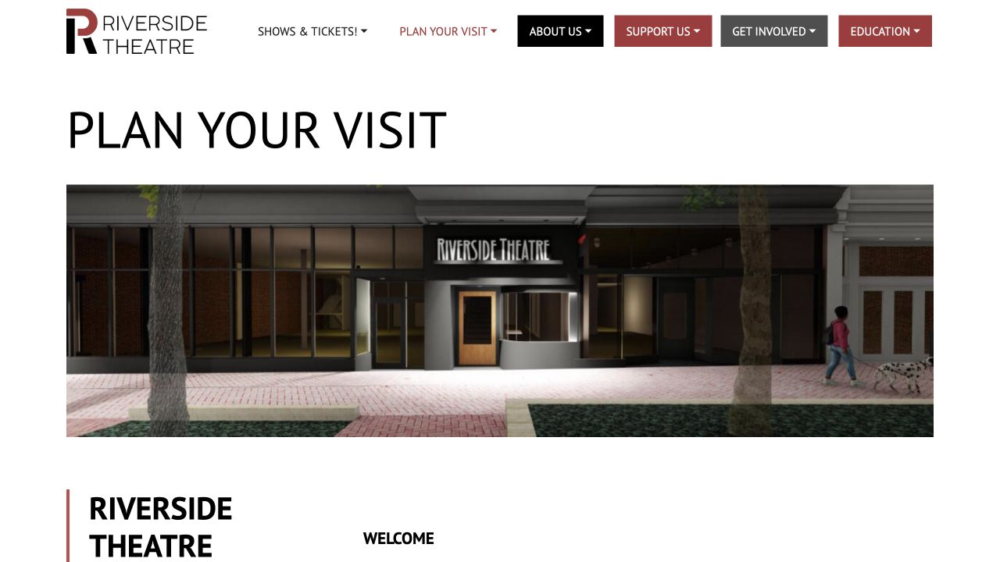

A live performance can turn an ordinary week into something to look forward to, and you do not need to know theatre well to begin. Iowa City offers different kinds of evenings: a touring production at Hancher, a play at Riverside, or a new piece made on campus. Decide what sounds interesting, then follow that production’s own ticket and venue information. Buying through the same box office does not mean two events have the same student discount or take place in the same building.

## Choose the kind of evening before choosing a seat

For a first musical, read a short plot description and listen to a few officially released songs; knowing the setting and main characters can make fast lyrics easier to follow. A play may put more weight on spoken dialogue, while a dance or instrumental performance offers another starting point if an evening of unfamiliar English feels tiring. Read the running time, interval information and content guidance on the individual event page. If you are inviting a friend, agree on the total budget and a date before one person buys a nonrefundable ticket. You can enjoy a familiar story without studying every line in advance.

## Use Hancher’s current season as the starting point

Hancher presents touring and visiting artists, including Broadway productions, music and dance. Open the current season, choose an event, and check both the date and the venue printed on its page. For a multi-performance run, compare weekday evenings with weekend matinees rather than assuming every date has the same seats or prices. An older poster shared in a group chat can be useful for discovering a title, but use the present event listing to find the actual performance. If a search result lands on a resale site, return to Hancher’s own site before buying.

- [Hancher · current season](https://hancher.uiowa.edu/2026-27)

## Student tickets depend on who presents the show

When a Hancher-presented performance offers a college student ticket, students enrolled in a college or university degree program can use that rate and must bring a valid student ID. Each eligible college student may also buy one guest ticket at the offered student rate. Campus Theatre Arts, Music and Dance productions use a different distinction: a UI Student ticket is for an enrolled Iowa student, with a separate college rate for students elsewhere, and that student price does not extend to a guest. Choose the category that matches both the presenter and each person attending, and check which discounts the selected performance offers. There is no year-round rule that every student ticket costs $5.

- [Hancher · ticket categories and student eligibility](https://hancher.uiowa.edu/Online/default.asp?BOparam%3A%3AWScontent%3A%3AloadArticle%3A%3Acontext_id=&BOparam%3A%3AWScontent%3A%3AloadArticle%3A%3Apermalink=tickets)

## Check the complete order, then save the actual ticket

Book from the event’s own purchase link, select the performance and seats, and read the final total before paying. Look for ticket fees, any restricted view, and exchange or refund terms, especially if a lab or examination could conflict. Keep the confirmation email and follow its ticket-delivery instructions. If it provides an electronic ticket or wallet pass, open it while you still have a connection and charge your phone; if it says Will Call, plan to collect it at the box office. An order confirmation and an admission barcode are not always the same document. If the delivery is unclear, call the Hancher Box Office at 319-335-1160.

## Riverside offers a downtown theatre evening

Riverside Theatre’s Iowa City home is at 119 E College St, close to downtown places to eat. Its programme is a useful place to look for a play when you want to build an evening around a local production. Open the current production from its own homepage and read the synopsis, performance dates, seating arrangement and ticket options. Ask the box office about a student or other discount for that specific show instead of relying on an old season’s rush price. The number is 319-259-7099. Confirm access to the theatre and any seating needs before purchase; allow time to find the entrance after dinner.

- [Riverside · current productions](https://riversidetheatre.org/)
- [Riverside · plan your visit](https://riversidetheatre.org/planyourvisit/)

## Campus theatre includes new work and smaller productions

The Theatre Arts events page lists mainstage shows alongside workshops, gallery productions and readings. Workshops and galleries currently offer free tickets at the door, with limited seating, so leave time to obtain one even when admission costs nothing. Mainstage productions have their own ticket arrangements; open the event instead of applying the workshop rule to everything. The Theatre Building is at 200 N Riverside Drive, and the event will identify the particular theatre inside. Reading the synopsis and virtual programme beforehand can help you follow a new play’s characters and themes. Campus musical productions are also worth checking alongside the touring season.

- [Theatre Arts · productions and events](https://theatre.uiowa.edu/)
- [2026–27 campus performing arts overview](https://performingarts.uiowa.edu/news/2026/07/performing-arts-iowa-announces-2026-27-season)

## Arrive with enough time to settle in

For a first visit, aim to reach the building about 30 minutes before the announced start, allowing more time if you need ticket collection, a device or help finding a seat. This is a planning buffer, not a promise of when doors open. Find the restroom and your row before the lights go down. Silence your phone and put its screen away; use the interval for conversations and messages, and follow the production’s photography rules. If you arrive after the start or leave the auditorium, ask an usher when you may enter. Hancher may hold late arrivals until a suitable break rather than seat them immediately.

## Arrange access and the return trip while choosing the show

Hancher is at 141 E Park Road. Its parking page lists complimentary Lot 55 parking for its evening and weekend events, subject to available spaces; that event arrangement does not provide daytime commuter parking. It also identifies nearby bus stops. Compare the show’s expected finish with that evening’s last bus before booking, and save a walking or ride option if the performance runs late. For Hancher wheelchair spaces, contact the box office by phone or in person; its access page also explains listening and other services. For any venue, request the support you need early, with the exact date and production, so the staff can confirm arrangements.

- [Hancher · parking, transit and accessibility](https://hancher.uiowa.edu/Online/default.asp?BOparam%3A%3AWScontent%3A%3AloadArticle%3A%3Aarticle_id=98F0FB54-4D05-4DEA-A38C-3A2694BF8D2C&doWork%3A%3AWScontent%3A%3AloadArticle=Load)

> Independently edited by ISAB · Sources checked October 18, 2026. Ticket availability, prices and entry arrangements can change; use the linked presenter or cinema for the performance you choose.

## Sources & useful links

- [Hancher · current season](https://hancher.uiowa.edu/2026-27)
- [Hancher · tickets and student eligibility](https://hancher.uiowa.edu/Online/default.asp?BOparam%3A%3AWScontent%3A%3AloadArticle%3A%3Acontext_id=&BOparam%3A%3AWScontent%3A%3AloadArticle%3A%3Apermalink=tickets)
- [Hancher · parking and accessibility](https://hancher.uiowa.edu/Online/default.asp?BOparam%3A%3AWScontent%3A%3AloadArticle%3A%3Aarticle_id=98F0FB54-4D05-4DEA-A38C-3A2694BF8D2C&doWork%3A%3AWScontent%3A%3AloadArticle=Load)
- [Riverside · current productions](https://riversidetheatre.org/)
- [Riverside · plan your visit](https://riversidetheatre.org/planyourvisit/)
- [Theatre Arts · productions](https://theatre.uiowa.edu/)
- [Campus performing arts · 2026–27 season](https://performingarts.uiowa.edu/news/2026/07/performing-arts-iowa-announces-2026-27-season)
