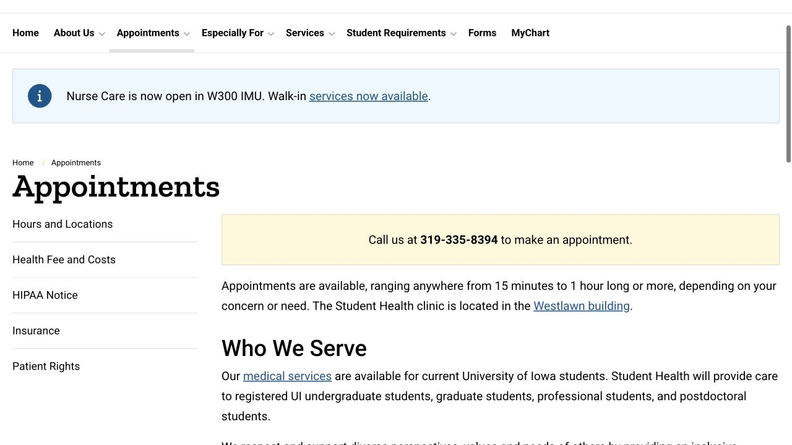

A medical visit involves several systems: the clinic books the appointment, the insurer applies your benefits, and the provider sends any remaining bill. Following those parts in order makes an unfamiliar process easier to manage, from a first phone call through the follow-up.

## Start with the care route that matches the question

Student Health is a useful starting point for routine student medical concerns, ongoing conditions and preventive care. Its Nurseline can help you work out whether to book an appointment and answer medication or self-care questions. Call 319-335-9704 during service hours; if a nurse cannot answer immediately, follow the voicemail instructions. This is a routine clinical advice route, so use the after-hours options for care when it is closed and emergency services for an immediate medical emergency.

- [Student Health · Nurseline](https://studenthealth.uiowa.edu/nurseline)
- [Student Health · Available medical services](https://studenthealth.uiowa.edu/services)

## Call for an appointment and describe the reason clearly

Student Health currently asks students to call 319-335-8394 to schedule; its homepage notes that MyChart self-scheduling is temporarily disabled. Say how long the concern has been present, what you need help with and whether you need a prescription review or follow-up. The main clinic is in Westlawn on Newton Road; the appointment confirmation gives the specific visit details. Arrive 15 minutes early and leave a generous gap before your next class, because appointment lengths vary. If plans change, call to cancel.

- [Student Health · Appointment instructions](https://studenthealth.uiowa.edu/appointments)
- [Student Health · Current hours and locations](https://studenthealth.uiowa.edu/appointments/hours-and-locations)

## Prepare the insurance card and a short health history

Bring your insurance card to each visit and make sure the clinic has the current policy information. New patients and anyone changing insurance should update the required form; SHIP and UIGRADCare information can be submitted through MyChart. It is also useful to bring the names and doses of medicines, allergies, and a short timeline of symptoms in whatever language helps you remember accurately. If communication is difficult, tell the clinic when booking and ask about available language assistance. A photo ID and the appointment confirmation are useful to keep together.

- [Student Health · Insurance card and information updates](https://studenthealth.uiowa.edu/appointments/insurance)

## Understand what the student health fee actually covers

The student health fee supports unlimited Student Health office visits for a provider’s evaluation and management of care, along with other services. Charges can still arise for tests, vaccines, supplies, procedures and physicals. Before a nonurgent extra service, you can ask what will be billed and which office can give a cost estimate. The health-fee benefit applies to Student Health; a visit to Quick Care, Urgent Care or another clinic follows that provider’s billing and your insurance terms.

- [Student Health · Health fee, additional costs and payment](https://studenthealth.uiowa.edu/appointments/health-fee-and-costs)

## Check the exact provider, service and network before outside care

For a planned visit outside Student Health, give the insurer the clinic and clinician’s details, the service and date, and your exact plan name. Ask whether the provider is in-network, what your share may be, and whether referral or prior authorization is required. These are separate questions: a medical referral can help arrange specialist care, while authorization concerns the plan’s approval rules. The current student-plan overview says UIGRADCare does not require referrals for specialist care, but covered providers and pre-approval rules still matter. A clinic saying it “accepts insurance” is only the beginning of this check.

- [Benefits · Student plan network and specialist overview](https://hr.uiowa.edu/benefits/ui-student-insurance)
- [Benefits · SHIP and UIGRADCare service comparison](https://hr.uiowa.edu/benefits/ui-student-insurance/student-insurance-overview/student-health-insurance/ship-and)

## Learn the four cost words that appear on a claim

Premium is what you pay to keep the policy. A deductible is the amount that applies before the plan begins paying for benefits subject to it; a copay is a fixed amount for a covered service; coinsurance is a percentage share. Different services can follow different rules, and preventive services may be treated differently from care for a new symptom. When asking about a bill, name the service rather than only asking “Is my insurance good?” An insurer can explain how that service would be processed under your benefits.

- [Benefits · Medical plan terms and definitions](https://hr.uiowa.edu/benefits/ui-student-insurance/student-insurance-overview/student-health-insurance/ship-and)
- [Benefits · Insurance terms glossary](https://hr.uiowa.edu/benefits/benefits-z/know-your-terms)

## After the visit, use MyChart and check the EOB against the bill

MyChart lets you review test results, messages, appointment information and prescription refill requests. Separately, the insurer’s Explanation of Benefits (EOB) shows how a claim was processed, including paid and uncovered amounts; it is not a request to pay the insurer. Compare the patient name, visit date and service with the provider bill and any U-Bill charge. If information does not match or a claim is denied, ask the billing office and insurer about the specific claim before paying a duplicate charge. Student Health billing is 319-335-8376; enrollment or premium questions go to University Benefits.

- [Student Health · MyChart and follow-up information](https://studenthealth.uiowa.edu/)
- [Benefits · What an EOB shows](https://hr.uiowa.edu/benefits/benefits-z/know-your-terms)
- [Student Health · Billing and insurance handling](https://studenthealth.uiowa.edu/appointments/insurance)

## Keep an after-hours plan before you need it

The Hours and Locations page lists current after-hours options, including nurse advice, Quick Care, Urgent Care and emergency departments. Review the appropriate location, services and opening hours when routine care cannot wait until Student Health reopens. For an immediate medical emergency, call 911. For planned nonemergency care, leave enough time to check your network and practical travel arrangements. Save the visit summary, medication instructions and any follow-up date afterwards, so the next provider can understand what has already been done.

- [Student Health · Current after-hours care options](https://studenthealth.uiowa.edu/appointments/hours-and-locations)

> Independently written by ISAB · Official sources checked October 18, 2026. The linked providers manage appointments, coverage and claims; use their current guidance for your situation.

## Sources & useful links

- [Student Health · Services](https://studenthealth.uiowa.edu/services)
- [Student Health · Nurseline](https://studenthealth.uiowa.edu/nurseline)
- [Student Health · Appointments](https://studenthealth.uiowa.edu/appointments)
- [Student Health · Hours, locations and after-hours options](https://studenthealth.uiowa.edu/appointments/hours-and-locations)
- [Student Health · Insurance information](https://studenthealth.uiowa.edu/appointments/insurance)
- [Student Health · Health fee and costs](https://studenthealth.uiowa.edu/appointments/health-fee-and-costs)
- [Student Health · MyChart and frequently asked questions](https://studenthealth.uiowa.edu/)
- [Benefits · UI student insurance overview](https://hr.uiowa.edu/benefits/ui-student-insurance)
- [Benefits · Plan comparison](https://hr.uiowa.edu/benefits/ui-student-insurance/student-insurance-overview/student-health-insurance/ship-and)
- [Benefits · Insurance terms](https://hr.uiowa.edu/benefits/benefits-z/know-your-terms)
