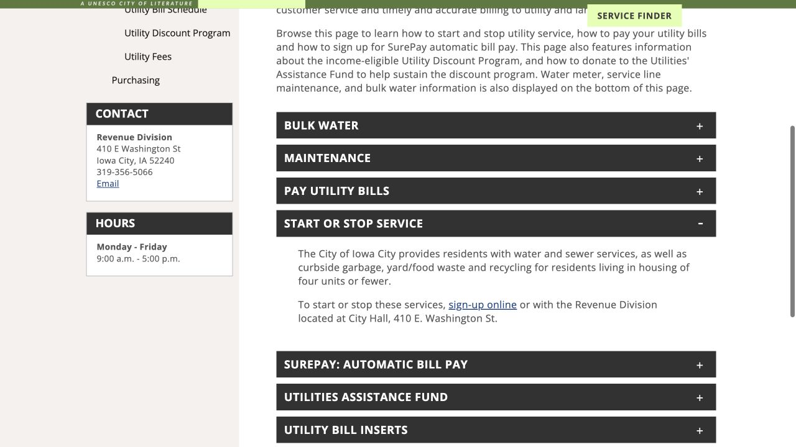
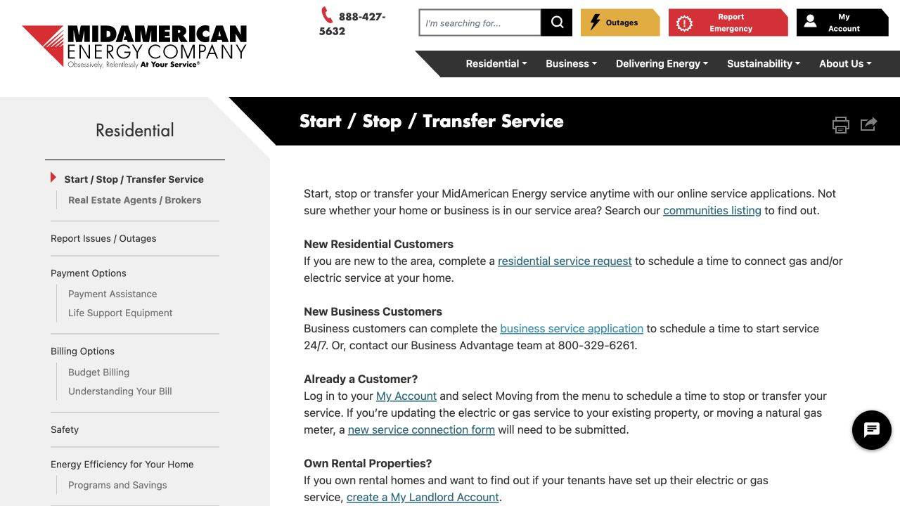

A rental’s “utilities included” description is only the beginning of understanding its monthly cost. Water, electricity, heating and trash may be handled differently, and the address determines which provider can serve the home. Once the lease and landlord’s explanation are clear, you can arrange the accounts that actually need to be in your name and check that their start dates fit the move.

## Turn the lease description into specific responsibilities

Read the utilities section with the landlord’s explanation beside it, separating water, electricity, heating and trash. For each one, establish whether it is included in rent, billed separately or divided among residents, and ask what energy source supplies the heat. Record the complete address and unit number and the date your responsibility begins. If the landlord already manages a service, clarify whether you need an individual account before submitting a second request.

## For Iowa City water service, use Start or Stop Service

When the property is served by Iowa City utilities, open Revenue & Utilities and find Start or Stop Service. That section links to the online route and explains the Revenue Division at City Hall alternative. Billing questions go to 319-356-5066. Use the property’s confirmed service address when choosing the provider: a rental described as being in the “Iowa City area” may be in Coralville or North Liberty and needs its own municipal or provider confirmation.

## For energy, match the provider and choose the customer route

If MidAmerican Energy serves the property, its Start / Stop / Transfer Service page offers different routes for New Residential Customers and Already a Customer. New residential customers follow the service request; existing customers use Moving within My Account. The same page links to a communities listing for service-area checks. Match the full address and the energy services supplied there, then request the start date that corresponds with the lease responsibility you established earlier.

## Read the scheduled date and access details before moving

MidAmerican’s residential request information says the confirmation email provides the scheduled date and any access requirements. Read it alongside your move-in arrangements, especially if a meter is indoors or behind a locked area that someone must open. Contact the provider if either the date or access cannot work. If the application asks for identification you cannot provide, discuss acceptable alternatives through the provider’s contact route. Keep the request confirmation with the lease, so you can refer to the actual arrangement if a question comes up during the move.

> Public pages checked October 17, 2026. This is an ISAB browsing and move-in preparation note. The lease, service address, and provider confirmation determine what applies to you. Submit requests and personal information directly to the provider; this site does not open or manage utility accounts.

## Sources & useful links

- [Iowa City · Revenue & Utilities](https://www.icgov.org/government/departments-and-divisions/finance/revenue-utilities)
- [MidAmerican · Start / Stop / Transfer Service](https://www.midamericanenergy.com/start-stop-service)
- [MidAmerican · Residential request information](https://www.midamericanenergy.com/ecss/StartService/StartService)
