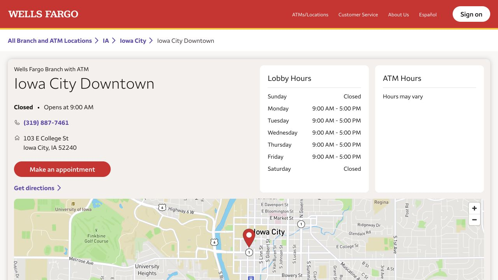
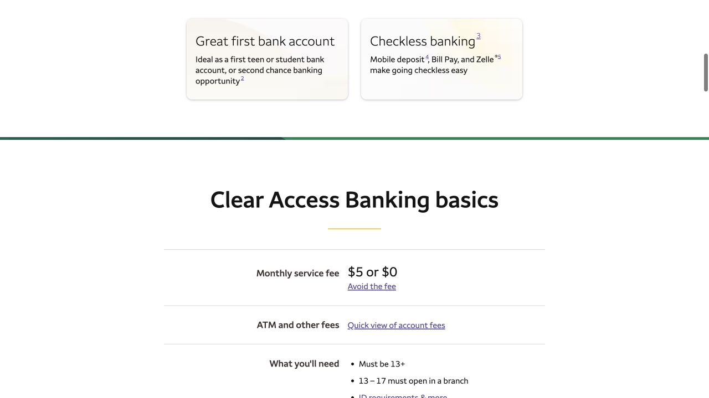

Wells Fargo is another local banking option in the handbook, with a branch on College Street. A useful comparison begins with ordinary use rather than the opening offer: whether you need paper checks, how you will receive money, and whether an age, balance or deposit waiver will fit over time. These steps follow that conversation through the first month of using the account.

## Book a visit to 103 E College Street

The Iowa City Downtown branch is at 103 E College St, Iowa City, IA 52240, phone 319-887-7461. Its published lobby hours are Monday–Friday, 9 a.m.–5 p.m., with Saturday and Sunday closed. The location page lists New Account Openings and an appointment button, so it is a useful place to reserve a weekday conversation. Recheck holiday hours before travelling, and use the lobby schedule when planning to meet a banker rather than relying on ATM availability.

- [Wells Fargo · Downtown branch and appointment](https://locations.wellsfargo.com/ia/iowa-city/103-e-college-st)

## Confirm how your documents meet the identification requirements

The in-branch document page asks for original primary and secondary IDs, such as a passport and student ID. The bank may also require separate proof of address, for example a lease or utility bill in your name. Bring your SSN or ITIN if you have one. For non-U.S. citizens without a U.S. taxpayer number, the page describes government identification showing nationality or residence. A call with your exact documents lets the branch explain what it can review; the published examples do not guarantee that every combination or applicant will be accepted.

- [Wells Fargo · IDs and address documents for branch opening](https://www.wellsfargo.com/checking/everyday/identification-required-to-open/)

## Clear Access works differently from an account with paper checks

Clear Access Banking has a $5 monthly service fee. Common waiver routes are a primary account owner aged 13–24 or at least $250 in qualifying electronic deposits per fee period. It has no overdraft fees and is checkless, so a landlord who requires checks you write yourself changes the comparison. Ask to see those features and the waiver together in the account disclosure. The age waiver ends at 25; ages 13–17 must open at a branch, and ages 13–16 also require an adult co-owner.

- [Wells Fargo · Clear Access Banking](https://www.wellsfargo.com/checking/clear-access-banking/)
- [Wells Fargo · Clear Access fee waiver](https://www.wellsfargo.com/checking/clear-access-banking/clear-access-monthly-service-fee/)

## Everyday Checking has its own waiver tests

Everyday Checking currently charges $15 per month unless an applicable waiver is met. Common routes include a primary owner aged 17–24, $500 in qualifying electronic deposits each fee period, a minimum daily balance of $1,500, or $5,000 in qualifying combined deposit and investment balances. This product supports paper checks, with checks available for purchase. Ask which route fits your account and how the fee period is measured. Continuing as a student after 24 does not by itself preserve the age waiver.

- [Wells Fargo · Everyday Checking and current waiver rules](https://www.wellsfargo.com/checking/everyday/)

## Make room for the first deposit and any hold before rent is due

At the appointment, ask how much your chosen product requires to open, when the first fee period begins and when the first deposit becomes available to spend. Record the answers together with the account name. The opening deposit, service fee and balance for a monthly waiver serve different purposes, which is why all three questions matter. Before sending a large rent or housing deposit, look at the available balance and any hold notice so you know when those funds can actually be used.

## Check whether your usual incoming money counts for a waiver

Wells Fargo’s qualifying-deposit rules include eligible payroll and other income through specified electronic networks. Transfers between accounts, mobile check deposits, Zelle, and deposits at a branch or ATM do not qualify. If the deposit route is your intended waiver, describe the payment you expect and ask the banker whether it meets that definition. That gives you a basis for planning the month instead of repeating transfers that move money without meeting the account’s fee requirement.

- [Wells Fargo · What qualifies as an electronic deposit](https://www.wellsfargo.com/checking/direct-deposit/)

## Find the right account details for wages or a family wire

In Wells Fargo Online, select the account to find its account and routing numbers in the details. The help page distinguishes these direct-deposit details from wire-transfer instructions. Ask the banker to show the information for your account, then store the official instructions securely and share only what the particular payer needs. A family member sending an international wire needs the appropriate receiving instructions and current fees, while your debit-card number is a different identifier used for card payments.

- [Wells Fargo · Find account and routing numbers](https://www.wellsfargo.com/help/routing-number/)

## Set alerts and use the statement to follow the account’s first month

The published alert route is Sign on → Manage Alerts → choose the account, alert types and delivery method → save. Low-balance and deposit alerts can help you notice what is happening while learning the app. Confirm your phone, email and mailing address, including apartment number, and ask how the debit card will arrive and be activated. On the first full statement, compare the Monthly Service Fee Summary with the waiver discussed at the branch. If age provides your waiver, leave a reminder before your 25th birthday to review the next option.

- [Wells Fargo · Set up account alerts](https://www.wellsfargo.com/mobile-online-banking/alerts/)

> Independently edited by ISAB · Official sources checked October 18, 2026. The branch confirms document acceptance and account eligibility; review the current disclosure before opening.

## Sources & useful links

- [Wells Fargo · Iowa City Downtown branch](https://locations.wellsfargo.com/ia/iowa-city/103-e-college-st)
- [Wells Fargo · Account-opening IDs and address proof](https://www.wellsfargo.com/checking/everyday/identification-required-to-open/)
- [Wells Fargo · Clear Access Banking](https://www.wellsfargo.com/checking/clear-access-banking/)
- [Wells Fargo · Clear Access fee waiver](https://www.wellsfargo.com/checking/clear-access-banking/clear-access-monthly-service-fee/)
- [Wells Fargo · Clear Access fee summary](https://www.wellsfargo.com/checking/clear-access-banking/account-fees-summary/)
- [Wells Fargo · Everyday Checking](https://www.wellsfargo.com/checking/everyday/)
- [Wells Fargo · Qualifying electronic deposits](https://www.wellsfargo.com/checking/direct-deposit/)
- [Wells Fargo · Routing and account numbers](https://www.wellsfargo.com/help/routing-number/)
- [Wells Fargo · Account alerts](https://www.wellsfargo.com/mobile-online-banking/alerts/)
