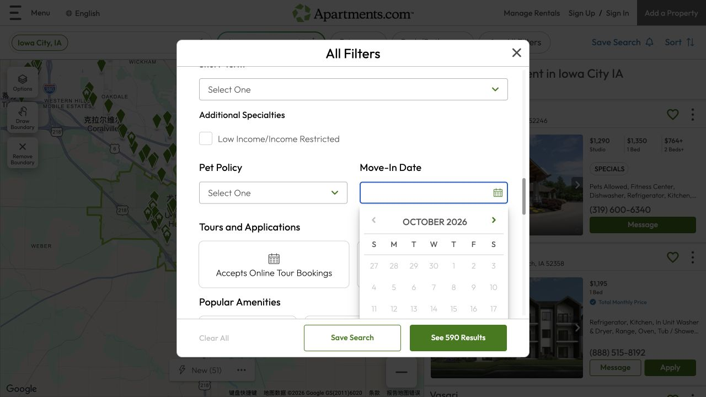
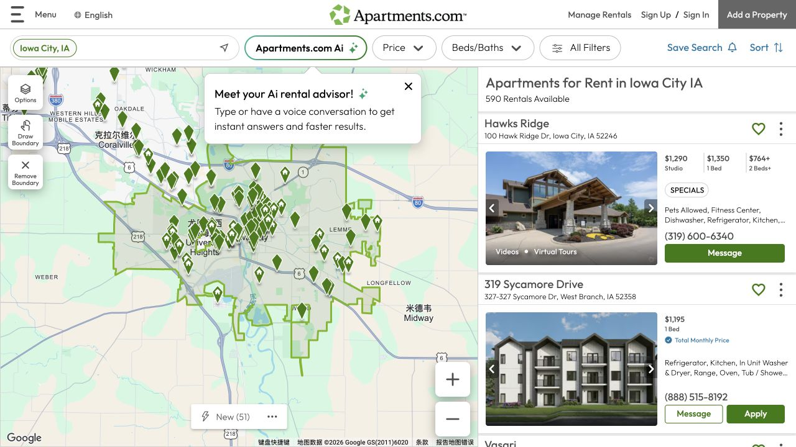

换一个租房网站，最有用的是继续回答前一轮候选里还没弄清的问题。Apartments.com 的空间和入住日期筛选帮助缩小范围，照片、视频和设施说明则让房子更具体。接下来再把这些展示材料与某个可租单元、实际日期和完整费用对应起来，第二站搜索就能推进选择，而不是又多存一串公寓名字。

## 空间与入住日期选对，价格才有可比性

这次展示的 All Filters 页面中，Space 分成 Entire Place（整套）和 Room for Rent（单间），Move-In Date 可以打开可入住日期日历。选好自己要租的范围，才能理解卡片价格对应什么：一间房和整套住宅，即使并排出现也不是同一种安排。日期筛选帮助缩小范围，具体单元何时能入住、提供哪段租期，还需要读房源并询问。如果抵达早于可入住日，也要把中间住宿纳入安排，让搬家的时间真正衔接上。

## 照片和虚拟看房，用来理解空间怎样连接

部分搜索卡片带 Virtual Tours（虚拟看房）或 Videos（视频）标记；房源提供这些材料时，可以借它们看房间之间怎么连接、家具周围还有多少可用空间。再对照文字里的户型和单元说明，问清展示的是待租这一套，还是代表性的样板间。同一栋楼可能有不同布局，一段清楚的视频能帮助提出更具体的问题。本文截图中的公寓是浏览示例，材料本身也不代表 ISAB 实地检查过这些房子。

## 把设施筛选，变成自己每天会遇到的问题

截图里的条件包括 In Unit Washer & Dryer、Air Conditioning、Utilities Included 和 Parking。标签可以缩小结果，细节则决定入住后怎样生活。看洗衣设施时，问机器在哪里、是否属于准备租的单元；看 Utilities Included 时，问具体含哪些服务、其余费用怎样计算；看停车时，确认是否已经包含车位、需另付费，或要等名额。把这些答案记在租金旁边，设施和费用就不会在比较时被分开遗漏。

## 第一次联系，就围绕一个单元和一个入住日问

可以这样组织第一条询问：“我想从某日开始，为几个人租一间房／整套公寓。那个日期有哪些具体单元或户型可租？对应的租金、额外费用和租期是什么？”把日期、人数和空间换成自己的情况，再加上最在意的一项设施。这样得到的答复，更容易把网站上的整栋物业与实际提供给你的房子连接起来。看房时也沿用同一个单元或户型名称，照片、文字与现场不一致的地方，就有了清楚的核对对象。

## 把整套安排并排比较，再决定最喜欢哪一个

将这里的候选和其他网站的记录按同一种格式放在一起：完整地址及单元、租住范围、租金、每月另收费、入住时支出、租期，以及日常交通。还缺的金额或没确认的设施，就保留成问题，等答复后再补。准备合租时，也把家庭内部如何分配空间和费用纳入自己的计划。当时间、可用空间和整体支出能互相配合，选择会比只看一张好照片或一个设施标签更有依据。

> 截图于 2026 年 10 月 17 日。价格、可租情况和网站界面可能变化。图中房源仅用于 ISAB 浏览笔记示例，不是具体公寓推荐，也不代表实地入住体验。

## 来源与实用链接

- [Apartments.com](https://www.apartments.com/iowa-city-ia/)
