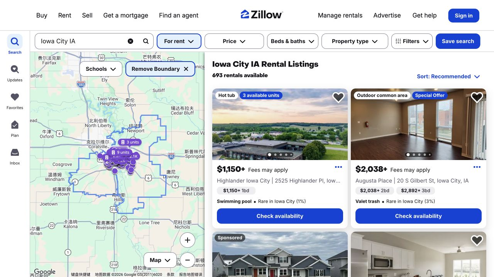
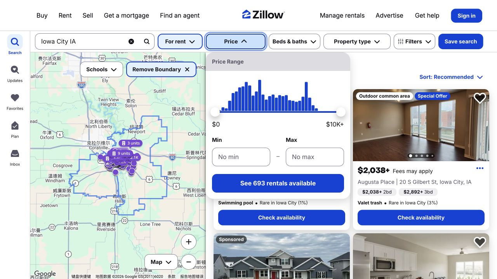
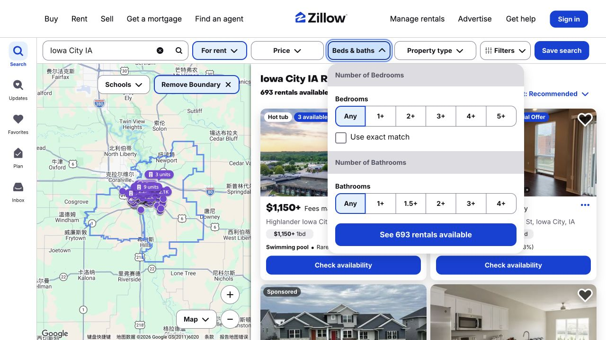

找房时，每一轮搜索可以解决一个不同的问题：哪个位置生活方便，页面的价格到底对应什么，以及某个具体单元能不能配合自己的搬家时间。Zillow 的 Iowa City 页面把地图、房源卡片和筛选放在一起，适合用来完成最初几轮比较。下面从读卡片开始，一直写到整理候选、联系看房，让收藏下来的不只是几个公寓名字。

## 把起价、地址和卧室数放在一起读

Iowa City 搜索页把地图与房源卡片并排展示，可以同时看位置和住宅信息。价格后面的“+”表示起价，并不是这栋楼里每个可租单元都按这个金额。出现“Fees may apply”时，费用说明也是理解报价的一部分。先打开位置、卧室数和起价大致合适的候选，再记清这个价格究竟对应哪个单元或户型。搜索结果的先后是网站的展示方式，并不代表 ISAB 给公寓排了名。

## Price 缩小的是租金范围，完整预算还要往下看

Price 面板中，Min 是下限，Max 是上限。如果主要限制是“最多能付多少”，可以用 Max 缩小结果，不必额外设一个没有实际需要的最低价。筛选用的是页面展示的租金，自己的预算还要加上这套房子适用的其他费用。读房源时，留意水电、网络、停车等是否另收，以及租金按什么范围报价；每月持续支出，与申请、押金或入住时要求支付的金额分别记录。这样既能看清到达前需要准备多少钱，也能判断之后每月是否承担得起。

## 卧室数量、住宅类型和“租哪一部分”，分清再比较

Beds & baths 里的 1+ 是至少一间卧室，因此也会出现两间或更多卧室的住宅；“Use exact match”才是按选定数量精确匹配。再用 Property type 区分公寓、独栋或联排。筛完卧室数后，仍需要在房源正文里确认：报价指整套住宅、某个具体单元，还是其中一间房。如果准备合租，就按每个人实际分担的租金和责任来比较，而不是把所有“一卧”结果都当成同一类报价。回到卡片时，再看一遍是否符合原本想找的空间。

## 把少量候选，记成同一种格式

一份有用的候选记录，可以从完整地址、单元号或户型开始，再写租金、每月另收费项目、可入住日和拟议租期。然后加上平常去教室、买菜等常去地点的交通方式。页面没写明的内容，就留下来作为待问问题，不必自己补成默认答案。用同样格式记三四个候选，取舍会更直观：一个展示租金更低的房源，可能对应不同通勤、较少包含项目，或一个衔接不上抵达时间的起租日。

## 联系看房时，把问题落到具体可租单元

联系管理方时，说明看到的房源、想问的单元或户型，以及预计入住日和入住人数。接着确认照片、视频或参观展示的是这一个单元，还是样板间；相应租金、费用和包含设施又是哪一套。现场或视频看房时，可以顺着厨房、卫生间、储物、洗衣安排和进楼路线看一遍，空间理解会比只看客厅封面完整。把书面答复存回候选记录，最终比较的就是对你实际可租的条件。

> 截图于 2026 年 10 月 17 日。价格、可租情况和网站界面可能变化。这是 ISAB 整理的网站浏览示范，图中公寓不代表推荐，也不代表我们实地看过或住过。

## 来源与实用链接

- [Zillow](https://www.zillow.com/iowa-city-ia/rentals/)
