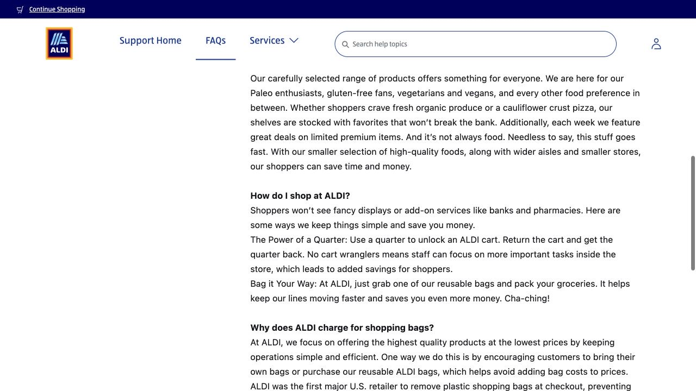

ALDI 适合买一些日常食材，第一次去主要是熟悉两个小习惯：购物车需要一枚可退的硬币押金，结账后通常要到旁边自己装袋。弄清这些，买菜就会顺手很多。可以把首趟当作接下来几顿饭的小采购，围绕自己会做的菜选东西，也给预算和回程的负重留出余地。

## 选门店时，把买完菜的回程一起算进去

本地两家门店分别在 Iowa City 的 760 Ruppert Road，以及 Coralville 的 2750 Heartland Drive。下方各门店入口可以查当天营业时间和导航。配送网站自动选出的门店可能只是跟着 ZIP code 走，出发前仍要核对具体地址。

比较时，可以从买完菜往回想：要走到哪个车站，等车多久，到家前还要拎多远。有时去程只差几分钟，满手购物袋时的回程却很不同。坐公交的话，提前存下回程站点和时刻，给结账、装袋和走到站台留出时间。

- [ALDI · Iowa City branch](https://info.aldi.us/stores/l/ia/iowa-city/760-ruppert-road/l135)
- [ALDI · Coralville branch](https://info.aldi.us/stores/l/ia/coralville/2750-heartland-dr/l125)

## 把一枚 quarter 和购物袋放在一起

取购物车要用一枚美国 25 美分硬币，也就是 quarter。把硬币插入车锁后，就能将车从车列中取出；用完把车送回并重新接好，硬币会退回。它是一笔可退押金，平时留一枚在买菜包里，下次就不用临出门找零钱。

购物袋也带自己的，忘记带可以在店里购买。第一次采购用一个背包加一只结实的袋子，比较容易判断自己是否搬得动；尤其下公交后还要走一段路时，提前想好怎么分装会省力一些。

## 围绕自己会做的几顿饭，组成第一车食材

可以先想接下来几次早餐和晚饭怎么吃。燕麦或面包解决早餐，米或意面作为主食，再配常吃的蛋白质，比如鸡蛋、豆类，或门店有货时的豆腐；蔬果可以从两种蔬菜、一种水果开始，再补牛奶或适合自己的替代品。具体选什么，跟着当天货架和自己的饮食需求调整。

熟悉的小包装更容易掌握用量。尝试新东西时读一下配料和饮食标签，也记得买把食材做成饭所需的调味料。等正餐部分已经在预算里，再逛零食和限时非食品区，就更容易判断哪些是这次真正想带回家的。

## 货架价看懂单位，才能知道这一袋多少钱

标签可能写每磅、每盎司、每个，也可能写整包价。比较前先统一单位，尤其注意 per lb 和 per oz。1 lb 约等于 454 克；按磅标价的商品，要结合实际重量理解总价，不能直接把那个数字当成整袋的价格。

小冰箱里更重要的是放得下、吃得完。大包装即使单位价低，如果最后用不完，整趟买菜未必更划算。遇到看不明白的标签，可以拍下来问店员，趁还没到收银台时把数量确认清楚。

## 人工收银结完账，到旁边再慢慢装袋

人工收银时，店员扫描后会把商品放进购物车。付款完成，再把车推到指定装袋区整理，不需要在收银台旁一边追着扫描速度一边把所有东西装好。重的罐头和盒装物放下方，怕压的蔬果放上面；使用自助收银时，则跟着机器的扫描和付款提示操作。

ALDI 的支付 FAQ 列有现金、多数借记卡、Visa、Mastercard、Discover、American Express，以及 Apple Pay 和 Google Pay。看一下机器上的支付标识，也带一个备用方式。装袋时顺便把重量分配好，下一段走路或坐车会轻松一些。

## 买多少，跟着自己怎么回家来决定

第一次无车采购，可以从一个背包加一只手拎袋的量开始。整箱饮料、大袋米、多瓶清洁剂，留到有合适交通工具的那一趟更方便。冷藏食品可以放进保温袋，装好后直接回家，也就不用在回程中反复担心食物放得太久。

选择配送或自提时，再把它当作一笔线上订单来比较：商品价格、配送或自提费，以及购物袋收费，都可能影响总价。ALDI 的帮助页单独说明这些费用。做预算时看最终付款金额，再决定这次是去店里买，还是让线上服务替自己省下往返时间。

> ISAB 独立整理 · 资料核对于 2026 年 10 月 18 日。出发或购买前，通过文中来源确认最新时间、费用与适用条件。

## 来源与实用链接

- [ALDI · Iowa City branch](https://info.aldi.us/stores/l/ia/iowa-city/760-ruppert-road/l135)
- [ALDI · Coralville branch](https://info.aldi.us/stores/l/ia/coralville/2750-heartland-dr/l125)
- [ALDI · Cart deposit, bags and checkout FAQ](https://help.aldi.us/faqs/article/About-ALDI-U-S---FAQs)
- [ALDI · Store payment methods](https://www.aldi.us/about-aldi/faqs/method-of-payment-aldi-gift-cards-coupons)
- [ALDI · Online ordering fees](https://help.aldi.us/faqs/article/Online-Ordering-Fees)
