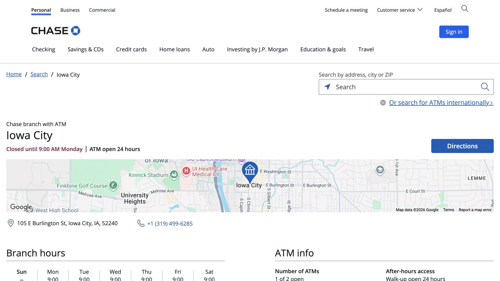
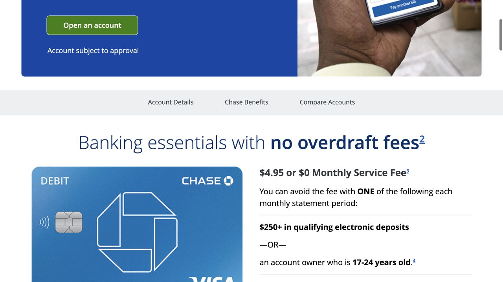

本地 checking 账户可以用来收工资、付房租，再通过 debit card 完成日常消费。Handbook 提到的 Chase 在市中心有网点，去之前就可以联系。准备开户时，最有用的是想好自己平常一个月怎样收钱、怎样付房租，再把账户功能和持续免月费的条件对应起来。这样离开柜台后，账户就更容易真正用起来。

## 从 Burlington St 网点约起

Iowa City 的 Chase 位于 105 E Burlington St, Iowa City, IA 52240，电话是 319-499-6285。门店页可以看当前柜台时间，并预约 personal checking 开户。如果还没有 SSN 或 ITIN，可以在电话里先说明已有的证件原件和住址材料，请网点确认能否核验这组材料，再安排过去。预约要看 banker 可接待的时间；ATM 是否开放，并不能说明当天能否现场开户。

- [Chase · Iowa City 网点与预约](https://www.chase.com/locator/banking/us/ia/iowa-city/105-e-burlington-st)

## 把证件原件和完整美国地址放在一起

Chase 要求 primary ID 与 secondary ID 原件。其国际学生材料表列有护照、带照片的学生证、I-20 或 DS-2019；非永久居民还需要在一份主证件或辅助证件上体现美国住址。整理材料时，同时准备写到房间号的公寓／宿舍地址和可联系的电话号码。已有 SSN 或 ITIN 就带上，Handbook 建议的住址证明和 I-94 也可以备好。具体哪些适用于你，由 banker 核对，备齐材料并不意味着每个人都必须提交每一项。

- [Chase · 可接受证件清单（PDF）](https://www.chase.com/content/dam/chase-ux/documents/personal/checking/acceptable-forms-of-identification.pdf)

## 了解 Secure Banking 适不适合自己的付款习惯

Secure Banking 当前标准月费是 $4.95；任一账户持有人 17–24 岁，或每个账期有 $250 合格电子入账，可免这项月费。它不收透支费，但不能开纸质支票，因此房租怎么付会直接影响选择。如果房东要求自己写支票，开户时就把这个需要说清楚。Chase 现在明确 College Checking 不接受新开户，过去学生攻略里的账户名称未必仍可申请，要看当下准备签署的具体产品文件。

- [Chase · Secure Banking 账户详情](https://personal.chase.com/personal/secure-banking)
- [Chase · College Checking 停止新开户说明](https://www.chase.com/personal/fees/college-checking)

## 用平常一个月的情况比较 Total Checking

Total Checking 标准月费 $15，符合适用条件可免。常见路径包括每账期 $500 合格电子入账、每天起始余额至少 $1,500，或符合条件的关联存款与投资平均每日起始余额合计 $5,000。这几种衡量的不是同一个数字，可以请 banker 指出自己的账户准备走哪条，以及文件中对应在哪里。学生身份本身不会免掉 Total 的月费。把长期每月的要求弄清后，再看短期开卡奖励是否真的增加价值。

- [Chase · Checking 产品与月费对比](https://personal.chase.com/personal/checking)

## 开户后的第一笔钱，按实际来源问清楚

收到一笔钱，和达到电子入账减免，是两件事。Secure Banking 不把现金、支票、Zelle、电汇和利息计入 qualifying electronic deposits。可以告诉 banker，平时主要是收工资、家里汇款，还是从别的账户转入，再问这种方式算不算。收工资时索取自己账户的 direct deposit 信息；家里要电汇时，另取对应的收款指引和费用说明。账号、routing 信息以及汇款类型需要相互匹配，不能从别人的开户攻略直接抄用。

## 趁在柜台，把 App 和借记卡的后续安排弄明白

核对姓名拼写和邮寄地址时，记得把公寓号也看一遍，再问借记卡会寄到哪里、收到后如何激活。接着登录官方 App，找到自己的账户资料和低余额提醒；需要帮助时，banker 还在旁边。客服联系方式从官方 App 或卡面保存。Checking 是存放资金的账户，debit card 是使用这些资金的一种方式；信用卡申请，以及可能另带月费规则的储蓄账户，都可以在理解用途后单独决定。

## 外部转账和房租付款，各按自己的用途设置

连接其他银行的合格账户时，Chase 公布的路径是 Pay and transfer → External accounts → Add external account，然后完成验证、安排转账。验证好后，在最后确认页查看收款对象、预计到账和另一家银行可能的收费。房租则需要向房东确认具体收款方式，因为 ACH、Zelle 和纸质支票使用不同指引，也不一定能互相替代。把付款约定与租约放在一起，第一次到缴租日时，就知道该从哪个入口操作。

- [Chase · 关联外部账户与转账步骤](https://www.chase.com/digital/transfer)

## 用第一张完整账单，确认账户确实按预期运行

第一张完整账单出来后，顺着产品名称、账期、服务费和实际减免逐项看一遍，再与开户时的说明对照。有不同之处时，把账单打开联系银行，工作人员更容易按那个具体账期解释。如果靠年龄免月费，可以在 25 岁生日前留个提醒，给自己时间比较后续选择。搬家或换手机号后及时更新银行资料，也能让寄卡、安全消息和之后的文件顺利到达。

> ISAB 独立整理 · 官网资料核对于 2026 年 10 月 18 日。证件接受情况与开户资格由网点核验，开户前阅读当时的账户文件。

## 来源与实用链接

- [Chase · Iowa City branch](https://www.chase.com/locator/banking/us/ia/iowa-city/105-e-burlington-st)
- [Chase · Iowa City address and phone](https://businessbranch.chase.com/ia/iowa-city/business/cbcb-Branch-20022)
- [Chase · Acceptable forms of identification](https://www.chase.com/content/dam/chase-ux/documents/personal/checking/acceptable-forms-of-identification.pdf)
- [Chase · International student banking](https://www.chase.com/personal/banking/education/basics/bank-accounts-for-international-students)
- [Chase · Secure Banking terms](https://personal.chase.com/personal/secure-banking)
- [Chase · College Checking availability](https://www.chase.com/personal/fees/college-checking)
- [Chase · Checking comparison and fees](https://personal.chase.com/personal/checking)
- [Chase · External account transfers](https://www.chase.com/digital/transfer)
