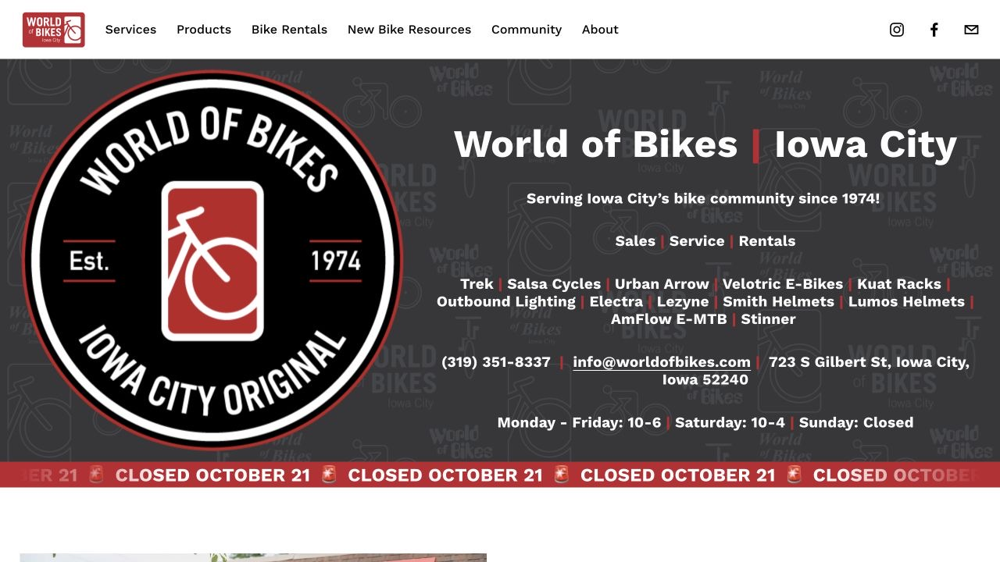

自行车或 scooter 能让不少日常路程更方便，选起来却不能只看网页上的续航。回家的坡、公寓的楼梯、买菜的袋子，以及冬天放在哪里，都会影响一辆车最后用得多不多。可以从家到上课或上班地点的路线出发，把围绕这段路的一天一起想清楚。这里的 scooter 指站立式电动滑板车；有座的 moped 属于另一类车辆，规则也不同。

## 从自己反复走的路，判断需要哪种车

如果能轻松踩完日常路线，又想要相对简单的通勤工具，可以从普通自行车看起。后货架加驮包也能照顾少量买菜。亲自试过回程的上坡，再判断助力对自己有没有必要，比只看别人的骑车体验更有参考。

距离或坡度是主要困难时，可以比较 e-bike。除了续航，还要看整车重量、自己能否搬上公寓楼梯、住处哪里允许充电，以及哪家店能修这个具体电机和电池系统。标称最高续航只能作为参考，实际表现还要结合路线和使用条件。

站立式 e-scooter 适合拿来比较短途、行李少的出行，前提是这台具体车型自己搬得动、放得下。在允许的地方试试折叠、提起、转弯和刹车，也感受不平路面上的表现，再判断它是否适合，而不要把大采购和冬季骑行直接算进预期。

## 路线一直看到入口和能锁车的架子

市政 Bicycle and Pedestrian Planning 页链接了 metro trails map。沿着家、目的地、常去买菜点再回家的顺序看一遍，留意过河位置和回程上坡；最后几分钟也算在内，找到真正使用的门和可以合法固定车辆的车架。

第一次可以白天试走或试骑，记下哪里要推行、哪里路面变化，以及天气转差时能到哪个公交站。回程站点和末班时间单独存好。如果计划把车带上公交，还要核对运营方对这个具体车型的携带规则；能折叠或装了电机，都不能单独说明一定能带上车。

## 去本地车店，把尺寸和操作一起试清楚

World of Bikes 在 723 S Gilbert St，电话 319-351-8337，官网列有销售、维修、租赁和电助力品牌；Geoff’s Bike & Ski 在 816 S Gilbert St，电话 319-338-7202。联系时说明身高、路线、预算和想看的型号，问有哪些尺寸，以及试骑是否需要证件、押金或预约。库存和安排会变化，问好再去更容易比较到合适的车。

试骑可以重点感受坡上起步、平稳刹车、转弯，以及关闭助力后能否骑动。整车自己提一次，也试一下准备使用的锁。请店里把组装、头盔、前后灯、车锁，以及需要的货架和车包列进报价，就能按真正开始通勤所需的总价来比较。

## 购买电动车前，找到这个型号的维修去处

网上下单或购买二手车前，把品牌、型号、轮径和电机系统发给维修店询问。Geoff’s 的公开政策接受部分 e-bike 项目，但不修 e-scooter 和 e-mini bike；机械维修条件包括有脚踏、有辐条、车轮大于 20 英寸，送修前还要求取下电池。具体型号能否接修，值得在付款前拿到明确答复。

二手车可以要求查看原配充电器、序列号，以及卖家能提供的原购凭证。保存交易凭证，拍下序列号并记录完整型号，再向车店了解验车费用。把广告价和后续可能的维修开销一起算，才更接近买来以后真正能放心使用的成本。

## 到了 downtown 的步行区域，把最后一段留给推行

Downtown 人行道禁骑范围由 Capitol、Burlington、Gilbert 和 Jefferson 四条街围成，并包含边界街道。在这些人行道和 Pedestrian Mall，骑自行车或 e-scooter 都应下车推行。市政自行车行驶规则同样适用于电助力自行车，警方说明 scooter 可以使用 downtown 的道路与自行车道；行驶中遵守信号灯，并在 Stop sign 处停稳。

市政公园规则禁止在 Chauncey Swan Park 和 Black Hawk Mini Park 内骑这些车，其他市政公园按现场限制通行并让行人。去 Farmers Market 时，在进入人多的市场前停到车架，再步行进去。日落到日出骑 scooter，规则要求白色前灯和红色后灯，分别能从至少 300 英尺外看见；反光衣可作为配合，车灯仍要准备好。

## 用一次小采购，试出载物后的感觉

第一次可以带一小袋必需品，感受增加重量后整段路是否仍然好骑。自行车的后架、篮子或驮包要跟车型适配，也要问清承重；装好后先在没有车流的地方练习。车把上的袋子晃动会影响控制，双手也需要能正常握把。

Scooter 携带的东西应以不改变握把和重心为限。购物车比预期满了，可以分两趟、约人接，或下次选择配送。大袋米、整箱饮料，或者已经结冰的回程路面，都可以成为这次另外安排交通的理由。

## 买之前，问清住处怎么停、怎么充电

向公寓说明具体车型，问允许停放和充电的位置。使用认可的固定车架，把车架与一个轮子一起锁住；只锁可拆卸轮子，车身仍可能被拿走。在 City Plaza，无人看管的自行车必须停到自行车架，不能锁在其他立柱或设施上。Scooter 使用物业认可的停放处，给门口、坡道和通道留出空间。

美国消防管理部门建议选择经过认证的设备，使用随车或其他来源可靠且适配的充电器，遵循厂商要求。充电设备放在出口和逃生通道之外，避免用延长线或多口转接器临时凑合。电池鼓包、漏液、开裂或异常发热时，先处理问题，再考虑下一次充电。

## 雨雪天，保留一个实际能用的回家办法

存好公交替代路线，也给偶尔叫车留一点预算。当天如果下雪、结冰、能见度差，或自己觉得骑回去没有把握，可以合法锁好车，晚些再取；电机助力不能让打滑的路面变得有抓地力。

入冬前，向厂商确认这个型号的充电温度、低温存放和防水要求，再和房东确定冬天及长假期间放在哪里。离开较久之前，把车从临时停放处收走。比较车型时解决这些细节，就更容易买到一辆搬得进住处、放得稳妥，也能长期用起来的车。

> ISAB 独立整理 · 资料核对于 2026 年 10 月 18 日。出发或购买前，通过文中来源确认最新时间、费用与适用条件。

## 来源与实用链接

- [World of Bikes · sales, service & rentals](https://www.worldofbikes.com/)
- [Geoff’s · bike & e-bike service policy](https://www.geoffsbikeandski.com/about/service-home-pg101.htm)
- [Iowa City · metro trails map & cycling videos](https://www.icgov.org/government/departments-and-divisions/metropolitan-planning-organization-of-johnson-county/what-we-do/bicycle-and-pedestrian-planning)
- [Iowa City Police · Walk Your Wheels](https://content.govdelivery.com/accounts/IAIOWA/bulletins/3b712a6)
- [City code · bicycle operation §9-8-1](https://codelibrary.amlegal.com/codes/iowacityia/latest/iowacity_ia/0-0-0-3645)
- [City code · electric-assist bicycles §9-8-7](https://codelibrary.amlegal.com/codes/iowacityia/latest/iowacity_ia/0-0-0-3679)
- [City code · scooters and lights §9-10-2](https://codelibrary.amlegal.com/codes/iowacityia/latest/iowacity_ia/0-0-0-3754)
- [City code · parks restrictions §10-9-2](https://codelibrary.amlegal.com/codes/iowacityia/latest/iowacity_ia/0-0-0-4442)
- [City code · City Plaza bicycle parking §10-5-3](https://codelibrary.amlegal.com/codes/iowacityia/latest/iowacity_ia/0-0-0-4147)
- [U.S. Fire Administration · battery charging](https://www.usfa.fema.gov/a-z/lithium-ion-batteries/community-education/)
