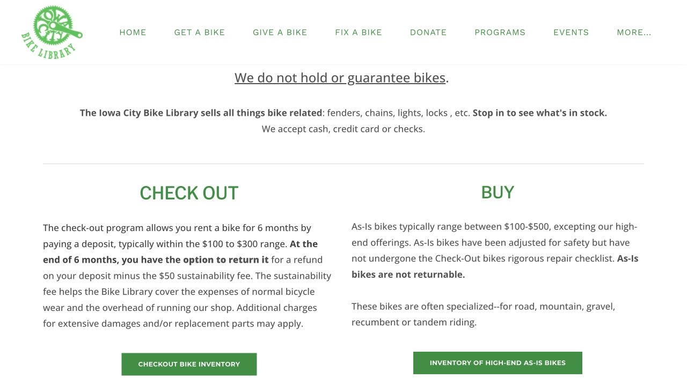
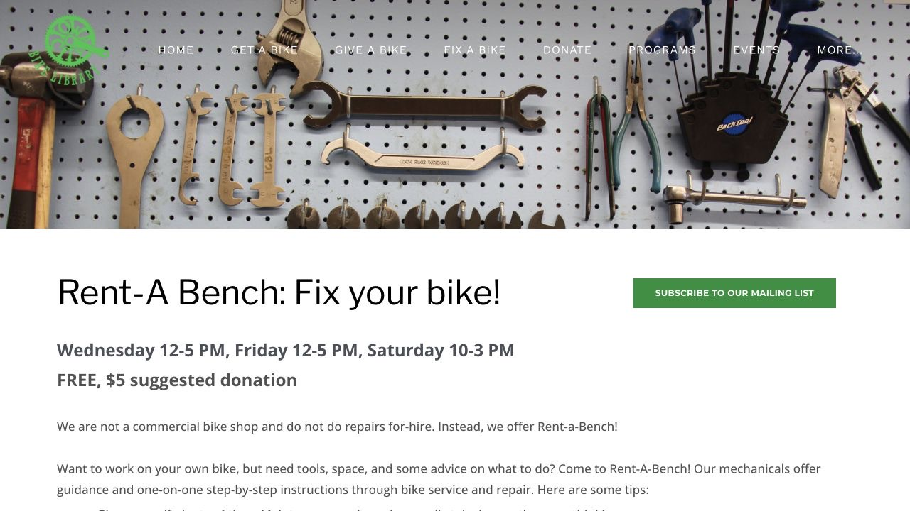

还没决定要不要买新车，也想试试骑车能不能融入一个学期的生活，可以了解 Iowa City Bike Library。它的 checkout 项目需要先付押金，之后可以选择留下自行车，或在六个月内按公开条件退车。借车当天把费用和期限弄清楚，第一次上路和学期末搬家的安排都会更从容。

## 在公开开放时间去，给选车留出余量

Bike Library 在 1222 S Gilbert Ct。公开 checkout 时间为周三、周五 12:00–17:00，以及周六 10:00–15:00，出发前再看主页或日历是否调整。车是先到先选，网页上的介绍可以帮助了解项目，但不等于已经为自己预留了一辆。

带上平常穿的鞋和通勤背包，告诉工作人员身高、常走路线，以及是否需要带菜。可以围绕座高、变速和刹车请他们帮忙判断。专门跑一趟之前，也可以先问 checkout 表格需要哪些信息；到店时给选车留一点时间，更容易找到适合自己的尺寸。

- [Bike Library · Get a bike](https://icbikelibrary.org/get-a-bike)

## 借车当天的预算，按整笔押金来准备

Checkout 押金通常为 $100–$300。六个月内退车时，退款会扣除 $50 sustainability fee，以及适用的损坏或零件费用。因此借车当天需要准备的金额，比顺利退车后的实际使用成本更高。

例如押金是 $200，假设没有额外扣费，扣除 $50 后会退 $150；但领车当天仍需支付完整的 $200。现场把这辆车的具体押金和最迟退车日问清楚，趁表格还在手边时就记进日历，之后安排假期和搬家也有依据。

## 确认这辆车属于 checkout，还是 as-is 购买

Checkout 的车可以选择留下，相应地放弃退车退款；六个月后，这个退款选项也会到期。As-is 则属于最终销售、不退货。两种方式可以对应不同的计划，关键是在签字前理解自己选的是哪一种。

请工作人员在资料上指出适用的方式和包含的东西，收好表格与凭证，拍下车况和序列号，也确认需要另外准备哪些锁和灯。把这些信息放在一起，之后询问维修，或决定是否留下车时，就不用再凭记忆回想。

## 需要维修时，按自己参加的项目来处理

六个月 checkout 期间，小修和调整由 Bike Library 承担；较大维修可能需要支付零件费，也可能要留车。发现问题后先联系说明情况，了解大致安排，再决定当天怎样出行，就不会把回程完全押在立刻修好上。

想学习自己维护，可以了解 Rent-A-Bench：它提供工具、场地和指导，操作由参与者自己完成。当前页面写的是免费、建议捐赠 $5，时间为周三、周五 12:00–17:00，以及周六 10:00–15:00。带着一个明确问题早点去，比如漏气的轮胎或蹭轮的刹车，留出跟着学习和动手的时间；它的节奏更接近有人指导的修车工作坊。

## 准备搬家或回国时，把退款邮寄时间也算进去

退车在公开开放时间办理，退款通过支票邮寄，公开说明约需四至六周，并先扣除使用费和其他适用费用。如果租约快结束或即将离境，这段邮寄时间就会影响安排。

可以提前联系 Bike Library，确认之后仍能可靠收到支票的地址。退车不要拖过期限，也给可能需要沟通的事项留出余量。办好后保存退车记录，和当初借车的资料放在一起，让学期结束时的这件事也能按计划完成。

> ISAB 独立整理 · 资料核对于 2026 年 10 月 18 日。出发或购买前，通过文中来源确认最新时间、费用与适用条件。

## 来源与实用链接

- [Bike Library · Get a Bike / checkout & returns](https://icbikelibrary.org/get-a-bike)
- [Bike Library · current hours & address](https://icbikelibrary.org/)
- [Bike Library · Rent-A-Bench](https://icbikelibrary.org/rent-a-bench)
