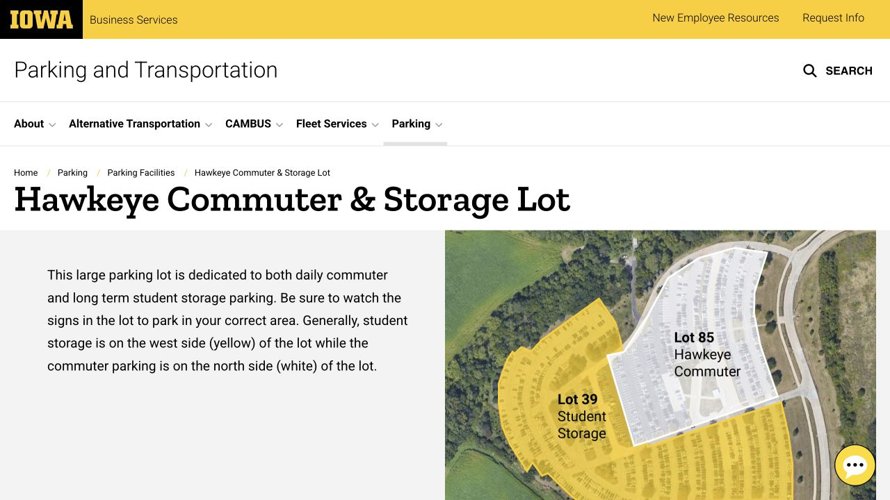
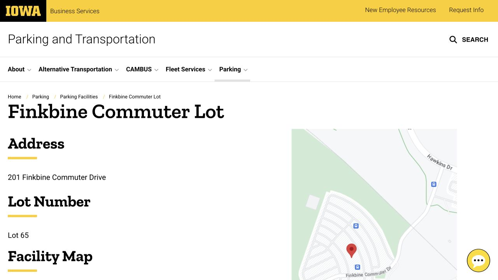
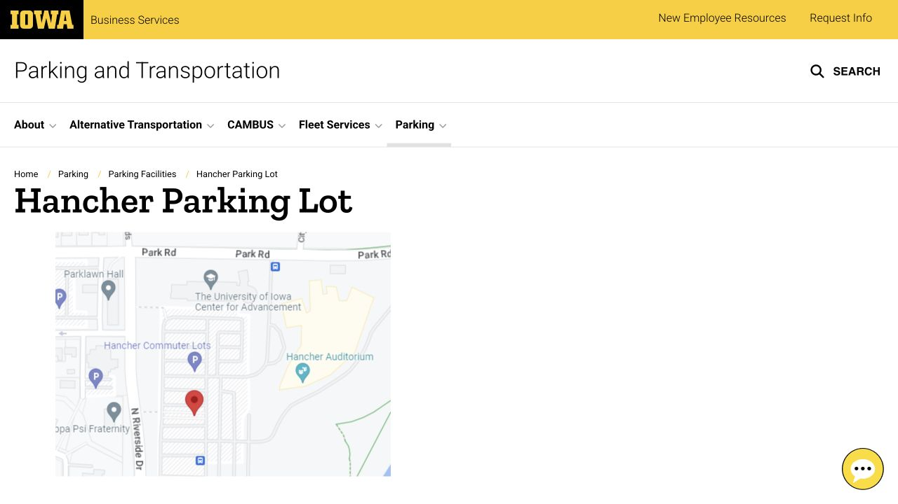

停车场编号要接上自己的课表，才会变成有用的信息。找到教室或实验室后，沿步行、接驳公交和停车位置倒着看，比较的就是一整天怎样抵达、怎样回家。下面包括日常通勤、住校存车和偶尔按小时停车三类安排；适合哪一种，要结合当前住址、学生身份与作息判断。这篇由 ISAB 独立整理，帮助大家使用校园设施。

## 先看这张比较表，再打开购买页面

比较费用之前，可以在官方互动地图上把目的地和 lot 编号一起找出来。表格使用 2026 年 7 月 1 日起的学生价格，“学期”指一个秋季或春季学期；月价方便横向比较，学生实际按学期计费。某处位置合适之后，再到 Parking Portal 确认自己的资格和可售余量，才能继续办理。

| 停车场 / 位置 | 适合拿来比较的需求 | 学生资格 | 月价 / 学期价 |
| --- | --- | --- | --- |
| 85 · Hawkeye Commuter | 校园西侧，通常还需接 CAMBUS | 研究生；从 Iowa City / Coralville 市界外通勤的本科生 | $18 / $81 |
| 65 · Finkbine | 西校区 / 健康科学区域日常通勤 | 研究生，仍需有可售余量 | $29 / $130.50 |
| 55 · Hancher | Arts Campus，或再步行 / 接公交 | 有市界限制；住市内的研究生须先确认下文的资格冲突 | $48 / $216 |
| 56 · Mayflower | Mayflower 宿舍楼后 | 仅当前 Mayflower 住户；需要闸口卡 | $68 / $306 |
| 38 · Parklawn / Mayflower Storage | 同一 lot 编号下有不同许可产品 | Parklawn 住户许可，或 Mayflower 住户存车许可 | Parklawn $68 / $306；存车 $55 / $247.50 |
| 39 · Hawkeye Storage | 住校学生把车存在西侧 | 必须当前住在学校宿舍 | $55 / $247.50 |

- [打开学校互动停车地图](https://experience.arcgis.com/experience/2fe7b2488d43433cb387e72238f96152)
- [当前学生停车许可价格表](https://transportation.uiowa.edu/parking-rates)

## Lot 85 · Hawkeye：通勤价较低，要把接驳也算进去

Hawkeye 通勤停车的导航地址为 3350 Hawkeye Park Road，位于主校区向西约两英里。大片场地同时包含 Lot 85 通勤位和 Lot 39 存车位；设施页把通勤区描述在北侧、存车区在西侧，所以需要按分区图和标志找到自己产品对应的区域。

使用 Lot 85 时，接驳也是行程的一部分。41 路到 West Campus Transportation Center，42 路连接 Hawkeye Campus、Health Sciences 与 Pentacrest。按教学楼确认站点和方向，再用平时下课的真实时间试一次回程。现在 CAMBUS 停中央银色候车亭，旧棕色亭和砖亭已不再使用；试走之后，就能更清楚这张许可怎样接进自己的日常。

- [Lot 85 / 39 地址、分区图与实际候车亭](https://transportation.uiowa.edu/parking/facilities/hawkeye-commuter-storage-lot)
- [Hawkeye 学生通勤资格](https://transportation.uiowa.edu/parking/student-parking/student-hawkeye-commuter-permit)

## Lot 65 · Finkbine：西校区日常上课、进实验室可以比较

Finkbine Lot 65 地址为 201 Finkbine Commuter Drive，位于 Finkbine Golf Course 东北侧，主要入口从 Hawkins Drive 进入。学生产品面向研究生，并取决于可售余量；本科生即使在西校区上课，也要按自己的分类查看其他可用产品。

51 路连接 Finkbine／Arena 与 West Campus Transportation Center，52 路连接 Health Sciences 与 Pentacrest 一带。比较课表时，把下车到教学楼的步行也算进去。两个候车亭在 11 月至次年 3 月可按需加热。场地东南角还有独立标识的公共付费区，zone 5104、最长十二小时；按临停付款时，应明确停在这个区域。

- [Finkbine 位置、照片与公共付费分区](https://transportation.uiowa.edu/parking/facilities/finkbine-commuter-lot)
- [Student Finkbine 许可资格](https://transportation.uiowa.edu/parking/student-parking/student-finkbine-permit)

## Lot 55 · Hancher：Arts Campus 可比较，买之前先核对资格

Hancher Lot 55 位于 300 North Riverside Drive，在礼堂西侧，向 Theater Building 一带延伸。想去 Arts Campus 时，可以查看到具体教学楼的步行路线，而后判断接驳是否有必要。秋春学期的工作日早、下午高峰有 54 路 Hancher–Newton Road；中午、周末和假期它不运行，需要看 31／32 路等替代服务。

资格方面，官方文字存在需要核实的地方：总览和价目表列出研究生，但通勤产品详细页又排除住 Iowa City／Coralville 市界内或学校宿舍的学生。住市内的研究生应把身份和地址报给 319-335-1475，确认后再买；本科生须从这两个城市市界外通勤。把这一步问清，才能知道这处方便的地理位置是否真的属于自己的选项。

- [Hancher 停车场位置与设施](https://transportation.uiowa.edu/parking/facilities/hancher-parking-lot)
- [查看 Hancher 学生资格原文](https://transportation.uiowa.edu/parking/student-parking/student-hancher-permit)
- [54 路 Hancher–Newton Road 运行时段](https://transportation.uiowa.edu/cambus/routes/54-hancher-newton-road)

## 住校：看存车与宿舍专用产品，不要买错 commuter

住校期间主要周末买菜、旅行才开车，可以比较存车产品，以及平时怎样去取车。Hawkeye Storage Lot 39 要求当前住学校宿舍，搬出后资格结束；它与同一大片场地里的 Lot 85 commuter 分别购买，适合的使用场景也不同。

Mayflower 楼后的停车场编号为 Lot 56，不是 Lot 54，面向当前 Mayflower 住户并需要闸口卡。售罄时可在 Portal 加对应候补；有余量时，Mayflower 住户也可能获配 Lot 38 Mayflower Storage。38 号场地同时另有 Parklawn 住户产品，选购要看完整名称。搬离 Mayflower 后需要更换许可，详细页介绍了换到 Hawkeye Storage 的安排。

- [Hawkeye Storage Lot 39 住校资格](https://transportation.uiowa.edu/parking/student-parking/hawkeye-storage-permit)
- [Mayflower Lot 56 与 Lot 38 候补说明](https://transportation.uiowa.edu/parking/student-parking/student-mayflower-permits)
- [按住宿情况与学生身份选择](https://transportation.uiowa.edu/parking/student-parking)

## 偶尔开车去自习：看 Library Lot 和 IMU 的具体临停方式

偶尔去 Main Library，可以看 Library Lot 3，地址 123 Museum Drive，从 Burlington Street 与 Museum Drive 路口进入；去 Iowa Memorial Union 一带，则比较位于 120 North Madison Street 的 IMU Ramp／Lot 60。两处为校园小时收费设施，85、65、55 的通勤许可并不把它们变成白天分配车位。其设施页均列出离场刷借记卡／信用卡，接受 Visa、Mastercard 和 Discover。

准备开往校区中心的小停车场时，可从设施页先看实时余位。进入后跟着临停设备操作，保管好离场所需票据或凭证；若使用另买的 Night Weekend 产品，则按该产品参与场地和时间确认是否适用。市政停车楼的首小时价格属于另一运营系统，也需要分别查。

- [Library Lot 3 入口与付款](https://transportation.uiowa.edu/parking/facilities/library-lot)
- [IMU Ramp / Lot 60 入口与付款](https://transportation.uiowa.edu/parking/facilities/iowa-memorial-union-ramp)
- [学校公共停车设施与实时余位入口](https://transportation.uiowa.edu/parking/facilities)

## 买完还要看车牌、分区和回程；比赛日另外查

学生的 85、65、55 许可通过登记车牌识别，这三种产品不需要闸口卡；Mayflower 与另购 NW 的闸口则需要相应 access card。保存确认邮件、留意生效日期，换牌后及时更新，能让第一次使用更顺利。许可还需对应具体场地和分区，小时收费、保留位与病人车位分别按其标识使用。

通勤场地页列出工作日执行时段 07:30–16:30，也要连同其他现场限制阅读。秋季主场 football 比赛会调整常规 CAMBUS，并加开专门接驳。安排晚实验、周末自习或假期出行时，重新看当天服务提醒和活动标志，回程才接得上。

- [学生购证、账单与车辆资料说明](https://transportation.uiowa.edu/parking/student-parking)
- [CAMBUS 路线、提醒和服务日历](https://transportation.uiowa.edu/cambus/routes)
- [2026 主场比赛接驳与绕行说明](https://transportation.uiowa.edu/cambus-football-shuttles-and-game-day-detours)

## ISAB 建议这样做一次真实选择

每天去西校区实验室的研究生，可以比较 65、85 和早晚实际接驳；从市界外通勤、主要去艺术区域的本科生，可以比较 55、85 及最后一段步行。住校而主要周末购物才用车，则比较存车产品和取车路线。本科生住 Iowa City／Coralville 市内，可以在核对本分类产品的同时，把公交和偶尔临停放进比较。这些例子帮助整理思路，最后仍需看每项产品的资格和余量。

拨 Parking & Transportation 319-335-1475 时，准备好身份、完整现住址、目标 lot、最早进场和最晚离场时间，具体问该产品能否购买、满位怎样安排，以及夜间周末是否还需其他凭证。位置确定后，可以接着看另一篇购证笔记，完成 Portal 下单、账单和取消安排。

- [官方 Student Parking 入口](https://transportation.uiowa.edu/parking/student-parking)
- [Parking Portal：查看有资格购买的产品](https://parking.uiowa.edu/)

> ISAB 独立整理 · 资料核对于 2026 年 10 月 18 日。校园停车由学校运营，本文从学生使用角度介绍选择；购买前通过所列运营方确认最新资格、余量、费用和当天限制。

## 来源与实用链接

- [Campus parking facilities / 校园停车设施与地图入口](https://transportation.uiowa.edu/parking/facilities)
- [Student parking classifications / 学生身份与住宿分类](https://transportation.uiowa.edu/parking/student-parking)
- [FY2027 student permit rates / 2026 年 7 月起学生价目表](https://transportation.uiowa.edu/parking-rates)
- [Hawkeye Commuter & Storage / Lot 85 与 39 设施](https://transportation.uiowa.edu/parking/facilities/hawkeye-commuter-storage-lot)
- [Student Hawkeye Commuter / Lot 85 学生资格](https://transportation.uiowa.edu/parking/student-parking/student-hawkeye-commuter-permit)
- [Finkbine Commuter / Lot 65 设施](https://transportation.uiowa.edu/parking/facilities/finkbine-commuter-lot)
- [Student Finkbine / Lot 65 学生资格](https://transportation.uiowa.edu/parking/student-parking/student-finkbine-permit)
- [Hancher / Lot 55 设施](https://transportation.uiowa.edu/parking/facilities/hancher-parking-lot)
- [Student Hancher / Lot 55 资格原文](https://transportation.uiowa.edu/parking/student-parking/student-hancher-permit)
- [Hawkeye Storage / Lot 39 住校存车](https://transportation.uiowa.edu/parking/student-parking/hawkeye-storage-permit)
- [Mayflower / Lot 56 与 38 产品](https://transportation.uiowa.edu/parking/student-parking/student-mayflower-permits)
- [Library Lot / Lot 3 图书馆临停](https://transportation.uiowa.edu/parking/facilities/library-lot)
- [Iowa Memorial Union Ramp / IMU Lot 60 临停](https://transportation.uiowa.edu/parking/facilities/iowa-memorial-union-ramp)
- [CAMBUS routes and service calendar / 公交路线与服务日历](https://transportation.uiowa.edu/cambus/routes)
- [54 Hancher–Newton Road / 高峰接驳时段](https://transportation.uiowa.edu/cambus/routes/54-hancher-newton-road)
- [2026 football shuttles and detours / 比赛日接驳与绕行](https://transportation.uiowa.edu/cambus-football-shuttles-and-game-day-detours)
