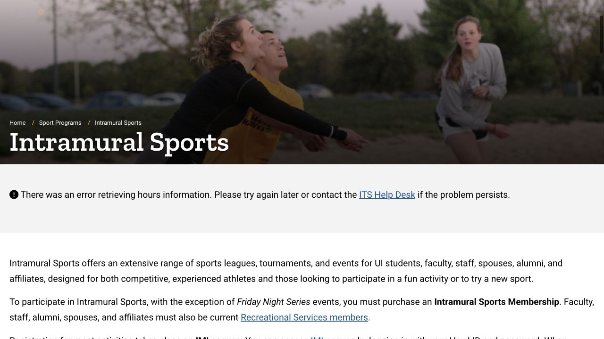

运动可以从课间的一次短训练开始，也可以是实验结束后游几圈，或者和朋友一起试一节团课。想好这次要做的活动和能去的时间，就比较容易选对场馆、查对开放时段，也能知道是否另外需要报名。下面把第一次从准备出门到进入场地的过程写清楚，方便你慢慢找到适合自己的节奏。

## CRWC 适合市中心一带，Field House 可以接在西校区行程里

Campus Recreation & Wellness Center 通常简称 CRWC，地址是 309 S Madison Street，集力量和有氧器械、室内跑道、球场、团课教室和泳池于一处。如果平时在 downtown 附近上课，可以把这里作为第一次熟悉运动设施的起点。西校区的 Field House 位于 225 S Grand Avenue，也有健身区域和多种球场，包括羽毛球／pickleball 区域；场地未被课程或活动预留时才开放给临时使用者。

选馆时，可以把上一节课在哪里、练完怎样回家一起考虑。真正方便到达的场馆，往往更容易坚持去。出发前打开对应场馆按日期显示的 hours；建筑开门与某块球场、某座泳池可用，需要分别确认。

- [CRWC 地址与当天开放时间](https://recserv.uiowa.edu/campus-recreation-wellness-center)
- [Field House 球场、位置与开放时间](https://recserv.uiowa.edu/field-house)

## 学费里可能已经包含会员，按自己的收费身份确认

当前在读、缴纳 mandatory recreation fee 的学生，其场馆会员已包含在学费和相关费用中。未收取这项费用或符合暂未注册资格的学生，当前单独会员为每月 $40，另有身份和学期限制。需要现场办理会员时带照片证件；不确定账单或资格，可以请会员服务台核对后再决定是否购买。

普通会员覆盖四处室内运动设施及多数日常活动。Intramural 比赛和专项项目可能另收费；朋友来访也要使用自己的有效资格或日票。

- [学生会员资格与当前价格](https://recserv.uiowa.edu/memberships)

## 第一次带一小包用品，也留一点时间熟悉场馆

可以准备学生证、水、便于活动的衣服、合适的运动鞋和小毛巾；游泳再加泳衣、平时会用的泳镜，以及装湿衣物的袋子。这是一份出门参考，具体项目仍按场馆现场要求使用装备。到了服务台可以问更衣区与储物柜的位置，把贵重物品安排妥当再开始。

官方运动 App 目前通过搜索“Fusion Go”下载，可查看场馆通知、团课时间、实时人数及电子会员条码；习惯用网页也可以。第一次不必把训练排满，留一点时间认服务台、更衣区和活动场地。遇到没用过的器械，就向工作人员询问用法。

- [官方 App、实时人数与电子证件说明](https://recserv.uiowa.edu/RecServApp)

## 想游泳，要看具体泳池的 lap swim 或 open swim

Aquatics 页面把 CRWC 的 competition pool、diving well、recreation pool 和 Field House pool 分开列时间。想沿泳道连续游，看 lap swim；想用休闲泳池，则找相应 open swim。选好日期和池子，当天再看一次通知，因为比赛或课程会改变可用时段。

Competition pool 用于泳道游泳，recreation pool 的布置和规则不同。穿合适泳衣，入水前淋浴，并听从救生员指示；有场馆入场资格，也要等泳池开放且救生员在场。需要学游泳时，可沿 Aquatics 的 Swim Lessons 入口查看真正的课程、报名和费用，把学习安排交给有指导的项目。

- [各泳池时间、游泳课程与使用规则](https://recserv.uiowa.edu/aquatics)

## 普通团课可以直接尝试，但要提前到教室

Group Fitness 页面列出 CRWC 与 Field House 的课程，包括力量、单车和身心舒展等方向。普通团课包含在有效运动会员内，目前线下课无需提前注册。打开实时课表，记下日期、教室和开始时间，开课前到达，并告诉老师这是自己的第一次。教室满员会关门，迟到也不能加入，因此第一次可以多留些找教室的时间。

页面单独宣传的 private 或 specialized 系列可能另收费、需要报名。看到这类名称时，继续读该项目的价格和注册说明，按具体课程安排参加。

- [当前团课课表与参加方式](https://recserv.uiowa.edu/groupfit)

## Intramural：校内联赛、短期比赛有单独报名和会员

Intramural Sports 是面向校园群体组织的比赛。大多数项目从官方页面进入 IMLeagues，用 HawkID 登录后点开运动项目，查看报名截止日、组别和比赛时间，再按说明创建或加入队伍。还没有队友时，可以看该项目是否提供 free-agent 选项，或联系项目办公室询问。

当前公开价格是秋季或春季单学期 $30，秋春合计 $50，也有短期锦标赛和单场选项。这笔费用在普通场馆会员之外；Friday Night Series 是页面列出的例外。付钱前读目标项目的完整说明，高尔夫锦标赛也有单独安排。

- [比赛项目、IMLeagues 入口与会员选项](https://recserv.uiowa.edu/intramural-sports)

## Sport clubs：想固定练习，就向社团了解投入程度

Sport club 是围绕体育或休闲活动组织训练、比赛和活动的学生社团。许多社团会与外校社团比赛，也有重在教学和社交的团体。在 active-club directory 找到自己的运动，例如羽毛球或某支球类队伍，打开具体介绍，再问负责人是否欢迎初学者、是否选拔、会费多少、需要什么装备、会不会出城比赛，以及本学期的训练时间。

社团参加资格与运动馆入场分别处理。社团成员在室内运动设施训练时，仍需要场馆会员或支付当天入场费。朋友提供的经验可以参考，自己的报名和训练要求以当前社团答复为准。

- [正在活动的体育社团与联系入口](https://recserv.uiowa.edu/sport-clubs)

## 用一周试出适合自己的节奏

如果还没有固定习惯，可以把第一周安排成一次短时个人训练，加一次感兴趣的团课；游泳或球队报名留到熟悉场馆之后。这只是便于开始的生活安排，可以按自己的体力和日程调整。把官方课表存到平时看课程表的地方，也更容易及时发现开放时间或实验安排的变化。

器械、报名页面或资格提示看不明白时，可以问对应项目联系人，或拨会员服务台 319-335-9293。带上课程名称、日期或报错截图，工作人员会更容易理解问题。试过几种活动，再决定哪一项适合长期放进自己的每周生活里。

> ISAB 独立整理 · 资料核对于 2026 年 10 月 18 日。实时课表、资格、收费与项目报名由文中各服务提供方处理。

## 来源与实用链接

- [CRWC · Facilities and hours / 场馆与时间](https://recserv.uiowa.edu/campus-recreation-wellness-center)
- [Field House · Courts and location / 球场与位置](https://recserv.uiowa.edu/field-house)
- [Recreation · Memberships / 会员与费用](https://recserv.uiowa.edu/memberships)
- [Recreation · Official app / 官方 App](https://recserv.uiowa.edu/RecServApp)
- [Aquatics · Pool schedules / 泳池时间与课程](https://recserv.uiowa.edu/aquatics)
- [Group Fitness · Participation / 团课参加规则](https://recserv.uiowa.edu/groupfit)
- [Intramural Sports · Registration and fees / 比赛报名与费用](https://recserv.uiowa.edu/intramural-sports)
- [Sport Clubs · Active directory / 体育社团目录](https://recserv.uiowa.edu/sport-clubs)
