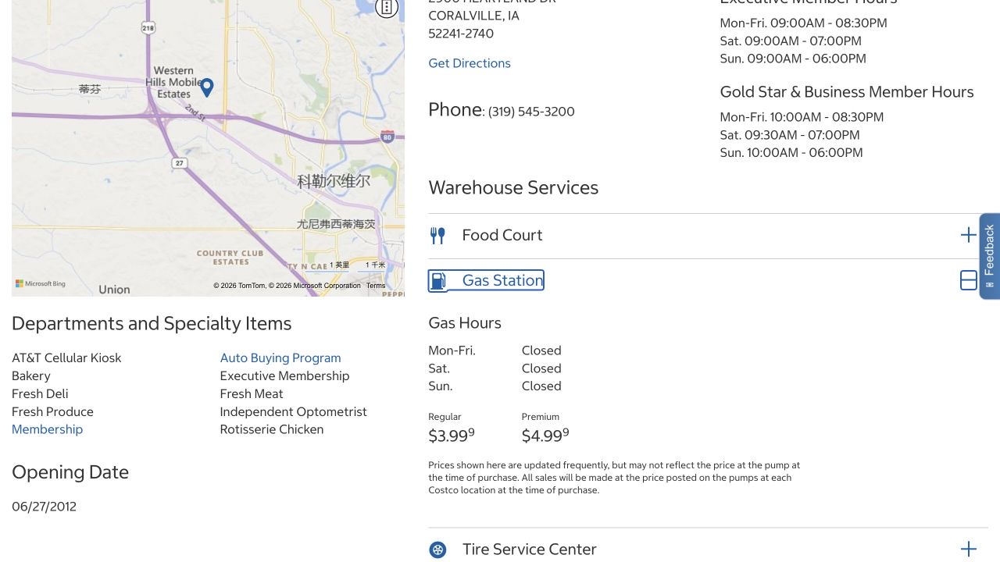

Costco 的大包装，只有跟做饭频率、储物空间和交通方式配合起来，才会变得方便。办卡前可以先想象自己平常的一次补货：会买什么，放在家里哪里，大概多久再去一次。这样年费就有了比较的依据，也能看出买菜和加油放在同一趟，对自己的日常到底顺不顺路。

## 出发前，分别确认仓库和油站的状态

Coralville Costco 在 2900 Heartland Drive, Coralville, IA 52241。门店页按会员类型列仓库营业时间，油站则有独立的 Gas Hours。2026 年 10 月 18 日浏览时，展开 Gas Station 后，工作日、周六和周日均显示 Closed；页面没有说明原因，也没有给出恢复日期。

如果主要为了加油而去，出发前拨打 319-545-3200，确认目前是否提供服务。仓库自己的开放时间，以及页面上仍显示的油价，都不能单独说明油机正在营业。把这两件事分开确认，才能决定这次要不要把补货和加油安排在一起。

- [Costco · Coralville warehouse and Gas Hours](https://www.costco.com/warehouse-locations/warehouse-1111.html)

## 把年费放进自己平常的采购习惯里比较

美国 Gold Star 普通会员每年 $65，Executive 每年 $130，另加适用销售税。Gold Star 可给同一地址、符合条件的另一人一张免费 Household Card。卡供持卡人本人使用；同住者一起使用会员权益时，应按规定申请自己的合资格卡，而不是让一张卡在朋友之间轮流使用。

比较年费时，把自己常买的食材和日用品，以及额外往返开销放在一起看。宣传里的返利或促销，只有用得上才有意义。可以从普通会员是否足够开始考虑，刚来不必直接选 Executive；办会员本身也不要求申请 Costco 联名信用卡。

## 让冰箱和下一周的饭，决定大包装买什么

首趟可以只列一两样本来就常吃的干货、放得下的日用品，再加一份吃得完的生鲜。和常去超市比较时，用相同单位的价格看，尤其留意那些单价低、整包却远大于平常用量的商品。

拿大盒肉前，想好冷冻室的位置和分装方式；拿大袋蔬菜前，想好接下来哪几顿饭会用到。和室友一起买也很合适，但最好在结账前就约好谁需要哪些东西、怎样分、费用怎么算。这样回家后能直接收纳做饭，不用再为整盒食材找人接手。

## 仓库收银台用什么卡，出门前确认好

美国仓库接受 Visa、多数带 PIN 的借记卡／ATM 卡、Costco Shop Card 和现金等，完整方式见支付 FAQ。网上和店里的规则有差别：能在 Costco.com 使用的 Mastercard 信用卡，并不是仓库普通买菜的通用付款方式；手机钱包也仍然取决于里面那张卡是否被接受。

带上自己有效的会员卡和适用的付款方式，就能在收银台顺利完成采购。不确定手上哪张卡符合时，出门前看一下卡种和 FAQ，此时补带备用卡比装满购物车后再处理方便得多。

## 正常营业的油站，按屏幕依次验证和加油

下面是 Costco 通用的自助流程，Coralville 当前能否加油仍需按上面的方式另行确认。到正常营业的油站后，沿单向标志排队，停到油机旁并熄火。按屏幕要求出示本人有效会员，再提供可接受的付款方式：Visa、多数带 PIN 的借记卡、Apple Pay 或 Costco Shop Card；油机不收现金。

继续按提示选择车辆说明书规定的油号，把油枪放入油箱口后操作。结束时挂回油枪、盖好油箱盖，需要小票就按提示领取，全部收好后再驶离。第一次不熟悉时，给自己留一点看清屏幕的时间。

## 卡或油机不熟悉，可以请现场工作人员协助

Costco 油站有受训工作人员。遇到付款报错、会员识别停住，或不认识油枪的操作方式时，可以直接请他们帮忙，避免同一笔交易反复尝试。停在油机旁期间保持熄火，也不要吸烟。

加油通常面向会员，官方 FAQ 另有预付 Costco Shop Card 的例外说明；需要使用时按那套具体条款办理。会员卡本身仍是本人使用，不能从这个例外推导出可以借别人的卡。带着自己准备使用的付款方式询问，现场人员更容易解释该怎么继续。

## 整趟是否划算，也包括路程和搬回家的安排

当路线本来顺路时，补货和加油放在一趟会方便。比较油价可以看现场油机标价，同时算上绕路距离和排队时间；忙的时候，省下的一点油费也要和多花的路程一起衡量。

大件采购带上袋子或箱子，安排能把它们搬回家的交通工具。没有车时，近一些的超市少量多次，可能更适合日常。家里的储物空间、往返交通和每年会费，都属于同一个决定；等这些条件合适了再加入会员，也完全来得及。

> ISAB 独立整理 · 资料核对于 2026 年 10 月 18 日。出发或购买前，通过文中来源确认最新时间、费用与适用条件。

## 来源与实用链接

- [Costco · Coralville warehouse and Gas Hours](https://www.costco.com/warehouse-locations/warehouse-1111.html)
- [Costco · Membership types and annual fees](https://customerservice.costco.com/app/answers/detail/a_id/857/)
- [Costco · Household membership eligibility](https://customerservice.costco.com/app/answers/detail/a_id/853/)
- [Costco · Membership card conditions](https://www.costco.com/f/-/member-privileges-conditions)
- [Costco · Warehouse and gas payment methods](https://customerservice.costco.com/app/answers/detail/a_id/719/)
- [Costco · Fuel FAQ](https://www.costco.com/f/-/gasoline-qanda)
- [Costco · Fuel station safety and attendants](https://www.costco.com/f/-/gasoline-environment)
