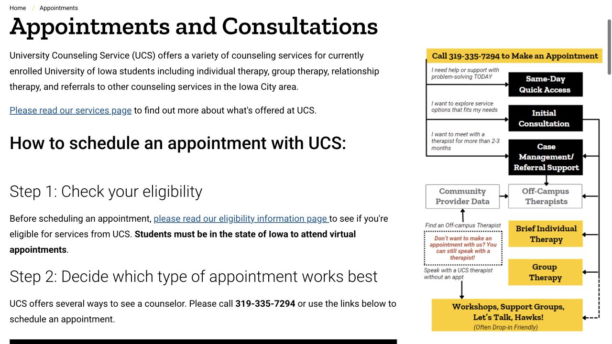

来到新的地方，既要适应上课与生活，又要摸清陌生的健康系统，开口求助有时会显得格外费力。这篇从第一次联系开始，讲清不同入口各适合什么、见面前准备什么，以及谈完后怎样把支持继续接上。你可以从现在最做得到的那一步开始。

## 从“最近哪里不太好过”说起就可以

初来一个地方的不适应、孤独、睡不好，或压力已经影响上课和工作，都可以成为寻求支持的起点。第一次联系时，不需要先给自己下诊断，也不用把事情组织成一段完整故事。University Counseling Service（UCS）面向当前注册学生和符合条件的博士后，资格依据注册状态确认；暑期能否继续使用也有专门说明。视频咨询通常要求本人当时在 Iowa 州内，去外州或回国前应联系 UCS 确认可用安排。

- [UCS · Eligibility and summer access](https://counseling.uiowa.edu/appointments-and-consultations/eligibility-information)

## 想认真梳理可以约初谈，也可以先试一次短谈

如果希望有较完整的时间聊近况，再讨论后续支持，可以选择 Initial Consultation（初次咨询）。如果只是想了解心理咨询是什么、自己适不适合，Let’s Talk, Hawks! 提供最长约 15 分钟的非正式交流，无须填写初诊材料；可以问一个困扰、学一个应对方法，或请咨询师指向合适资源。它和正式治疗、紧急支持的用途不同。活动地点及报名方式会变化，从当期页面选一个方便到达的场次就好。

- [UCS · Initial Consultation and booking](https://counseling.uiowa.edu/appointments-and-consultations)
- [UCS · Let’s Talk, Hawks!](https://counseling.uiowa.edu/outreach-services-scope-and-offerings/lets-talk-hawks)

## 约好时间后，把当天填表和到达的时间留出来

从 UCS 预约页进入在线报名，或拨 319-335-7294 联系工作人员。Initial Consultation 的在线时段可提前两周查看；网页暂时没空位时，电话还有可能获得其他安排。首次来访，或距离上次已超过三个月，需在预约当天填写背景与当前困扰，最迟在开始前 30 分钟完成。主办公室在 Iowa Memorial Union 的 W200，但实际房间或视频链接要看确认信息。预约时可以说明语言偏好和无障碍需要，让对方了解怎样的沟通最适合你。

- [UCS · Booking, forms and cancellations](https://counseling.uiowa.edu/appointments-and-consultations)

## 眼前的事情让你很难撑住时，查看 Quick Access

Quick Access 面向近期迫切的心理困扰或生活压力事件，希望在一场交流里先处理当下，再想下一步。专门预约页目前列出的安排是周一至周五 9:00–16:00、每场 60 分钟的单次咨询，可在 48 小时内在线查找，按预约先后分配。“当天／次日”是服务类型，并不保证每次打开都有名额；可以同时电话联系 UCS，说明现在最需要哪方面支持。

- [UCS · Quick Access appointments](https://counseling.uiowa.edu/quick-access-appointments)

## 短程个人咨询和团体咨询，各有适合的情况

初谈结束后，你会和咨询师一起讨论合适的方向。UCS 的个人咨询以短程、具体目标为主，官网说明多数学生接受三到八次；它可能围绕一段过渡期、反复出现的困扰，或适合在短程中处理的问题展开。团体咨询则提供与其他学生共同工作的空间，加入前会有筛选谈话，确认形式和需要是否契合。可以让咨询师解释当前有哪些团体、各自做什么，再决定自己愿不愿意参加。

- [UCS · Brief individual therapy](https://counseling.uiowa.edu/clinical-services/brief-individual-therapy)
- [UCS · Current group therapy options](https://counseling.uiowa.edu/clinical-services/group-therapy)

## 需要长期支持时，让 Navigator 帮你把下一步接起来

如果希望长期咨询、寻找某项专门服务，或对语言和文化背景有偏好，可以约 Mental Health Navigation。Navigator 能一起看保险、协助联系保险公司、整理社区咨询师选项、帮助安排第一次见面，并在之后了解衔接有没有遇到困难。带好保险卡，也把交通、可约时间和费用这些现实限制说出来，匹配会更具体。在找到新咨询师之前可能获得过渡支持；Navigation 本身并不是无限期治疗。

- [UCS · Mental Health Navigation](https://counseling.uiowa.edu/clinical-services/mental-health-navigation)
- [UCS · Community Provider Database](https://cpd.counseling.uiowa.edu/)

## 开始时，可以直接问隐私怎样保护、费用怎样处理

UCS 的学生服务标明免费、保密。保密说明写明，未经事先书面同意，受保护信息以及是否来过咨询，通常不会向教授、导师、父母或朋友披露；法律和安全方面有范围较窄的例外，具体写在政策里。第一次见面时可以请咨询师解释这些界限。如果之后转到社区机构，则要按那个机构的方式核实保险网络和个人费用；转介来自 UCS，并不意味着外面的每项服务也免费。

- [UCS · Confidentiality and its limits](https://counseling.uiowa.edu/about-us/confidentiality)
- [Well-Being at Iowa · Student mental health services](https://wellbeing.uiowa.edu/mental-health-and-resilience)

## 结束时，带走一个自己理解的后续安排

离开前可以确认：接下来是再约一次、等待团体筛选，还是联系另一家机构；如果迟迟联系不上，应该回到哪个入口求助。把联系人和下一步记在手机里，比只记住一个网站名称更容易继续。正常预约时段之外迫切需要支持时，学校的 distress-response 页面集中列出当前可用的即时帮助；如有眼前的人身危险或医疗急症，联系当地紧急救援。这里的 ISAB 学生指南不接收或转交咨询预约。

- [Campus Safety · Current distress-response resources](https://safety.uiowa.edu/response)

> ISAB 独立撰写 · 官网资料核对于 2026 年 10 月 18 日。预约、参保和理赔由文中服务方办理，个人适用情况请向对应机构确认。

## 来源与实用链接

- [UCS · Appointments and consultations](https://counseling.uiowa.edu/appointments-and-consultations)
- [UCS · Eligibility information](https://counseling.uiowa.edu/appointments-and-consultations/eligibility-information)
- [UCS · Let’s Talk, Hawks!](https://counseling.uiowa.edu/outreach-services-scope-and-offerings/lets-talk-hawks)
- [UCS · Quick Access appointments](https://counseling.uiowa.edu/quick-access-appointments)
- [UCS · Brief individual therapy](https://counseling.uiowa.edu/clinical-services/brief-individual-therapy)
- [UCS · Group therapy](https://counseling.uiowa.edu/clinical-services/group-therapy)
- [UCS · Mental Health Navigation](https://counseling.uiowa.edu/clinical-services/mental-health-navigation)
- [UCS · Confidentiality](https://counseling.uiowa.edu/about-us/confidentiality)
- [Well-Being at Iowa · Mental health and resilience](https://wellbeing.uiowa.edu/mental-health-and-resilience)
- [Campus Safety · Distress response resources](https://safety.uiowa.edu/response)
