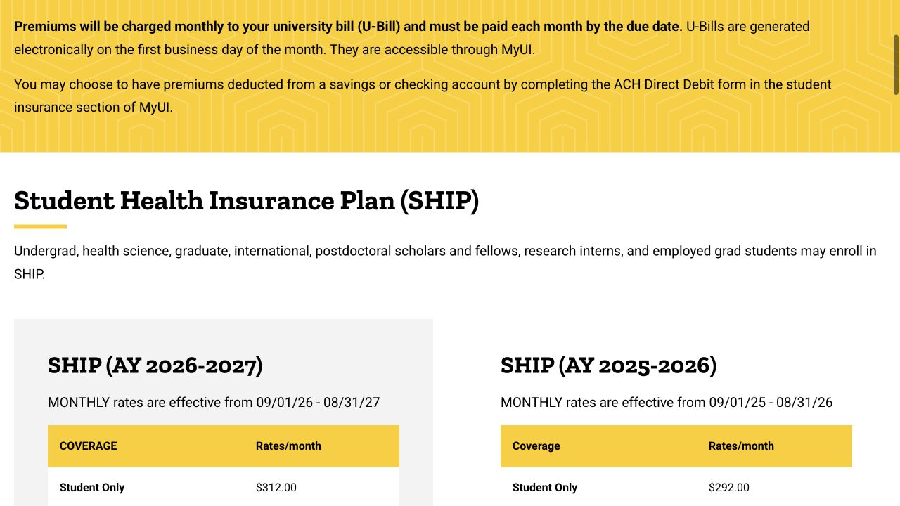
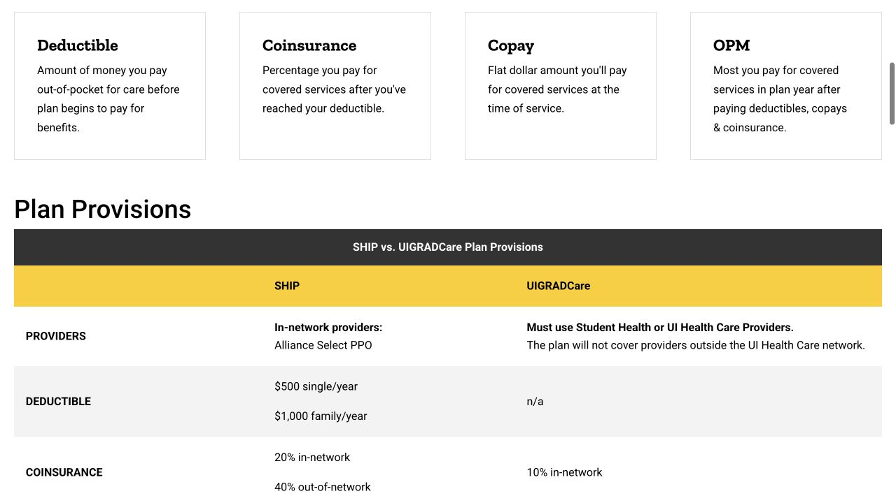

保险看起来像一张很长的价格表，真正需要弄清的是三件事：自己能参加哪种计划、它覆盖在哪里就医，以及补助生效前后每月由谁承担多少钱。把聘任或资助信息放在旁边，再顺着保障范围、费率和办理步骤看，会更容易把选择与自己的生活对应起来。

## 把保险生效日和开学、到达时间放在一起看

国际学生需要医疗保险，牙险可以另行选择。Benefits 的说明是：没有获接受的其他保险证明时，会按学生本人 SHIP 计费，保障和保费从注册、开课所在月份的第一天起算。因此，开学日期、抵达日期和保险生效日期要放在一起核对；提前到达的时段，向 Benefits 询问怎样衔接。准备抵达预算时也要留出首月保费，不能仅凭拿到 assistantship 就推定补助已开始。

- [Benefits · International student coverage requirements](https://hr.uiowa.edu/benefits/ui-student-insurance/international-student-benefits)

## 比较月费之前，想清楚自己会去哪里看病

SHIP 使用 Alliance Select PPO 网络，在 Iowa 州内外均有保障安排，网络内外的费用分担不同。UIGRADCare 面向研究生和健康科学学生，不适用于普通本科生，常规医疗网络主要是 Student Health 和 UI Health Care。如果经常去外州、已在某位医生处治疗，或预计需要专科，可以从这些实际场景倒推：自己需要的机构是否在该计划里。精神健康和急诊有单列条款，要查看对应项目，不能只根据网络概述判断。

- [Benefits · SHIP plan and coverage manual](https://hr.uiowa.edu/benefits/ui-student-insurance/student-insurance-overview/student-health-insurance/student-health)
- [Benefits · UIGRADCare plan and coverage manual](https://hr.uiowa.edu/benefits/ui-student-insurance/student-insurance-overview/student-health-insurance/uigradcare-plan)

## 看 2026–27 学年的表，并选对参保人数

2026 年 9 月 1 日至 2027 年 8 月 31 日，官网列出的学生本人全额月费为：SHIP $312，UIGRADCare $495；本人牙险另为 $25。这里是尚未扣就业补助的保费，并不是每次看病的账单。带配偶、孩子或全家参保时有各自费率，UIGRADCare 的“学生加孩子”这一档目前标为 N/A。打开 AY 2026–2027 表格后，先选符合自己情况的家庭档位，再与其他计划比较。

- [Benefits · Current student insurance premium rates](https://hr.uiowa.edu/benefits/ui-student-insurance/student-insurance-overview/student-insurance-premium-rates)

## Assistantship 的补助，要同时核对资格和开始时间

已注册的研究生，持至少 25% time 的 assistantship，或每学期至少 $5,000／每学年至少 $10,000 的 fellowship，可能符合学校分担保费的资格。按当前本人参保档位，符合条件者每月个人承担 SHIP $31.20，或 UIGRADCare $49.50；选择牙险再加 $3.75。Benefits 写明补助从聘任并提交 MyUI 参保表之后的下一个月第一天开始。把聘任起始日、参保提交日和补助生效日一起请系里与 Benefits 核对；八月开始聘任，之前或当月可能仍出现全额费用。

适用期：2026 年 9 月 1 日至 2027 年 8 月 31 日，仅学生本人档位。牙险另行选择；补助资格与开始时间见上文，家属参保使用另列费率。

| 计划 · 仅学生本人 | 全额月费 | 符合补助资格者个人月费 |
| --- | --- | --- |
| SHIP | $312 | $31.20 |
| UIGRADCare | $495 | $49.50 |
| Student Dental 牙险 | $25 | $3.75 |

- [Benefits · Employed graduate eligibility, contribution and timing](https://hr.uiowa.edu/benefits/ui-student-insurance/employed-grad-benefits)

## 把月费、自付额和一次常见就医的费用一起比较

月费之外，还要看用到服务时自己承担多少。当前比较表列出 SHIP 本人年度 deductible $500，网络内基层门诊 copay $25、专科门诊 $50；UIGRADCare 对其覆盖的医疗服务商不设 deductible，门诊 copay $10。化验、影像和其他项目仍可能另有分担比例。这是计划的一般比较，Student Health 自身的 health fee 安排还会影响它的门诊费用。把预计会用到的项目带进 coverage manual 阅读，比把一个 copay 当作整次就医总价更清楚。

- [Benefits · SHIP and UIGRADCare comparison](https://hr.uiowa.edu/benefits/ui-student-insurance/student-insurance-overview/student-health-insurance/ship-and)

## 牙险单独看，不要和医疗保险混成一项

Student Dental Plan 由 Delta Dental of Iowa 管理，采用三层服务商网络；检查、洁牙、修复等项目依计划的限额和分担规则支付。选了医疗保险，不等于也选了牙险；每月交牙险，也不代表每次治疗都没有个人费用。如果已经预计需要补牙或其他治疗，预约时可以问诊所在该计划的哪一层网络，并请对方按自己的计划做费用估算，再确定治疗安排。

- [Benefits · Student Dental Plan details](https://hr.uiowa.edu/benefits/ui-student-insurance/student-insurance-overview/student-dental-insurance/student-dental-0)

## 在 MyUI 提交后，还要看处理结果和保险卡

路径是 MyUI → Student Information → +More → Student Life Management → Student Insurance → Enroll in Insurance。选好计划及家属，提交后保留 workflow 确认，并查看请求状态；MyUI 的居住地址要准确，因为保险卡会寄到那里。公开参保窗口为 8 月 1 日至 9 月 9 日、1 月 1 日至 2 月 9 日、5 月 1 日至 6 月 9 日，窗口外需符合 qualifying event。新增家属另有到达、资格产生或出生后的时限，发生相关情况时就从参保页核对，不必等到学期末。

- [Benefits · Enrollment steps and dependent deadlines](https://hr.uiowa.edu/benefits/ui-student-insurance/student-insurance-overview/how-enroll)

## 已有其他保险、暑假回国，也需要把手续办完整

已有其他保险时，可以在 MyUI 的 Student Insurance 页面提交 Proof of Coverage，由 Benefits 按条件审核。手里有一张保险卡，还不等于获批豁免。公开证明截止日是 9 月 9 日、2 月 9 日和 6 月 9 日；已错过时直接联系 Benefits 说明情况，是否还能处理由其确认。保障可能延续到暑期，离开美国也不会自动停费；符合条件的暂时离境要按要求提交 temporary cancellation。把批准结果及生效日期留好，之后核对账单会方便很多。参保、豁免或保费问题，可联系 University Benefits：319-335-2676，或 benefits@uiowa.edu。

- [Benefits · Proof, exemptions and summer coverage](https://hr.uiowa.edu/benefits/ui-student-insurance/international-student-benefits)

> ISAB 独立撰写 · 官网资料核对于 2026 年 10 月 18 日。预约、参保和理赔由文中服务方办理，个人适用情况请向对应机构确认。

## 来源与实用链接

- [Benefits · International student requirements and proof](https://hr.uiowa.edu/benefits/ui-student-insurance/international-student-benefits)
- [Benefits · SHIP](https://hr.uiowa.edu/benefits/ui-student-insurance/student-insurance-overview/student-health-insurance/student-health)
- [Benefits · UIGRADCare](https://hr.uiowa.edu/benefits/ui-student-insurance/student-insurance-overview/student-health-insurance/uigradcare-plan)
- [Benefits · AY 2026–27 premium rates](https://hr.uiowa.edu/benefits/ui-student-insurance/student-insurance-overview/student-insurance-premium-rates)
- [Benefits · Employed graduate students](https://hr.uiowa.edu/benefits/ui-student-insurance/employed-grad-benefits)
- [Benefits · SHIP and UIGRADCare comparison](https://hr.uiowa.edu/benefits/ui-student-insurance/student-insurance-overview/student-health-insurance/ship-and)
- [Benefits · Dental plan details](https://hr.uiowa.edu/benefits/ui-student-insurance/student-insurance-overview/student-dental-insurance/student-dental-0)
- [Benefits · How to enroll](https://hr.uiowa.edu/benefits/ui-student-insurance/student-insurance-overview/how-enroll)
