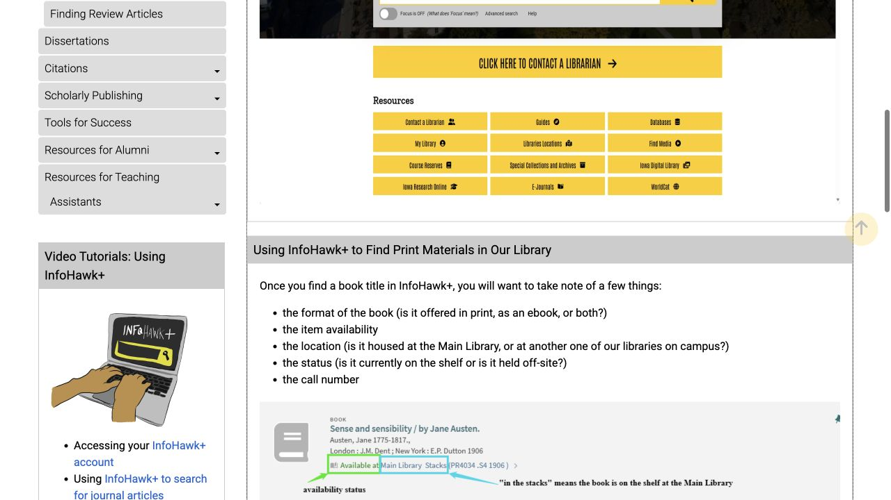
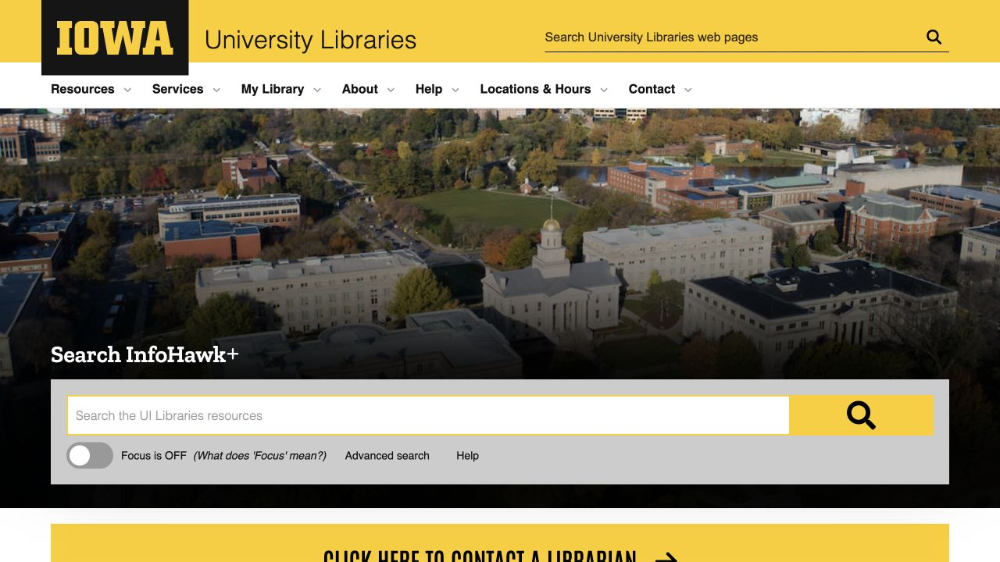

查图书馆往往从很具体的需要开始：课程大纲里的一本书、别人引用的一篇论文，或一个还没有缩小的题目。下面把这些起点，接到真正能借到、打开并阅读的材料。做作业时可以把图书馆主页放在手边，搜索或访问卡住时，再请馆员帮助调整。这篇是 ISAB 对图书馆服务的独立使用介绍，具体借阅与访问都在图书馆系统完成。

## 先按任务选馆，不用每次都去 Main Library

Main Library 在 125 W Washington Street，适合咨询一般借阅问题，人文与社科材料也较集中；600 Newton Road 的 Hardin Library 面向健康科学，120 E Iowa Avenue 的 Sciences Library 支持科学研究。学科可以帮助选择起点，但某一本书究竟在哪，还要看目录里的馆藏记录。

出门前查一次，可以省去在几栋楼之间来回寻找的路程。找到持有该书的馆后，再核对地址和入馆方法。去 Sciences Library 时，尤其要读联系页的当前入口说明和施工提示，再按最新方向进入。

- [Main Library · Location and floor plans](https://www.lib.uiowa.edu/locations/main/)
- [Hardin Library · Location and access](https://www.lib.uiowa.edu/locations/hardin/)
- [Sciences Library · Current access and contact](https://www.lib.uiowa.edu/sciences/contact/)

## 找纸质书：把“在哪、能不能借、索书号”存好

在 InfoHawk+ 搜书名或作者后，点开完整记录，把版本／载体、所在馆、availability 或 status、call number 一起看。这几项分别说明找到的是什么版本、放在哪里，以及现在是否可用。同名结果可能是一册电子书、已借出的纸本、另一分馆的副本，或馆外仓储材料。

去书架时可存下索书号和位置，或把整条记录截图；找不到就拿给服务台看。如果系统提供纸质请求，登录后选择可用取书点。收到 ready-for-pickup 邮件，才表示请求的材料已准备好，可以安排去取。

- [InfoHawk+ · Library search](https://search.lib.uiowa.edu/)
- [UI Libraries · Using InfoHawk+](https://guides.lib.uiowa.edu/hssgradstudent/catalog)

## 读论文或电子书：点到全文，再核对是不是同一篇

读论文时，用准确题名或 DOI 搜索通常更容易定位。打开记录后，沿可用 online access 链接继续进入文章或电子书，再确认当前看到的是可读内容。结果页有时只列引用与摘要，所以看到标题后还需要走到全文这一步。

把题名、作者、年份与老师或参考文献给的信息对应；电子书还要核对版次。阅读笔记里一并记下引用和 DOI，以后回看就能找到同一个版本。具体可读范围取决于图书馆订阅和资源条款，因此看起来相似的记录，也可能提供不同的访问方式。

- [InfoHawk+ · Library search](https://search.lib.uiowa.edu/)
- [UI Libraries · Find resources](https://www.lib.uiowa.edu/find/)

## 在家遇到付费墙：先从图书馆入口重开一次

在家直接打开出版社网站遇到 paywall 时，可以回图书馆主页、目录或数据库列表，从它提供的链接重新进入。这条路径会把符合条件的校外使用者带到访问验证，需要时输入 HawkID；直接到达出版社时，页面可能还没有识别你能使用的订阅权限。

沿图书馆路径仍打不开，就保留题名、DOI、使用的链接和报错信息，交给馆员查询。这些信息能帮助工作人员定位同一篇材料和失败的访问环节。Hardin 的校外访问页也介绍了可选 LibKey Nomad 浏览器扩展，习惯用扩展找可访问全文的人可以查看。

- [UI Libraries · Off-campus access troubleshooting](https://guides.lib.uiowa.edu/c.php?g=132222&p=863309)
- [Hardin · Off-campus access and LibKey Nomad](https://www.lib.uiowa.edu/hardin/off-campus-access/)

## 查研究题目：用学科数据库缩小范围

总搜索结果太杂时，可以进入 Databases A–Z，沿学科资源入口找到适合领域的数据库；老师指定某个数据库时，也从这里打开。通过图书馆链接进入，可以把搜索与订阅访问接在一起。

第一次尝试，可以把题目拆成两三个概念，再为每个概念换一组同义词。将找到有用结果的数据库名称和检索词记下来，之后就能继续扩展，而不用每次重新起步。不同数据库覆盖材料的范围不同，选择检索入口本身也是逐步明确研究问题的过程。

- [UI Libraries · Databases A–Z](https://guides.lib.uiowa.edu/databases)

## 还是拿不到？试试 Interlibrary Loan

需要的材料没有本馆收藏时，可登录 Interlibrary Loan & Document Delivery，按要整本书、文章或章节选择请求，并在系统里查看进度。Document Delivery 也能为本馆符合条件的纸本文章或章节提供扫描；如果某篇文章只在本地纸本卷期里，这条路径同样可能有用。

填写前核对引用，尤其分清要整本书还是其中一章，因为提供方式会不同。尽量提前留出时间，等候时先完成其他阅读。能否供应和需要多久取决于具体材料，请求提交后以系统进展和馆方通知为准。

- [UI Libraries · Interlibrary Loan and Document Delivery](https://www.lib.uiowa.edu/services/illdd/)

## 课程材料先看 ICON 里的 Course Materials+

查课程指定阅读，可以进入 ICON 的具体课程，寻找老师提供的 Course Materials+ 清单。这是图书馆与目录连接的课程阅读工具；没有看到列表，或不清楚某本书怎样获取时，直接问老师该阅读材料的安排，会比猜测所有教材都有免费电子版更有效。

纸质 course reserves 把需求高的材料留作短期借阅。去服务台核对该书所在馆和自己的借用时长，再据此安排阅读。这样的短借期是为了让多人轮流使用同一册书，和一般馆藏较长时间带走的节奏不同。

- [UI Libraries · Course Reserves and Course Materials+](https://www.lib.uiowa.edu/services/course-reserves/)

## 卡住时找馆员：带上题目、截止日和试过的搜索

已经尝试几次搜索，仍找不到合适材料时，可以约 research consultation。图书馆有线下与 Zoom 预约，也提供 live chat 和现场帮助；当天可选方式以咨询页面为准。带上作业要求、题目、截止日，以及试过的两三次搜索，馆员就能从实际困难开始协助。

可以具体问：这个主题适合哪种数据库、为什么只能打开摘要、怎样把问题缩小。还有时间调整时就去问，得到的建议也更容易用于正在完成的作业。

- [UI Libraries · Research consultation appointments](https://www.lib.uiowa.edu/research/consultations/)

> ISAB 独立整理 · 资料核对于 2026 年 10 月 18 日。文中链接通往 University of Iowa 运营的图书馆服务；目录、账户验证和借阅均由对应服务方提供。

## 来源与实用链接

- [UI Libraries · Search, locations and services](https://www.lib.uiowa.edu/)
- [Main Library · Location and floor plans](https://www.lib.uiowa.edu/locations/main/)
- [Hardin Library · Location and access](https://www.lib.uiowa.edu/locations/hardin/)
- [Sciences Library · Current access and contact](https://www.lib.uiowa.edu/sciences/contact/)
- [UI Libraries · Using InfoHawk+](https://guides.lib.uiowa.edu/hssgradstudent/catalog)
- [UI Libraries · Find resources](https://www.lib.uiowa.edu/find/)
- [UI Libraries · Off-campus access troubleshooting](https://guides.lib.uiowa.edu/c.php?g=132222&p=863309)
- [Hardin · Off-campus access and LibKey Nomad](https://www.lib.uiowa.edu/hardin/off-campus-access/)
- [UI Libraries · Databases A–Z](https://guides.lib.uiowa.edu/databases)
- [UI Libraries · Interlibrary Loan and Document Delivery](https://www.lib.uiowa.edu/services/illdd/)
- [UI Libraries · Course Reserves and Course Materials+](https://www.lib.uiowa.edu/services/course-reserves/)
- [UI Libraries · Research consultation appointments](https://www.lib.uiowa.edu/research/consultations/)
