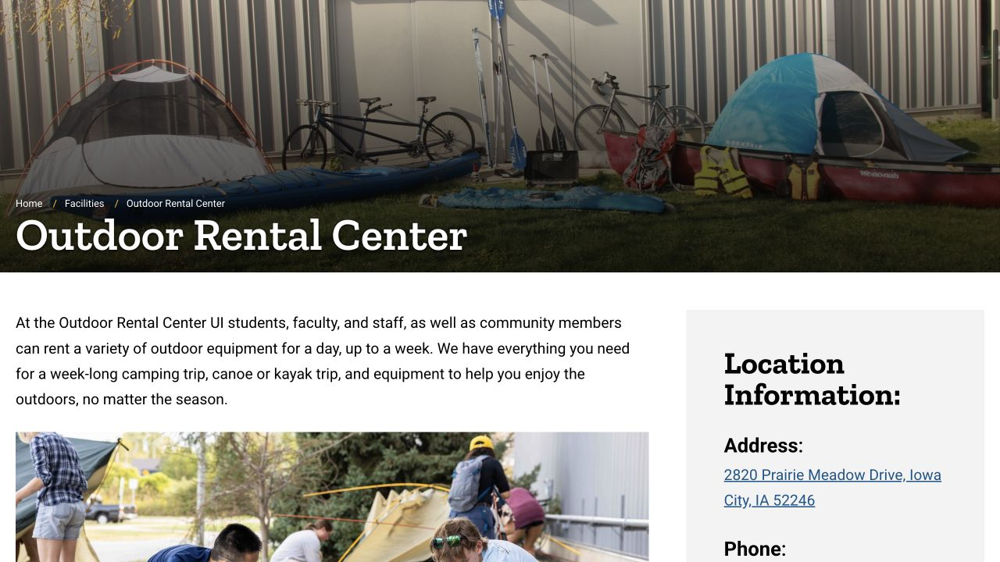

课业之间想换换环境，不一定要安排一整天出游。Iowa City 的公园可以走短程原路返回，也有容易辨认的环湖路线和林间步道。记下起点与回程安排，再结合天气、天黑时间和当天体力选路，就能把一次户外活动安排得比较轻松。下面介绍的都是公共城市公园；涉及课程或装备租借时，再单独按对应服务的流程办理。

## City Park：适合随时缩短的河边散步

City Park 地址是 200 E Park Road。市政府列出的设施包括河边步道、开阔草地、野餐棚与球场，适合和朋友散步、找个地方坐坐。从有标识的公园入口或停车区进入，打开城市地图辨认方向，沿当天开放的路径走。第一次可以采用原路往返，天气变化时比较容易结束行程。

例如，约定走十五分钟就转身，而不是一直沿陌生小路走到累了才找出口。这是方便开始的行程建议，并非官方里程路线。公园设施清单里的泳池、滑冰等项目各有季节和开放条件，想参加时要另外查看当天是否运营。

- [City Park 地址、地图与设施](https://www.icgov.org/Home/Components/FacilityDirectory/FacilityDirectory/26/252)

## Terry Trueblood：从明确起点绕湖一圈

Terry Trueblood Recreation Area 地址是 579 McCollister Boulevard。城市 South District 规划文件把 Sand Lake 环湖自行车／步行路径描述为约两英里，也就是约 3.2 公里。按公园地图和现场开放路径环湖，可回到同一入口；如果还要从住处走去或骑去，总距离要把这两段也算进去。只想短走时，途中原路返回也可以。

当前城市 Parks and Trails 页面写明，这里因低水位与水质问题禁止游泳。即使旧攻略提到沙滩，也应按现在的公告安排活动。湖边散步和进入水中分别受不同条件约束，看到装备租借或旧活动宣传，也要继续遵守现场限制。

- [城市最新公园公告与禁止游泳说明](https://www.icgov.org/government/departments-and-divisions/parks-and-recreation/parks-and-trails)
- [城市 South District 规划 · 环湖路径描述](https://www.icgov.org/home/showpublisheddocument/2700/638834135430870000)

## Hickory Hill：想走林间步道时可以选这里

城市目录列出的 Hickory Hill Park 地址为 800 Conklin Street，有自然区域、步道、停车区和野餐设施。想换成树林里的散步体验，可以把这里放进周末选项。进入前看地图、记住自己使用的入口，第一次选一段容易原路返回的路线，熟悉后再组合其他小路。

鞋子要适合走可能不平或潮湿的地面，也给天黑前返回留余量。公园有多条路径，实际距离取决于怎样走，因此这里不为整座公园编一个统一的“环线长度”。遇到泥泞、障碍或关闭标识，缩短行程或换开放路线即可。

- [城市公园目录 · Hickory Hill 地址与设施](https://www.icgov.org/government/departments-and-divisions/parks-and-recreation/parks-and-trails/parks)

## 骑车去公园，要把从家出发和回程一起接起来

城市 Parks and Trails 页面提供公园互动地图与步道入口。把住处到公园的整段路线接起来，看清道路交叉口和回程方向；地图里一段独立步道很舒服，两端如何接到街道，也会影响第一次骑行的体验。

可以先在白天试一条离家近、方便重复的小路线，带头盔、车灯、水和有电的手机。经过步行者时留足空间，超车前示意，并按该路径现场规则骑行。E-bike 或 scooter 的使用规则要对应具体车辆与地点确认。本网站另一篇骑行笔记介绍选车与本地车店，计划买车时可以接着看。

- [城市公园地图与步道规划入口](https://www.icgov.org/government/departments-and-divisions/parks-and-recreation/parks-and-trails)

## 还没决定买装备，可以先租一次体验

Outdoor Rental Center 位于 2820 Prairie Meadow Drive，向学生和社区成员出租自行车、露营及雪地活动等装备。想预约时，至少提前三个工作日通过公开 request form 提出申请，再等工作人员确认是否有货和取还安排；提交表格后还需要收到确认。

当前公路／山地自行车价格为日租 $20、周末 $40，包含头盔。周末按周末价计，需在周一开放时段归还。租用者须年满十八岁并带照片证件。安排前问好物品怎样搬运、何时取还；网页不同段落对一般开放日的描述有差异，因此以工作人员发来的确认安排为准。

- [装备、价格、申请表与取还规则](https://recserv.uiowa.edu/outdoor-rental-center)

## 天气和季节会改变一条路线的体验

出门前看当天预报和城市公告。冷天把提早日落考虑进去，阴影处的地面也可能更湿、更容易结冰；带一件停下来时能加上的外套，自备水，就不用依赖沿路饮水设施恰好开放。天气拿不准时，选离家近、随时可结束的短路线，会更适合这次出门。

步道有除雪安排，也仍可能有冰。遇到围挡、积水或湿滑路段，按现场公告改路。和朋友一起去时，把集合入口和预计结束时间说清楚，迟到的人也能找到集合点，无需在整座公园里寻找。

## 给一个容易实现的周末安排

可以从 City Park 的短散步和野餐开始，等熟悉交通、天气也合适时，再安排完整的 Terry Trueblood 环湖。带搬得动的食物、收走自己的垃圾，并为返程留时间。这里提供的是自由安排的例子，不是已经组织好的 ISAB 活动。

涉及租装备的聚会，应在邀人前把预约和搬运安排落实。普通公共步道、装备租借与有人带领的户外课程，各自需要的准备不同。需要付费或报名时，到相应服务的官方页面查看余量并办理；日常公园散步可以直接按开放情况自行安排。

> ISAB 独立整理 · 资料核对于 2026 年 10 月 18 日。出发前核对公园当前限制、天气、步道状况与装备租借确认。

## 来源与实用链接

- [Iowa City · Parks, maps and current notices / 公园地图与当前公告](https://www.icgov.org/government/departments-and-divisions/parks-and-recreation/parks-and-trails)
- [Iowa City · City Park / 城市公园](https://www.icgov.org/Home/Components/FacilityDirectory/FacilityDirectory/26/252)
- [Iowa City · Park directory / 公园地址与设施](https://www.icgov.org/government/departments-and-divisions/parks-and-recreation/parks-and-trails/parks)
- [Iowa City · South District plan / 环湖路线官方描述](https://www.icgov.org/home/showpublisheddocument/2700/638834135430870000)
- [Recreation · Outdoor Rental Center / 户外装备租借](https://recserv.uiowa.edu/outdoor-rental-center)
