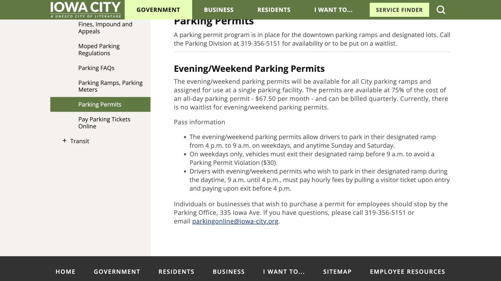
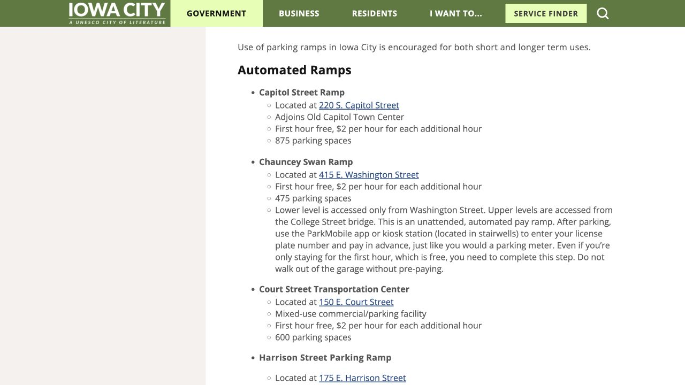

一张停车许可是否实用，要看车位在哪里，以及有效时段能不能接上自己的生活。每天早上开车去实验室，和把车放在公寓附近、晚上偶尔去 downtown，需要考虑的安排就不同。把目的地、进出时间、每周开车次数，以及租约是否已含车位记下来，再比较下面的校园与市政两条购证路径，会更容易选到合适的产品。

## 天天通勤，还是偶尔办事？先算自己的使用量

如果每天开车上课，可以把整学期许可费用，与停车后走路、等车到教学楼的时间一起比较。只是偶尔去图书馆或办事，则按真实开车次数算临停更直观。较远停车场的价格可能更低，但是否适合，还取决于你下课时接驳是否运行；停车地图与公交服务日历需要放在一起看。

校园停车与市政停车楼分别运营，许可适用于购买产品写明的场地。普通许可通常也没有给个人预留某一个固定车位。付款前读清位置、限制和余量，并了解场地满位时运营方提供什么安排，这样第一天开过去时才有完整预期。

## 校园路径第一步：按身份和住址查能买什么

Student Parking 页面按身份和居住情况整理产品，包括住校宿舍、本科生住 Iowa City／Coralville、市界外通勤本科生，以及研究生／专业学位学生。选择当前符合自己的分类后，还要继续打开目标产品的详细页，才能把总览里的选项与具体资格接起来。

例如 Lot 85 详细页列出的适用人群是住 Iowa City／Coralville 市界外的通勤本科生，以及研究生，购买仍受余量限制。本科生在 Iowa City 租了公寓，并不因此获得 commuter 资格。页面没有说清自己的住址或身份怎样适用时，可以拨校园停车部门 319-335-1475，说明情况后再购买。

## 先准备真实车牌；新车临牌要另问

下单前准备校园登录账号、当前联系方式和准确车牌。虚拟许可通过登记车牌识别，学生许可只能关联一辆车，因此车牌与车辆资料会直接影响检查结果。换车、临牌换正式牌后，记得回许可系统更新。

新车仍使用临时牌或经销商牌时，校园说明要求联系停车部门，把完整 VIN 加入许可；具体做法与临停 App 的填法可能不同。还要查看目标场地是否需要 access card。虚拟登记负责识别许可，部分闸口仍通过另一张卡进出，购证后应一并安排。

## 校园下单：从 Parking Portal 进入，核对后再付钱

从 Student Parking 的官方说明进入 Parking Portal，用自己的校园账号登录，再打开许可购买流程。把账号显示可买的产品，与地图上的完整产品名和 lot 编号对上。如果目标产品没有显示或已售罄，可以向停车部门询问帮助或候补安排，确认后再继续。

选择正确车辆，阅读有效日期与条款，再使用页面提供的付款方式；学生说明列出线上支付或计入学生账单。购买完成后保存确认邮件，核对车牌、产品、日期和付款。需要闸口卡的产品，也要在第一次使用前确认取卡方法。下方 Portal Info 有官方购证和车辆修改教程，可以对应自己的操作查看。

- [打开校园停车购买入口](https://parking.uiowa.edu/)

## 看学期总价，不要只看“每月多少钱”

2026 年 7 月 1 日起的学生价格表可用于比较预算：Lot 85 每月 $18／每学期 $81；研究生与专业学位学生的 Lot 65 每月 $29／每学期 $130.50；学生 Night Weekend 每月 $8／每学期 $36。选择时结合自己的资格，看完整学期金额，才更接近实际支出。

学年许可覆盖 8 月 16 日至次年 5 月 15 日，暑期另有 5 月 16 日至 8 月 15 日的产品。表上的月价是这套安排里的比较方式，下单应按页面真正显示的日期和金额安排预算，而不是按普通的一个月订阅理解。

## NW 夜间周末许可：证要付费，停车优惠也有边界

学生 Night Weekend，简称 NW，面向符合条件、未住学校宿舍的学生。公开页面列出的平日闸口进场窗口为周一至周五 16:30–次日 04:29，周末全天，且仅适用参与场地；Hospital Parking Ramps 1、2、4 不在其中。准备常去某处之前，打开 NW 详细页把目标场地对上。

进出都要刷 access card，即使闸杆已抬起也一样；取访客票进场，会形成另一种停车记录。该页写明工作日 08:31–16:29 停车产生小时费，并将凌晨 4 点进、下午 4 点出列为不当使用。涉及过夜时，把第二天的离场也算进一次完整停留；如果具体时刻拿不准，请停车部门按真实进出时间解释计费。

## 假期不用车位，要按流程取消；春季还有账单

学生停车费按秋、春学期收取，第二期在 1 月 1 日计费。秋季用过的信用卡不会被保留用来扣春季款，春季费用会进入学生账单。NW 和 Lot 85 页面都说明，未取消时许可会进入春季财务续订，因此离校或改用其他交通后，也要处理这笔安排。

不再需要时使用官方 Cancel Permit Form，并保存取消确认，费用会持续至取消或到期。公开规则按半月算最后一期：当月 1–15 日取消计半月，16 日起取消计整月。下一学期也应重新读销售和续订通知，把可能变化的住址、身份与用车习惯一起更新。

## 城市路径：先问哪座 ramp，再问全天还是夜间周末

市政停车楼许可可向 Parking Office 咨询，电话 319-356-5151，办公地址 335 Iowa Avenue。说明想用哪座 ramp，询问余量与候补后，再确认联系、账单、车辆和闸口卡资料怎样准备、怎样取卡，以及续订和取消流程。公开页面把购买问题导向这间办公室。

城市收费表列出的预付全天 ramp 许可为每月 $90；evening/weekend 每月 $67.50，可按季度计费，只适用于分配给你的一座停车楼。夜间周末时段为工作日 16:00–次日 09:00，以及周六周日全天，因此平日应在早上 9 点前结束这段停留。09:00–16:00 如需停车，按访客取票并付小时费，依页面流程在 16:00 前付费离场。购买前核实当前条款和目标楼余量，页面整体写暂无夜间许可候补，也仍需确认具体哪座楼能安排。

- [市政停车楼许可与办理地点](https://www.icgov.org/government/departments-and-divisions/transportation/parking/parking-permits)

## 只去 downtown 一会儿：首小时免费，也可能要先登记

市政停车楼公布的临停价为首小时免费，之后每小时 $2，但每处操作方式不同。Chauncey Swan 与 Harrison Street 要求停车后在 kiosk 或 ParkMobile 输入车牌、开启 session，待一小时以内也要完成。其他停车楼可能在进场取票、出场付款，跟着现场设备和标志操作即可。

短时间去 downtown 或图书馆时，选定附近停车楼，也顺便了解付款步骤，才能安心离车。校园停车楼有自己的收费；路边咪表则要同时遵守标明的最长停留时间，即使机器还能收钱，也不能据此延长到限制之外。

> ISAB 独立整理 · 资料核对于 2026 年 10 月 18 日。出发或购买前，通过文中来源确认最新时间、费用与适用条件。

## 来源与实用链接

- [Campus · Student eligibility, ordering & billing / 校园学生购证说明](https://transportation.uiowa.edu/parking/student-parking)
- [Campus · Parking Portal / 校园停车购证入口](https://parking.uiowa.edu/)
- [Campus · Portal ordering & vehicle tutorials / 购证和车辆修改教程](https://transportation.uiowa.edu/parking/license-plate-recognition/parking-portal-info)
- [Campus · Plates & virtual permits / 车牌与虚拟许可](https://transportation.uiowa.edu/parking/license-plate-recognition)
- [Campus · Lot 85 eligibility / Lot 85 通勤许可资格](https://transportation.uiowa.edu/parking/student-parking/student-hawkeye-commuter-permit)
- [Campus · Current rate table / 当前价格表](https://transportation.uiowa.edu/parking-rates)
- [Campus · Student Night Weekend rules / 学生夜间周末许可规则](https://transportation.uiowa.edu/parking/student-parking/student-night-weekend-permit)
- [Iowa City · Permits & office purchase route / 城市许可与办理入口](https://www.icgov.org/government/departments-and-divisions/transportation/parking/parking-permits)
- [Iowa City · Current parking fee code / 城市现行停车收费表](https://codelibrary.amlegal.com/codes/iowacityia/latest/iowacity_ia/0-0-0-1146)
- [Iowa City · Ramp locations & payment steps / 停车楼位置和缴费方法](https://www.icgov.org/government/departments-and-divisions/transportation/parking/parking-ramps-parking-meters)
