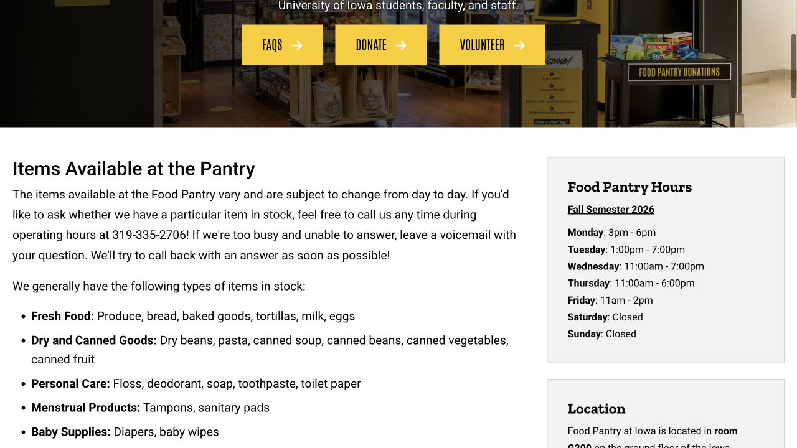

Handbook 列了不少支持服务，但真正遇到问题时，仍可能不知道自己的情况该找哪一个。买菜的钱快不够了、住房突然出问题、课堂展示不知怎样准备，适合的帮助各有侧重。可以直接用自己的话描述正在发生什么，让服务人员解释有哪些选择。下面把资源名称展开成具体路径：找谁、带什么，以及联系之后如何继续。

## 一件突发事情影响好几方面生活：联系 Student Care and Assistance

生病、家人离世、校外居住问题或其他意外，开始影响上课和日常安排时，可以联系 Student Care and Assistance。它为本科生、研究生、专业学位学生及博士后协调支持，可安排线下、线上或电话沟通。从公开页面的 Make an appointment 预约，或拨 319-335-1162 描述情况、询问从哪里开始。

例如，住院后既不知道怎样和老师沟通，又需要安排接下来几天的生活，就可以把这两件事一起说出来。整理简短时间线、受影响的课程或截止日，以及最急需处理的问题，会更方便团队连接相关部门。当前页面提到 Calvin Hall 临时办公室，预约后按确认信息核对实际见面地点。

- [Student Care and Assistance · 预约与联系方式](https://dos.uiowa.edu/assistance)

## 吃饭、住房或财务压力：和 Basic Needs advisor 谈一谈

Basic Needs 页面可以预约顾问，讨论食物获取、住房稳定和财务方面的问题。困难逐渐累积时也可以联系，不必等到发生突发事件。开头可以很具体：“我的买菜预算撑不到下个月了”，或“旧租约结束与新租约开始之间可能没地方住”。

预约前记下眼前的期限、已经试过哪些办法，以及现在最需要什么支持。顾问会介绍校园和社区资源，并解释相关申请。能用哪项项目由服务方按条件判断；第一次求助时，把实际需求说清楚就已经足够开始讨论。

- [Basic Needs · 顾问预约与资源入口](https://dos.uiowa.edu/basic-needs)

## Food Pantry：带学生卡和袋子，到 IMU G200

Food Pantry 为符合校园身份的使用者提供免费食物和基本用品，没有特定收入门槛，地点在 IMU ground floor 的 G200。带 Iowa One Card 和购物袋，进门登记、按货架限量取物，离开前到 checkout 由志愿者记录和称重，无需付买菜钱。当天食物和日用品按库存变化。

当前规则是每个 school week 可来一次，周一重置。2026 秋季时间为周一 15–18 点、周二 13–19 点、周三 11–19 点、周四 11–18 点、周五 11–14 点，周末关闭；假期前查看实时页。遇到饮食限制或不熟悉的配料，可以请志愿者协助。

- [Food Pantry · 当前时间、地点与规则](https://foodpantry.org.uiowa.edu/)
- [Food Pantry FAQ · 资格与收入门槛问题](https://foodpantry.org.uiowa.edu/frequently-asked-questions)

## 需要做好的餐食：Hawkeye Meal Share 有单独申请入口

Hawkeye Meal Share 利用捐出的 meal swipes，为食物不足的符合条件学生提供短期 dining marketplace 餐食支持，名额取决于捐赠余量。在官方页面点 Request meals 并填写服务方的申请，之后由 Student Care and Assistance 联系、确认资格和领取方式。当前每次分配为七次 swipe，每学期最多申请两次。

页面顶部高需求公告说，申请在四个工作日内审核；下面较旧的段落仍写二十四小时。安排时按高需求公告预留等待，有眼前的吃饭困难就直接拨 319-335-1162。等回复期间也可以联系顾问或按开放时间去 Pantry，把实际可用的食物来源接起来。

- [Hawkeye Meal Share · 当前公告与餐食申请](https://dos.uiowa.edu/assistance/hawkeye-meal-share)

## 突发支出可能影响继续读书：了解 Emergency Fund

Student Life Emergency Fund 面向当前在读本科生、研究生和专业学位学生，用来处理可能中断学业的意外财务困难。官方举例包括严重事故、紧急安全需要，以及直系家人离世后的旅行支出。它不用于日常长期生活开销，也不能用于学校学费或相关收费。

页面写目前平均资助约 $500，每学年最多一次，实际资格和金额仍由项目审核。读清条件后从官方入口申请；也可以先向办公室说明发生了什么、何时要付款、已经考虑过哪些资源，再问需要准备什么资料。用具体情况展开，比只问“我能拿多少”更容易获得适合自己的指导。

- [Student Life Emergency Fund · 条件与申请入口](https://dos.uiowa.edu/assistance/student-life-emergency-fund)

## 论文和课堂演讲，都可以从当前 Writing Center 系统约起

Writing Center 为各学科学生提供免费写作和演讲支持，主页有预约与 document review 入口。第一次在链接的预约系统注册后，需要通过发到完整校园邮箱的邮件激活账号。准备作业要求、已有草稿和两三个问题，例如论证怎样展开，或五分钟展示怎样讲得更清楚。

旧 handbook 链接可能把你带到独立的 Speaking Center 日历，但旧系统的公告写明，演讲预约自 2023 年秋已转到 Writing Center。现在需要 presentation 支持，走当前 Writing Center 入口即可。顾问会和你讨论结构、表达与修改思路，帮助你完成自己的作品；整篇代改不属于其服务。

- [Writing Center · 当前预约与稿件反馈入口](https://writingcenter.uiowa.edu/)
- [Writing Center FAQ · 准备材料与演讲支持](https://writingcenter.uiowa.edu/services/frequently-asked-questions)
- [原 Speaking Center · 预约迁移公告](https://uiowa.mywconline.net/)

## 租约或其他法律疑问：向 Student Legal Services 预约咨询

Student Legal Services 为在读学生提供持牌律师的免费咨询，可线下或 Zoom 进行。当前预约页要求向 student-legal@uiowa.edu 发送问题简介及 student ID number，再按服务方流程完成 intake。租约、相关邮件或照片等材料，在会前直接交给该服务，方便律师了解问题。

例如，房东提出一笔看不懂的费用，可以整理租约、书面收费说明与往来沟通，再约时间讨论。页面列出的咨询时长为四十五分钟。办公室会说明能提供哪些协助，或是否需要转介；具体服务范围与后续代理安排，请与律师确认。

- [Student Legal Services · 当前咨询预约方法](https://studentlegal.uiowa.edu/schedule)

## 谈完之后，把“接下来做什么”记下来

一次咨询结束时，记下下一步是什么、由谁处理，以及大约什么时候应收到回复。涉及多个办公室时，把确认邮件放在一起；可以当场问：“到这个日期还没消息，我应该联系谁？”这样，咨询里得到的帮助就能接成后续行动。

个人记录、证明和申请资料直接使用服务方自己的预约、上传或联系入口。ISAB 网站负责帮助大家找到路径，资格判断、文件处理与预约由对应机构完成。如果第一次的入口暂时没有空位，或者不适合你的问题，可以继续说明仍未解决的需求，请对方提供转介。

> ISAB 独立整理 · 资料核对于 2026 年 10 月 18 日。资格、隐私条款、预约及申请由文中各服务提供方直接处理。

## 来源与实用链接

- [Student Care and Assistance · Support and contact / 综合协助与联系](https://dos.uiowa.edu/assistance)
- [Basic Needs · Advisor and resources / 顾问与资源](https://dos.uiowa.edu/basic-needs)
- [Food Pantry · Current visit rules and hours / 当前使用规则与时间](https://foodpantry.org.uiowa.edu/)
- [Food Pantry FAQ · Eligibility / 资格](https://foodpantry.org.uiowa.edu/frequently-asked-questions)
- [Hawkeye Meal Share · Requests / 餐食支持申请](https://dos.uiowa.edu/assistance/hawkeye-meal-share)
- [Student Life Emergency Fund · Eligibility / 紧急资助条件](https://dos.uiowa.edu/assistance/student-life-emergency-fund)
- [Writing Center · Current booking entry / 当前预约入口](https://writingcenter.uiowa.edu/)
- [Writing Center FAQ · Writing and presentations / 写作与演讲支持](https://writingcenter.uiowa.edu/services/frequently-asked-questions)
- [Former Speaking Center · Move announcement / 迁移公告](https://uiowa.mywconline.net/)
- [Student Legal Services · Appointment instructions / 咨询预约说明](https://studentlegal.uiowa.edu/schedule)
