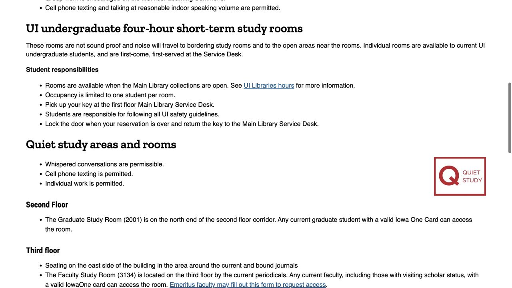
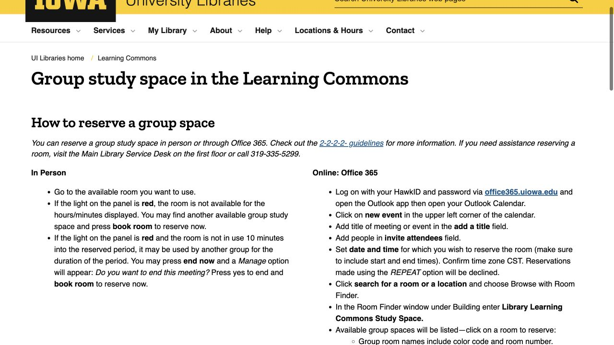

一个人读书、小组讨论，以及参加线上会议，对空间的需要不同。想清楚这次要做什么，再看楼层图和预约规则，就比较容易选到能安心使用的地方。下面从去哪找、怎样确认预约，写到到场后如何使用；ISAB 帮大家认路，实时余位和预订由图书馆系统处理。

## 先选安静还是讨论，再查当天开放时间

Main Library 一楼的 Learning Commons 面向协作学习，有讨论房、桌位和休闲座椅。需要连续阅读或写作时，标注 quiet／silent 的区域会更适合作为起点。按任务选择空间，也是在找周围同学对声音和活动有相似预期的环境。

晚上去之前查看当天 hours，建筑、馆藏区和咖啡店可能各有时间表。把回程和一个备用地点一起想好，第一选择较忙时就能平稳调整，不用到了现场再重新安排整场自习。

- [Main Library · Learning Commons](https://www.lib.uiowa.edu/commons/)
- [UI Libraries · Current opening hours](https://www.lib.uiowa.edu/hours/)

## 安静座位看楼层图，别把整层都当讨论区

Main Library 的 quiet／silent 地图会标明具体区域，包括三楼东侧期刊区，以及四、五楼书架附近的安静座位。结合地图与现场标签，比仅凭楼层高低判断能否说话更准确。

研究生持有效 Iowa One Card，可进入二楼走廊北端的 Graduate Study Room，房号 2001。坐定后按该处 quiet／silent 要求学习，需要接电话或交谈时移到中央走廊。共享学习环境里的声音预期一致，也更方便自己和其他人持续专注。

- [Main Library · Study spaces and lockers](https://www.lib.uiowa.edu/about/studyspaces/)
- [Main Library · Quiet and silent study map (PDF)](https://www.lib.uiowa.edu/about/files/2012/10/map-of-quiet-study-spaces.pdf)

## Main 组队房：HawkID → Outlook → Room Finder

预约 Main 的学生组队房，可以用 HawkID 登录 UI Office 365，进入 Outlook Calendar，新建 event，加入组员和开始、结束时间。打开 Room Finder，在 Building 搜索“Library Learning Commons Study Space”，从列表选择空闲房间，再保存／发送事件。

核对时区后，查看房间发来的接受邮件。房间拒绝时，事件仍可能留在个人日历，所以分享给组员的依据应是接受回复。周期性重复预约会被拒绝，需要按实际会议分别选择符合规则的时段。

- [Learning Commons · How to reserve a group space](https://www.lib.uiowa.edu/commons/group-spaces/)
- [UI Office 365 · Sign in and open Outlook Calendar](https://office365.uiowa.edu/)

## 订之前记住 2-2-2-2，别只看有没有空位

Learning Commons 预约有四个“2”：小组至少两名学生，每次最多两小时，每名学生每周最多两次，最多提前两周。预约开始十分钟仍未到场，小组就失去该时段。选时间时把这些规则和全组到达时间一起考虑，房间才真正用得上。

收到接受后，保存邮件并把房名、时间告诉参与者。计划改变，或看不懂房间回复时，可以联系 Main Library Service Desk，请工作人员协助释放或更正。及时处理，也能把自己不用的时段留给其他同学。

- [Learning Commons · 2-2-2-2 and no-show policy](https://www.lib.uiowa.edu/about/policies/group-spaces/)

## 到了门口先看屏幕，再确认房型和设备

讨论室门口面板会显示预约状态。官方使用说明介绍了空闲房间怎样在面板现场预订，因此到门口后读屏幕、按提示操作，再安顿物品。某一刻屋里没人，也可能仍处在另一组已预约的时间内。

普通彩色条纹组队房最多容纳六人，更大的房间和开放区配置不同。按人数和设备需求选择，准备投屏时尤其要提前看列出的设备。白板笔和板擦可向 Service Desk 借用。房间或预约操作有问题，可到一楼服务台，或拨 319-335-5299 寻求帮助。

- [Learning Commons · How to reserve a group space](https://www.lib.uiowa.edu/commons/group-spaces/)

## 个人房有另一套方法，不是把组队房约给自己

Main Library 的短时个人自习房面向当前本科生，一人一间，可使用四小时。馆藏区开放时，到一楼 Service Desk 问当天先到先得的余位，并在那里领钥匙，用完归还。这些房间不隔音，打算面试或通话时，可以向服务台说明需求，再确认是否适合。

长期研究房则通过另一套按资格分配的方式办理。日常一个人学习，安静开放座位通常已能满足需要；确实需要房间时，把任务说明白，工作人员才好指向对应选项。

- [Main Library · Study spaces and lockers](https://www.lib.uiowa.edu/about/studyspaces/)

## Hardin 要走自己的日历，别照搬 Main 的步骤

Hardin 有自己的实时组队房日历。从官方 Study Rooms 链接进入，选可用时段并用校园邮箱预约，确认邮件中有取消入口。这里有十一间可预约讨论室；单人使用或小组迟到十五分钟，预约可能被取消，因此应把到场时间与组员约好。四楼个人房先到先得，不能预订。

Hardin 三楼另设正常闭馆后的二十四小时安静学习区域，供符合条件的本校师生员工持被接受的 UI／UI Health Care badge 使用。这是特定区域的访问安排。晚间出发前，读空间页和预约提示的当前证件要求、入口说明，再据此安排进入。

- [Hardin · Study rooms and 24-hour study access](https://www.lib.uiowa.edu/hardin/information/spaces-at-hardin/)
- [Hardin · Live group-room availability and booking](https://uiowa.libcal.com/reserve/hardin-groupstudy)

## 吃东西、放包，以及找不到座位时的准备

Main Library 许多地方允许饮食，但电脑、复印／打印设备附近和部分部门有限制，各分馆也可能另有规则。按座位附近标志使用，结束后收好垃圾。Learning Commons 靠 Madison Street 一侧列有日用储物柜；长期分配柜则另走申请。

日常可以轻装带耳机和充电器，需要开口参加会议、或找不到合适座位时，向服务台讲清任务。把任务与空间配好，就更容易安顿下来完成这次学习，也减少中途不断换地方的麻烦。

- [UI Libraries · Food and drink policy](https://www.lib.uiowa.edu/about/policies/fooddrink/)
- [Main Library · Study spaces and lockers](https://www.lib.uiowa.edu/about/studyspaces/)

> ISAB 独立整理 · 资料核对于 2026 年 10 月 18 日。以图书馆当天开放时间、权限要求和预约确认结果为准；ISAB 不代订房间，也不展示实时空位。

## 来源与实用链接

- [Main Library · Learning Commons](https://www.lib.uiowa.edu/commons/)
- [Main Library · Study spaces and lockers](https://www.lib.uiowa.edu/about/studyspaces/)
- [Main Library · Quiet and silent study map (PDF)](https://www.lib.uiowa.edu/about/files/2012/10/map-of-quiet-study-spaces.pdf)
- [Learning Commons · How to reserve a group space](https://www.lib.uiowa.edu/commons/group-spaces/)
- [Learning Commons · 2-2-2-2 and no-show policy](https://www.lib.uiowa.edu/about/policies/group-spaces/)
- [UI Office 365 · Sign in and open Outlook Calendar](https://office365.uiowa.edu/)
- [Hardin · Study rooms and 24-hour study access](https://www.lib.uiowa.edu/hardin/information/spaces-at-hardin/)
- [Hardin · Live group-room availability and booking](https://uiowa.libcal.com/reserve/hardin-groupstudy)
- [UI Libraries · Food and drink policy](https://www.lib.uiowa.edu/about/policies/fooddrink/)
- [UI Libraries · Current opening hours](https://www.lib.uiowa.edu/hours/)
