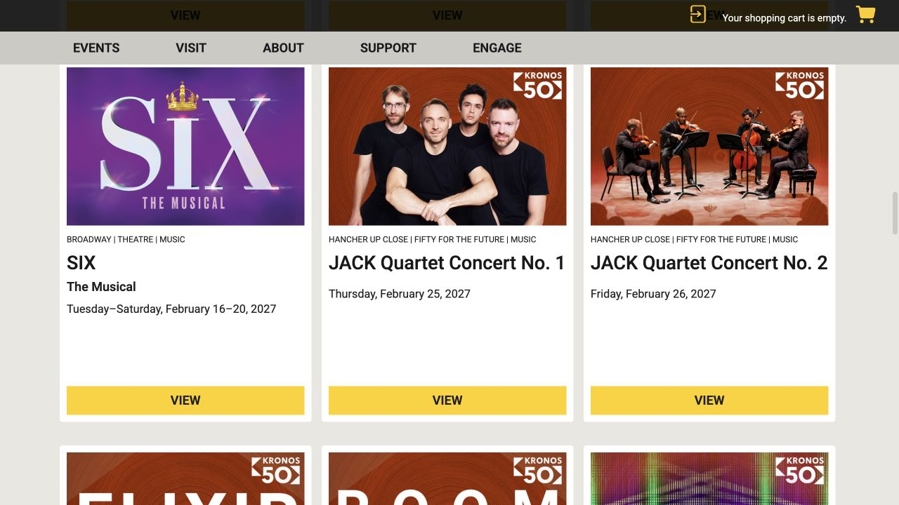
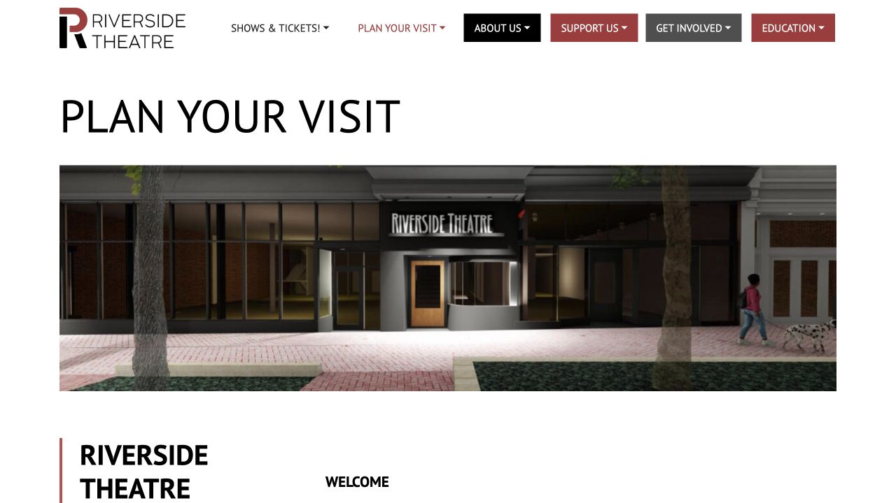

想在课业之外给一周留点期待，可以从一场现场演出开始。Iowa City 有不同的选择：去 Hancher 看巡演，在 Riverside 看一部本地制作的话剧，或到校园剧场接触正在形成的新作品。不必先成为懂戏的人；找到感兴趣的故事，再顺着这一场的购票和场地信息安排就好。同一个售票处可能代售不同主办方的节目，因此学生优惠、演出地点和入场方式，都要看自己选中的场次。

## 从自己愿意看的内容开始选

第一次看音乐剧，可以读一段剧情介绍，再听几首官方发布的歌曲；知道故事发生在哪里、主要人物是谁，现场遇到语速快的唱段也更容易跟上。话剧往往更依赖对白；如果一整晚听陌生英语让人有压力，舞蹈或器乐演出也可以成为起点。选节目时一起看时长、是否有中场休息，以及内容提示，判断它适不适合自己的状态和兴趣。约朋友同行的话，在付款前把日期和总预算说清楚，也给实验、考试等安排留出余地。

## 大型巡演和音乐剧，从 Hancher 当前演出季查起

Hancher 的节目包括外来巡演、Broadway 音乐剧、音乐和舞蹈。打开当前演出季，进入具体节目后再核对日期与场地；同一部戏如果连演多场，可以比较工作日晚场和周末日场的余票与价格。群里转发的旧海报可以用来认识剧名，但真正购票仍应回到正在售票的节目页。搜索引擎可能把转售网站排在前面，付款前看清自己是否还在 Hancher 网站，再沿节目自己的购票入口继续。

- [Hancher · 当前演出季](https://hancher.uiowa.edu/2026-27)

## 学生票先看主办方，再选对应身份

Hancher 主办的演出如果提供 college student 票，在高校学位项目就读的学生可使用该优惠，入场需带有效学生证；每名符合资格的学生还可为一位同行者购买当场提供的同价 guest 票。校园 Theatre Arts、Music 和 Dance 的制作则另分 UI Student 与其他高校学生票，前者只适用于本校在读学生，也没有随带一位同价 guest 的规则。付款时把每一位观众的身份和票种对应起来，并查看所选场次实际开放哪些优惠。开学季某次促销不代表全年、全场次都只要 $5。

- [Hancher · 票种与学生资格](https://hancher.uiowa.edu/Online/default.asp?BOparam%3A%3AWScontent%3A%3AloadArticle%3A%3Acontext_id=&BOparam%3A%3AWScontent%3A%3AloadArticle%3A%3Apermalink=tickets)

## 看完最终金额，再保存真正用于入场的票

从所选节目的购票按钮进入，依次确认日期、场次和座位，付款前读最终金额、手续费、视线限制，以及改期或退票规则。确认邮件收到后，按里面的方式取票：提供电子票或钱包票时，提前打开并把手机充好电；写着 Will Call 时，就把到售票处取票的时间算进去。订单付款成功的邮件不一定就是能扫码入场的条码，出发前把票面单独找出来。如果一直找不到或不明白交付方式，可联系 Hancher Box Office，电话 319-335-1160，报自己的订单和场次询问。

## 想把晚饭和话剧排在一起，可以看 Riverside

Iowa City 的 Riverside Theatre 位于 119 E College St，在 downtown 安排吃饭和看戏比较顺路。可以从它的主页进入当前制作，读故事梗概、演出日期、座位安排和当场提供的票种，再决定约哪一天。学生优惠或 rush 票需要问这部戏当前怎么执行，不要照搬多年以前的价目表；售票处电话是 319-259-7099。若需要电梯、无障碍座位或其他协助，买票时就把需求问清楚。吃完饭也留一点找入口的时间，避免到了同一条街却还没找到真正的剧场门。

- [Riverside · 当前演出](https://riversidetheatre.org/)
- [Riverside · 到访信息](https://riversidetheatre.org/planyourvisit/)

## 校园剧场也值得看，尤其是新剧和小型制作

Theatre Arts 的活动页除了 mainstage 主舞台作品，还列 workshop、gallery 和剧本朗读。当前 workshop 和 gallery 免票，但需要到门口领票，而且座位有限；免费也要留时间到场。Mainstage 另有自己的购票安排，不能把小型制作的规则套到所有节目。Theatre Building 地址是 200 N Riverside Drive，进去后还要看票上写的是楼内哪一间剧场。对新作品，可以先读剧情简介和 virtual programme，认识人物与主题；校园音乐剧也可以和 Hancher 的巡演一起纳入选择。

- [Theatre Arts · 节目与活动](https://theatre.uiowa.edu/)
- [2026–27 校园表演艺术季介绍](https://performingarts.uiowa.edu/news/2026/07/performing-arts-iowa-announces-2026-27-season)

## 第一次去，给自己留出坐定的时间

可以按开演前约半小时到楼里来规划，如果还要取票、借设备或找无障碍路线，再多留一点。这是方便安排的余量，不代表所有场次都在同一时间开门。进场后先找到洗手间、楼层和座位，把手机调成静音并收起亮屏，聊天和回消息留到中场。能不能拍照、录影，以当场提示为准。迟到或中途离席后要重新进入时，先问引座员什么时候方便；Hancher 可能要等到合适的段落才安排入座，不一定能一到就走进观众席。

## 散场怎么回家，也在选场次时一起安排

Hancher 在 141 E Park Road。其停车说明列明：Hancher 晚间及周末活动可在 Lot 55 先到先停，车位有限；这类活动安排并不等于平时白天通勤也能免费停。页面同时列有附近公交站点。买晚场前，用预计结束时间比较当天末班车，再存一个步行或叫车方案，避免剧还没结束就担心回程。Hancher 的轮椅席位需电话或现场联系售票处购买，听力辅助等服务也可从无障碍页了解。无论去哪家剧场，有需要时带着具体剧名、日期提前联系，方便工作人员确认可提供的安排。

- [Hancher · 停车、公交与无障碍服务](https://hancher.uiowa.edu/Online/default.asp?BOparam%3A%3AWScontent%3A%3AloadArticle%3A%3Aarticle_id=98F0FB54-4D05-4DEA-A38C-3A2694BF8D2C&doWork%3A%3AWScontent%3A%3AloadArticle=Load)

> ISAB 独立整理 · 资料核对于 2026 年 10 月 18 日。票价、余票和入场安排可能调整，请以所选场次的主办方或影院页面为准。

## 来源与实用链接

- [Hancher · current season](https://hancher.uiowa.edu/2026-27)
- [Hancher · tickets and student eligibility](https://hancher.uiowa.edu/Online/default.asp?BOparam%3A%3AWScontent%3A%3AloadArticle%3A%3Acontext_id=&BOparam%3A%3AWScontent%3A%3AloadArticle%3A%3Apermalink=tickets)
- [Hancher · parking and accessibility](https://hancher.uiowa.edu/Online/default.asp?BOparam%3A%3AWScontent%3A%3AloadArticle%3A%3Aarticle_id=98F0FB54-4D05-4DEA-A38C-3A2694BF8D2C&doWork%3A%3AWScontent%3A%3AloadArticle=Load)
- [Riverside · current productions](https://riversidetheatre.org/)
- [Riverside · plan your visit](https://riversidetheatre.org/planyourvisit/)
- [Theatre Arts · productions](https://theatre.uiowa.edu/)
- [Campus performing arts · 2026–27 season](https://performingarts.uiowa.edu/news/2026/07/performing-arts-iowa-announces-2026-27-season)
