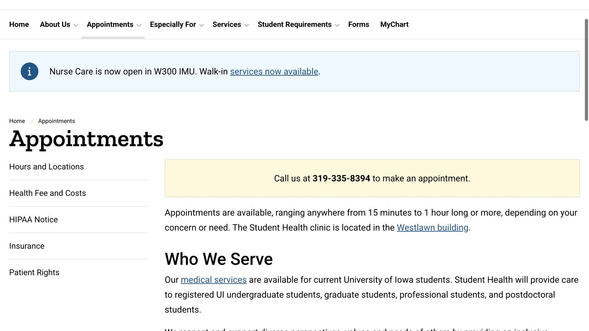

在美国看一次病，可能会接触诊所、保险公司和账务系统：诊所安排就医，保险按计划处理 claim，之后才形成个人应付费用。把它们按时间顺序分开理解，就不必在生病时同时猜所有规则。这篇从第一通电话写到看完病后的结果、续药和账单。

## 不确定该去哪看时，可以先找 Student Health 的护理咨询

Student Health 可以处理学生常见医疗问题、慢性病管理及预防保健。拿不准是否要预约，或对用药、日常照护有问题时，可以在服务时间拨 Nurseline 319-335-9704，与注册护士讨论；暂时无人接听就按语音提示留言。这个入口用于常规医疗建议。诊所关门时另有 after-hours 选择，眼前的医疗急症则需要紧急救援，不应等待一般预约回复。

- [Student Health · Nurseline](https://studenthealth.uiowa.edu/nurseline)
- [Student Health · Available medical services](https://studenthealth.uiowa.edu/services)

## 电话预约时，把这次想解决的事情说清楚

Student Health 目前要求拨 319-335-8394 预约，主页也注明 MyChart 自助预约暂时停用。电话里可以说明不舒服持续多久、这次主要希望解决什么，以及是否涉及续药或复诊。主诊所在 Newton Road 的 Westlawn 楼，具体就诊安排以确认信息为准。预约页建议提前 15 分钟到达，下一节课或考试前也留出足够间隔，因为不同问题需要的时间不一样；去不了时电话取消，方便工作人员重新安排。

- [Student Health · Appointment instructions](https://studenthealth.uiowa.edu/appointments)
- [Student Health · Current hours and locations](https://studenthealth.uiowa.edu/appointments/hours-and-locations)

## 把保险卡和简短的病情记录一起准备好

每次就诊都带保险卡，并确认诊所记录的是当前保单；新患者或换过保险的人要更新资料，SHIP 和 UIGRADCare 信息可以通过 MyChart 提交。另用手机记下药名、剂量、过敏情况，以及症状何时开始、有什么变化，能帮助你在现场把事情讲完整。可以先用自己最熟悉的语言整理，再挑出需要解释的词；预约时也可以说明沟通困难，询问可用的语言协助。把身份证明和预约确认一并保存，到前台时更从容。

- [Student Health · Insurance card and information updates](https://studenthealth.uiowa.edu/appointments/insurance)

## Health fee 包的是哪些服务，要和保险分开理解

学生 health fee 支持 Student Health 医护人员的门诊评估和诊疗管理，以及其他相关服务，但化验、疫苗、耗材、操作和体检等仍可能产生费用。需要做非紧急的额外项目时，可以在进行前问清会按什么项目计费、哪里能提供估价。这个 health fee 安排适用于 Student Health；到 Quick Care、Urgent Care 或其他诊所就医，则按对应机构的账务和自己的保险条款处理。

- [Student Health · Health fee, additional costs and payment](https://studenthealth.uiowa.edu/appointments/health-fee-and-costs)

## 去其他机构前，用具体医生和项目核对网络与手续

安排校外或其他门诊时，向保险公司提供诊所、医生、项目、日期和完整计划名称，再问该服务商是否在网络内、个人大概分担什么，以及是否需要 referral 或 prior authorization。医疗转介用于衔接专科，保险预先批准则涉及计划的支付规则，二者不是同一回事。当前学生保险概览写明 UIGRADCare 看专科不要求 referral，但服务商范围和需要预先批准的项目仍要核实。诊所说“接受保险”之后，才是针对自己这份计划进一步确认的开始。

- [Benefits · Student plan network and specialist overview](https://hr.uiowa.edu/benefits/ui-student-insurance)
- [Benefits · SHIP and UIGRADCare service comparison](https://hr.uiowa.edu/benefits/ui-student-insurance/student-insurance-overview/student-health-insurance/ship-and)

## 看账单前，先分清四个常见费用词

Premium 是维持保单的保费；deductible 是适用于相关项目、在计划开始分担前由自己承担的自付额；copay 是某项服务的固定金额；coinsurance 则按比例分担。它们不是每次就诊都以同一种方式叠加，预防项目与因新症状接受的检查也可能按不同规则处理。问费用时，说明具体服务和项目，会比只问“我的保险能不能用”得到更有用的解释。

- [Benefits · Medical plan terms and definitions](https://hr.uiowa.edu/benefits/ui-student-insurance/student-insurance-overview/student-health-insurance/ship-and)
- [Benefits · Insurance terms glossary](https://hr.uiowa.edu/benefits/benefits-z/know-your-terms)

## 看完病，在 MyChart 跟进，再把 EOB 与账单对照

MyChart 可以看检查结果、消息、预约信息，也能提交处方续配请求。之后保险公司的 Explanation of Benefits（EOB）会解释这笔 claim 怎样处理、支付了多少、哪些没有覆盖；EOB 本身不是向保险公司付款的通知。把姓名、日期、项目和机构账单、U-Bill 中的相关费用对照；有拒付、金额不一致或重复收费疑问时，带着具体 claim 联系账务和保险公司。Student Health 账务电话是 319-335-8376；参保和保费问题则由 University Benefits 处理。

- [Student Health · MyChart and follow-up information](https://studenthealth.uiowa.edu/)
- [Benefits · What an EOB shows](https://hr.uiowa.edu/benefits/benefits-z/know-your-terms)
- [Student Health · Billing and insurance handling](https://studenthealth.uiowa.edu/appointments/insurance)

## 平时存好非营业时间的入口，需要时更容易安排

Hours and Locations 页集中列出非营业时间的护理建议、Quick Care、Urgent Care 和急诊地点。常规问题无法等到 Student Health 再开门时，从这里查当天哪家提供相应服务、何时开放；眼前的医疗急症拨 911。能够提前安排的非紧急就医，则把保险网络和来回交通一并确认。就医后保存 visit summary、用药说明和复诊日期，后续换一家机构，也能清楚交代已经做过哪些处理。

- [Student Health · Current after-hours care options](https://studenthealth.uiowa.edu/appointments/hours-and-locations)

> ISAB 独立撰写 · 官网资料核对于 2026 年 10 月 18 日。预约、参保和理赔由文中服务方办理，个人适用情况请向对应机构确认。

## 来源与实用链接

- [Student Health · Services](https://studenthealth.uiowa.edu/services)
- [Student Health · Nurseline](https://studenthealth.uiowa.edu/nurseline)
- [Student Health · Appointments](https://studenthealth.uiowa.edu/appointments)
- [Student Health · Hours, locations and after-hours options](https://studenthealth.uiowa.edu/appointments/hours-and-locations)
- [Student Health · Insurance information](https://studenthealth.uiowa.edu/appointments/insurance)
- [Student Health · Health fee and costs](https://studenthealth.uiowa.edu/appointments/health-fee-and-costs)
- [Student Health · MyChart and frequently asked questions](https://studenthealth.uiowa.edu/)
- [Benefits · UI student insurance overview](https://hr.uiowa.edu/benefits/ui-student-insurance)
- [Benefits · Plan comparison](https://hr.uiowa.edu/benefits/ui-student-insurance/student-insurance-overview/student-health-insurance/ship-and)
- [Benefits · Insurance terms](https://hr.uiowa.edu/benefits/benefits-z/know-your-terms)
