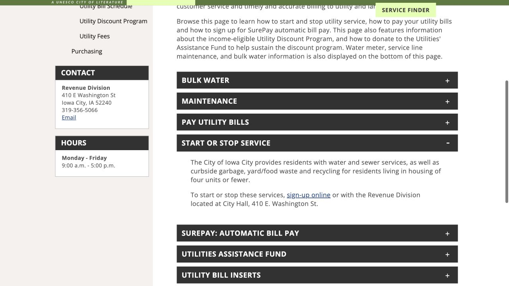
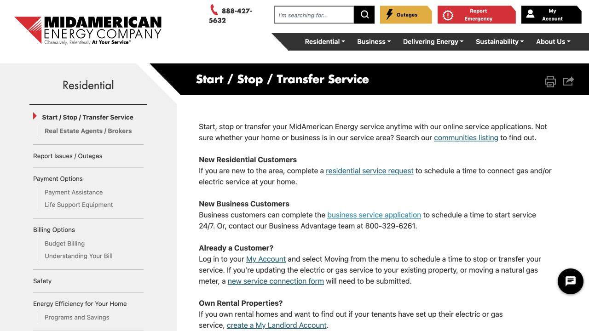

房源写了“Utilities included”，还需要知道具体包含什么，才能算清每月生活成本。水、电、暖气和垃圾可能由不同方式处理，地址也决定了能够服务这套房子的机构。把租约和房东的解释对上之后，再安排真正需要开在自己名下的账户，搬家日期和计费责任就能接得更顺。

## 把租约里的“包水电”，变成明确的负责范围

打开租约的 utilities 部分，和房东的答复一起看，逐项确认水、电、暖气和垃圾：哪些已包含、哪些另收、哪些由住户分摊，暖气又使用什么能源。同时记下完整门牌、单元号，以及从哪天开始由你承担费用。如果某项原本由房东统一管理，可以在提交申请前确认是否需要单独账户，避免在尚未了解安排时又开一份服务。

## Iowa City 水务，从 Start or Stop Service 进入

确认房子由 Iowa City 市政供水后，打开 Revenue & Utilities，找到 Start or Stop Service。这里同时提供线上办理入口，以及 City Hall 的 Revenue Division 办理方式；账务问题可拨 319-356-5066。选择机构时依据这套房子的服务地址，而不是广告里“Iowa City 周边”的描述。Coralville 或 North Liberty 的房子，需要由所在地市政或服务商确认对应入口。

## 能源服务，按服务商和新老客户选择入口

如果该地址由 MidAmerican Energy 服务，Start / Stop / Transfer Service 页面会区分 New Residential Customers 和 Already a Customer。新住宅客户进入服务申请；已有客户在 My Account 中使用 Moving。页面也链接到 communities listing，方便核对服务地区。将完整地址、单元号及这里具体提供的电力或燃气服务对上，再按前面确认的租约责任日期申请开通。

## 搬家前，用确认邮件核对日期和是否需要开门

MidAmerican 的住宅申请说明写明，确认邮件会给出排定日期和所需的进入安排。把邮件与搬家计划放在一起读，尤其留意表具是否在室内或上锁区域，届时由谁提供进入条件。日期或进入安排无法配合，就直接联系服务商协调；申请中要求的身份证明暂时没有，也通过官方联系入口讨论可接受的替代材料。把确认信息与租约一并保存，搬家中有人问起服务何时开始，便能回到实际记录核对。

> 公开页面核对于 2026 年 10 月 17 日。这是 ISAB 整理的网站浏览与搬家准备笔记。具体责任以租约、服务地址和服务商确认结果为准。申请和个人资料直接交给服务商，本站不代开或管理水电账户。

## 来源与实用链接

- [Iowa City · Revenue & Utilities](https://www.icgov.org/government/departments-and-divisions/finance/revenue-utilities)
- [MidAmerican · Start / Stop / Transfer Service](https://www.midamericanenergy.com/start-stop-service)
- [MidAmerican · Residential request information](https://www.midamericanenergy.com/ecss/StartService/StartService)
