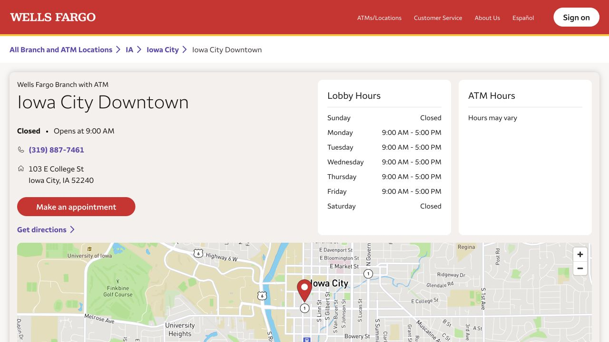
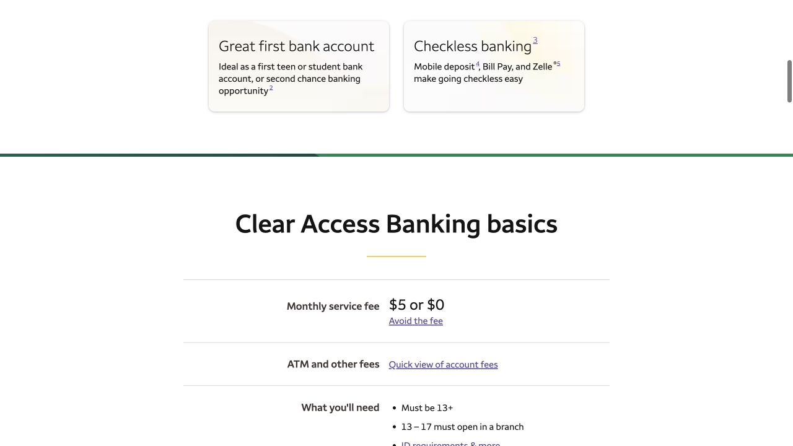

Handbook 提到的 Wells Fargo 在 College Street 有网点。比较账户时，可以从平常怎么用开始：房租需不需要纸质支票，钱通常从哪里来，以及年龄、余额或入账哪一种减免能长期满足。弄清这些，再看开卡奖励会更有依据。下面按预约、核材料、选产品到第一个月的使用顺序展开。

## 去 103 E College St 前，约好能办开户的时间

Iowa City Downtown 网点位于 103 E College St, Iowa City, IA 52240，电话 319-887-7461。公开柜台时间为周一至周五 9:00–17:00，周六、周日关闭。门店页列有 New Account Openings 和预约按钮，可以从这里安排工作日的开户交流。节假日前重新查看营业调整；与 banker 见面要按柜台时间来排，ATM 能用并不说明现场能办开户。

- [Wells Fargo · Downtown 网点与预约](https://locations.wellsfargo.com/ia/iowa-city/103-e-college-st)

## 把自己的材料，与证件要求具体对上

网点开户页要求 primary ID 和 secondary ID 原件，例如护照搭配学生证，也可能另需本人姓名下的租约、水电账单等住址证明。已有 SSN 或 ITIN 就带上。对没有美国税号的非美国公民，页面另说明可用于证明国籍或居住身份的政府证件。电话里把自己有什么说具体，网点才能说明能核验哪些；官网列出的例子，并不代表所有申请人和所有材料组合都会被接受。

- [Wells Fargo · 网点开户证件与住址材料](https://www.wellsfargo.com/checking/everyday/identification-required-to-open/)

## Clear Access 的减免和不能写支票，要放在一起看

Clear Access Banking 标准月费 $5，常见减免路径是主账户持有人 13–24 岁，或每个 fee period 有至少 $250 合格电子入账。它不收透支费，也不能写纸质支票，所以房东若要求自己开支票，选账户时就要把这点算进去。可以请 banker 在文件里把功能和减免条件一起指出来。年龄减免到 25 岁结束；13–17 岁须到网点开户，13–16 岁还需成年共同持有人。

- [Wells Fargo · Clear Access Banking](https://www.wellsfargo.com/checking/clear-access-banking/)
- [Wells Fargo · Clear Access 月费减免](https://www.wellsfargo.com/checking/clear-access-banking/clear-access-monthly-service-fee/)

## Everyday Checking 要按它自己的规则比较

Everyday Checking 当前标准月费 $15，符合适用条件可免。常见路径包括主账户持有人 17–24 岁、每账期 $500 合格电子入账、每天最低余额 $1,500，或符合条件的存款与投资余额合计 $5,000。这个账户支持纸质支票，支票本另行购买。请 banker 说明自己准备依靠哪条减免、fee period 从哪天算到哪天；超过 24 岁后即使还在读书，也不自动保留年龄减免。

- [Wells Fargo · Everyday Checking 与当前减免规则](https://www.wellsfargo.com/checking/everyday/)

## 第一笔存款能什么时候用，要和房租日期一起安排

开户时可以把三个问题连起来问：所选产品首次要存多少、第一段 fee period 何时开始，以及今天存进去的钱何时可以支出。把答案和产品名称记在一起，因为开户存款、服务费和免月费所需余额各有用途。准备用新账户支付大额押金或房租前，查看 available balance 和有没有 hold 通知，就能知道哪些钱已经可用、哪些还要等待。

## 每月常收到的钱，是否真的计入合格入账

Wells Fargo 的 qualifying deposits 包括通过指定电子网络入账的合格工资或其他收入；账户间转账、手机存支票、Zelle，以及柜台和 ATM 存款不计入。如果准备用这一条免月费，就把预计收到的款项来源告诉 banker，请对方按定义判断。确认后再安排每月资金，会比单纯反复转账更可靠，因为有钱进入账户和达到减免条件并不是同一件事。

- [Wells Fargo · 哪些属于 qualifying electronic deposits](https://www.wellsfargo.com/checking/direct-deposit/)

## 工资和家里电汇，各找到对应的账户资料

登录 Wells Fargo Online 后，选中账户，在详情里查看 account number 和 routing number；帮助页会区分工资 direct deposit 资料与 wire transfer 指引。可以请 banker 演示自己账户的信息在哪里，再妥善保存正式说明，按每项付款只提供需要的资料。家里从境外汇款时，要取适合该笔汇款的收款指引并核对当前费用；debit card 的卡号用于卡片交易，和这些银行账户信息不同。

- [Wells Fargo · 查找账号与 routing number](https://www.wellsfargo.com/help/routing-number/)

## 用提醒和第一张账单，熟悉账户的运行方式

官方提醒路径是登录 → Manage Alerts → 选账户、提醒内容和接收方式 → 保存。刚开始用时，低余额和入账提醒能帮助你及时看到资金变化。接着核对手机、邮箱和带公寓号的邮寄地址，问清借记卡怎样送达、怎样激活。第一张完整账单出来后，把 Monthly Service Fee Summary 和开户时讨论的减免对照；如果依靠年龄减免，在 25 岁生日前留出重新选择的时间。

- [Wells Fargo · 设置账户提醒](https://www.wellsfargo.com/mobile-online-banking/alerts/)

> ISAB 独立整理 · 官网资料核对于 2026 年 10 月 18 日。证件接受情况与开户资格由网点核验，开户前阅读当时的账户文件。

## 来源与实用链接

- [Wells Fargo · Iowa City Downtown branch](https://locations.wellsfargo.com/ia/iowa-city/103-e-college-st)
- [Wells Fargo · Account-opening IDs and address proof](https://www.wellsfargo.com/checking/everyday/identification-required-to-open/)
- [Wells Fargo · Clear Access Banking](https://www.wellsfargo.com/checking/clear-access-banking/)
- [Wells Fargo · Clear Access fee waiver](https://www.wellsfargo.com/checking/clear-access-banking/clear-access-monthly-service-fee/)
- [Wells Fargo · Clear Access fee summary](https://www.wellsfargo.com/checking/clear-access-banking/account-fees-summary/)
- [Wells Fargo · Everyday Checking](https://www.wellsfargo.com/checking/everyday/)
- [Wells Fargo · Qualifying electronic deposits](https://www.wellsfargo.com/checking/direct-deposit/)
- [Wells Fargo · Routing and account numbers](https://www.wellsfargo.com/help/routing-number/)
- [Wells Fargo · Account alerts](https://www.wellsfargo.com/mobile-online-banking/alerts/)
